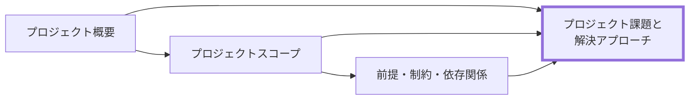

---
specdojo:
  id: specdojo:prj-issues-and-approach-rulebook
  type: rulebook
  deliverable_type: project
  status: ready
  target_format: markdown
  recipe: specdojo:prj-issues-and-approach-recipe
  sample: specdojo:prj-issues-and-approach-sample
  template: specdojo:prj-issues-and-approach-template
  based_on:
    - specdojo:rulebook-authoring-standard
  supersedes: []
---

# プロジェクト課題と解決アプローチ 作成ルール

Project Issues and Approach Documentation Rules

関係者が「何が課題で、どれを、どう解く方針か（なぜその方針か）」を短時間で合意できるよう、プロジェクト課題と解決アプローチの記述基準を定めます。

## 1. 全体方針

- **目的と適用範囲**: 課題の整理と採用アプローチの合意により、意思決定の前提を揃えます。詳細な設計・実装・テスト設計は対象外とします。
- **事実と仮説の区別**: 事実・観察と推測・仮説を混ぜず、混ざる場合はラベルで区別します。
- **複数の方針**: 解決策は 2 件以上挙げ、相互に代替する案か、異なる課題・原因を扱う補完策かを区別して採用理由を明記します。
- **共通の運用**: 役割の割り当ては適用先のメンバー定義に、`status` の昇格と承認、改訂と廃止、未決事項の登録簿への引き継ぎは [[specdojo:document-metadata-standard|ドキュメントメタ情報標準]] に従い、本書と成果物で言い直しません。文書の整形・lint はリポジトリの検証で扱います。

## 2. 位置づけ

プロジェクト概要の背景・必要性、スコープの対象範囲、前提・制約・依存関係の成立条件を受けて、課題と解決アプローチを定めます。



## 3. ファイル命名・ID規則

- **配置**: `docs/ja/projects/<project-id>/020-project-definition/prj-issues-and-approach.md` とし、構成は [[specdojo:docs-structure-guide|ドキュメント構成ガイド]] に従います。
- **ファイル名**: `prj-issues-and-approach.md` とします。
- **文書 ID**: `<project-id>:prj-issues-and-approach`（例: `prj-0001:prj-issues-and-approach`）とします。

## 4. 推奨 Frontmatter 項目

許可キー・必須項目・型制約は [[specdojo:document-metadata-standard|ドキュメントメタ情報標準]] と `docs/specdojo/schemas/v1/deliverable-frontmatter.schema.yaml` を正本とします。

- `specdojo.type` は `project`、`specdojo.rulebook` は `specdojo:prj-issues-and-approach-rulebook` とします。
- `specdojo.based_on` には、直接の根拠とした概要・スコープ・前提・制約・依存関係の ID を記載します（なければ `[]`）。

```yaml
---
specdojo:
  id: prj-0001:prj-issues-and-approach
  type: project
  status: draft
  rulebook: specdojo:prj-issues-and-approach-rulebook
  based_on:
    - prj-0001:prj-overview
    - prj-0001:prj-scope
    - prj-0001:prj-assumptions-constraints-dependencies
  supersedes: []
---
```

## 5. 本文構成（標準テンプレ）

見出しの骨組みは Frontmatter の `template` を正本とし、次の順序で配置します。

| 章                   | 必須 | 内容・受入条件                                                               |
| -------------------- | ---- | ---------------------------------------------------------------------------- |
| 導入部（H1 直下）    | ○    | どの利用場面で何を判断するための文書か、合意対象と合意対象外                 |
| 課題一覧             | ○    | 各課題に課題・影響・優先度（`High` / `Medium` / `Low`）を記載する            |
| 原因（仮説でも可）   | ○    | 課題ごとの原因を、事実と仮説を分けて根拠とともに示す                         |
| 解決策候補           | ○    | 2 件以上の方針と、案の関係（代替・補完）、対応する課題・原因                 |
| 採用アプローチと理由 | ○    | 採用方針、判断軸による理由、補完策を組み合わせる理由、非採用案と理由         |
| トレードオフ/リスク  | 任意 | 代償、リスクと軽減策、前提が崩れた場合の対応                                 |
| 次の検討事項（ToDo） | 任意 | 次の意思決定に必要な追加調査・確認・承認と、その完了条件・期限               |
| 見直しと変更管理     | 任意 | 本書の合意を見直す契機、確認する観点、対応方針。記録先と記録の責任は書かない |

## 6. 記述ガイド

完成例は Frontmatter の `sample` で宣言された sample を参照してください。見出し配下は箇条書きと必要最小限の表を基本とし、未確定は `_TODO_` または `_UNDECIDED_` で明示します。

### 6.1. 導入部

- どの利用場面で何を判断するための文書かを 1〜2 文で示します。承認者や利用ロールの割り当ては書きません。
- 合意対象（優先課題、採用アプローチ、先送り事項など）と合意対象外（設計詳細、特定技術の採否など）を分けて書きます。

### 6.2. 課題一覧

- 課題は「困っている現象」を書き、解決策の先取りにしません。良い例:「在庫の減りに気づくのが遅く、品切れが起きる」。悪い例:「自動発注がない」。
- 課題 ID を振り、原因・解決策候補・決定記録から参照できるようにします。
- 優先度は `High`（初期に必ず扱う）/ `Medium`（初期に扱うが後回しにできる）/ `Low`（先送りできる）のいずれかとし、判断の根拠を影響の列で読めるようにします。

| 課題ID | 課題 | 影響 | 優先度 | 備考 |
| ------ | ---- | ---- | ------ | ---- |
| P-01   |      |      | High   |      |

### 6.3. 原因（仮説でも可）

- 原因は分解して書きます（例: 情報不足、判断基準の不在、手順のばらつき、システム制約）。
- 原因区分で事実と仮説を分け、根拠文書・観察事実または確認方法を添えます。良い例:「仮説: 在庫確認のタイミングが決まっていない（品切れ時の状況から推測）」。悪い例: 根拠のない「属人化している」。

| 課題ID | 原因区分 | 内容 | 根拠 / 補足 |
| ------ | -------- | ---- | ----------- |

### 6.4. 解決策候補

- 各案を `代替` または `補完` に区分し、概要と期待できる効果を 1〜3 行で書きます。
- 案 ID と対応課題を示します。補完策は、ほかの案と役割が重複しないことを確かめます。
- 同じ判断を置き換える一式の案を評価軸で詳細比較する場合は `prj-comparison-of-alternatives` へ委譲し、本書では比較が必要な論点までを示します。

| 案ID | 案  | 関係 | 概要 | 期待できる効果 | 対応課題 |
| ---- | --- | ---- | ---- | -------------- | -------- |

### 6.5. 採用アプローチと理由

- 採用案を明記し、判断軸（効果・コスト・期間・リスク・現場適合など）で理由を説明し、重視する順序を示します。
- 採用しない代替案は、その理由を 1 行で添えます。
- 補完策を組み合わせる場合は、各案が担う課題・原因と、単独では不足する理由を書きます。中核・補助または実行順序がある場合だけ、その関係も示します。

| 採用対象 | 判定 | 理由 |
| -------- | ---- | ---- |

### 6.6. トレードオフ/リスク（任意）

- トレードオフは「何を捨てる・先送りする・我慢するか」を書きます。
- リスクは「起きうること」と「軽減策」をセットで書き、区分は `トレードオフ` / `リスク` で揃えます。

| 区分 | 内容 | 軽減策 |
| ---- | ---- | ------ |

### 6.7. 次の検討事項（ToDo）（任意）

- 次の意思決定に必要な追加調査・確認・承認事項を、目的・完了条件・期限（または判断タイミング）とともに列挙します。良い例: 完了条件「初期リリースの機能一覧が確定する」、期限「開発着手前」。悪い例: 完了条件のない「移行方法を検討する」。
- 責任ロールは、プロジェクトの体制定義で採用済みのロールで書きます。

| ToDo | 目的 | 完了条件 | 期限 / 判断タイミング | 責任ロール |
| ---- | ---- | -------- | --------------------- | ---------- |

### 6.8. 見直しと変更管理（任意）

- 見直す契機（仮説の反証、スコープ・前提制約の変更、採用アプローチに影響する決定、リスクの顕在化など）を挙げます。
- 契機ごとに、確認する観点と対応方針をセットで書きます。見直しの記録先と記録の責任は共通の運用に従うため書きません。

| 見直しの契機 | 確認する観点 | 対応方針 |
| ------------ | ------------ | -------- |

## 7. 禁止事項

| 項目                                                  | 理由                                       |
| ----------------------------------------------------- | ------------------------------------------ |
| 設計詳細（DB設計、API設計、画面詳細等）               | プロダクト仕様/設計ドキュメントへ委譲      |
| “だいたい/適切に” 等の曖昧表現                        | 合意・検証ができない                       |
| 課題を解決策の欠落として書く（例:「自動発注がない」） | 問題の同定ができず、手段が固定化する       |
| 方針を 1 件しか出さず、代替または補完の検討をしない   | 判断と課題への対応関係が不透明になる       |
| 補完策を代替案として非採用扱いにする                  | 異なる課題・原因を同時に扱う必要性を失う   |
| 理由のない採用（判断軸が書かれていない）              | 後から説明できず、意思決定がやり直しになる |
| 個人や特定の組織を識別できる情報、非公開の観察事実    | 公開できない情報が課題・原因・リスクに残る |
