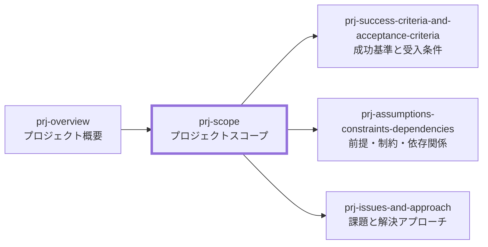

---
specdojo:
  id: specdojo:prj-scope-rulebook
  type: rulebook
  deliverable_type: project
  status: ready
  target_format: markdown
  recipe: specdojo:prj-scope-recipe
  sample: specdojo:prj-scope-sample
  template: specdojo:prj-scope-template
---

# プロジェクトスコープ 作成ルール

Project Scope Documentation Rulebook

関係者が「今回やること、やらないこと、境界変更時の判断方法」を合意できるプロジェクトスコープの記述基準を定めます。

## 1. 全体方針

- 対象は **プロジェクトスコープ**（対象範囲、スコープ外、境界判断、変更方針）です。
- 本書では今回扱わない対象を「スコープ外」と呼びます。スコープ外の表の列名「対象（Out）」も同じ意味です。
- 目的は、対象範囲とスコープ外を確認でき、後続の成功基準、前提・制約、課題整理、計画作成の前提を揃えることです。
- スコープは設計詳細ではなく、業務価値、利用者影響、合意対象、責務境界を確認するための境界定義です。
- 詳細な成功判定や受入条件は `prj-success-criteria-and-acceptance-criteria`、前提・制約・依存は `prj-assumptions-constraints-dependencies`、課題と解決方針は `prj-issues-and-approach` へ委譲します。
- **共通の運用**: 役割の割り当ては適用先のメンバー定義に、`status` の昇格と承認、改訂と廃止、未決事項の登録簿への引き継ぎは [[specdojo:document-metadata-standard|ドキュメントメタ情報標準]] に従います。文書の整形・lint はリポジトリの検証で扱い、業務の受入確認に含めません。

## 2. 位置づけ

プロジェクトスコープは、プロジェクト概要で示した背景・必要性・期待効果を受け、対象範囲とスコープ外を定義する文書です。後続文書は、本書の境界を前提に詳細化します。

## 3. ファイル命名・ID規則

### 3.1. 配置（推奨）

- `docs/ja/projects/<project-id>/020-project-definition/prj-scope.md` へ配置します。
- プロジェクト配下の章構成は [[specdojo:docs-structure-guide]] に従います。
- 参考図表や補足資料を別ファイルにする場合は、スコープ本文から参照リンクで紐付けます。

### 3.2. ドキュメントID（推奨）

- 推奨: `<project-id>:prj-scope`
  - 例: `prj-0001:prj-scope`

### 3.3. ファイル名（推奨）

- 推奨: `prj-scope.md`

## 4. 推奨 Frontmatter 項目

### 4.1. 設定内容

許可キー・必須項目・型制約は [[specdojo:document-metadata-standard|ドキュメントメタ情報標準]] と `docs/specdojo/schemas/v1/deliverable-frontmatter.schema.yaml` を正本とします。

- `id` は `<project-id>:prj-scope`、`type` は `project`、`rulebook` は `specdojo:prj-scope-rulebook` とします。

### 4.2. 推奨ルール

- `based_on` には直接の根拠を記載し、`prj-overview` が存在する場合は含めて背景・必要性・期待効果とスコープを対応させます。成果物カタログに `depends_on` がある場合はその推移閉包内に限定します。
- H1 は `# プロジェクトスコープ: <プロジェクト名>` とします。

## 5. 本文構成（標準テンプレ）

各章は次の内容を満たすものとし、見出し順と記入欄は宣言済みの template を正本とします。H1 直下の導入文は任意とし、置く場合はプロジェクト概要を受けて何の境界を定める文書かを 1 文で書きます。

### 5.1. プロジェクトスコープ（Project Scope）

| 番号 | 章               | 必須 | 内容・受入条件                                           |
| ---- | ---------------- | ---- | -------------------------------------------------------- |
| 1    | 対象業務         | ○    | 対象とする業務、活動領域、利用場面、利用者影響           |
| 2    | 対象システム     | ○    | 対象となるシステム、成果物、文書体系、基盤、外部連携範囲 |
| 3    | 対象期間         | ○    | 初期対象期間、判断イベント、継続改善との切り分け         |
| 4    | スコープ外       | ○    | 明示的にやらないこと、理由、後続で扱う条件               |
| 5    | 境界の判断基準   | 任意 | 迷ったときの判断原則、優先順位、SSOT                     |
| 6    | スコープ変更方針 | 任意 | 変更入口、影響評価、承認者、記録方法                     |

## 6. 記述ガイド

### 6.1. 共通

- 対象範囲、スコープ外、利用者影響、合意対象が読み取れる粒度で記述します。設計詳細を書かないことは `禁止事項` に従います。

### 6.2. 対象業務

- 機能名ではなく、現場の作業・判断・活動領域の単位で書き、対象者、利用場面、利用者影響を添えることを推奨します。
- 文書体系、ルール整備、公開準備が目的の場合は「対象とする活動領域」として記述してよいです。
- 作るものと、運用・管理できるようにするものを含めます。
- 良い例: 「入荷、棚卸、廃棄を含む店頭在庫を管理する」。悪い例: 「在庫画面を作る」（機能名だけで利用場面と影響が読めない）。

### 6.3. 対象システム

- 各行は対象業務のいずれかを支えるものとし、どの対象業務を支えるかを内容または境界から読み取れるようにします。どの対象業務も支えない行は置きません。
- 実行可能なツールや CLI、正本となる管理データ、正本から生成する成果物は、プロジェクトが整備・変更・運用するなら対象システムに含めます。所有者、編集方法、責務が異なる場合は別の行に分けます。
- 生成物を含める場合は、生成元となる正本と、直接編集の可否を境界に記述します。
- 外部連携、公開基盤、補助ツールを含める場合は、プロジェクトが担う設定・接続・利用と、外部サービスや外部ツール本体の責務を分けて記述します。

推奨表:

| 対象 | 内容 | 境界 |
| ---- | ---- | ---- |

### 6.4. 対象期間

- 日付が確定していない場合は、イベント基準で書いてよいです。
- 初期リリース、初回公開、運用開始、継続改善など、どの期間までを本スコープに含めるかを明示します。
- マイルストーンやスケジュールを期間の根拠にする場合は本文から参照するだけとし、`based_on` には含めません（後続文書への逆依存を防ぐため）。
- 未確定なら未確定と明記し、決めるための条件または意思決定ポイントを添えます。

### 6.5. スコープ外

- 今回含めない対象を明示します。
- 推奨: スコープ外にした理由（コスト、効果、責務境界、公開適性、後続フェーズ等）を添えます。
- 利用者影響が大きいスコープ外の項目は、後続で扱う条件や再検討タイミングも示します。
- 良い例: 「複数店舗管理」を、単一店舗の運用定着を優先する理由と、運用定着後に再検討する条件とともに書く。悪い例: 理由のない「その他の機能」。

推奨表:

| 対象（Out） | 理由 | 補足 |
| ----------- | ---- | ---- |

### 6.6. 境界の判断基準

- 迷ったときに参照できる SSOT（判断原則）を書きます。
- 判断順序が重要な場合は、優先順位付きの箇条書きにします。
- 業務価値、利用者影響、公開適性、保守容易性、AI 利用可能性など、プロジェクトの性質に合う判断軸を選びます。

### 6.7. スコープ変更方針

推奨表の各行には次を書きます。

| 項目     | 書く内容                                                                                                                               |
| -------- | -------------------------------------------------------------------------------------------------------------------------------------- |
| 変更入口 | 誰が、どこへ変更を提案するか                                                                                                           |
| 影響評価 | 評価の観点（業務価値、利用者影響、工数、費用、期日、運用、リスク）と、影響を受ける成果物（成果物カタログ、スケジュール、管理計画など） |
| 承認者   | スコープ変更を最終判断する役割                                                                                                         |
| 記録先   | 判断理由と影響範囲の記録先（DEC、課題一覧、Issue、PR、変更要求ログなど）                                                               |

## 7. 禁止事項

| 項目                                     | 理由                                      |
| ---------------------------------------- | ----------------------------------------- |
| 設計詳細（DB設計、API設計等）            | プロダクト仕様/設計ドキュメントへ委譲する |
| スコープ外の未記載                       | 境界が曖昧になり手戻りの原因になる        |
| どの対象業務も支えない対象システムの行   | 見積、優先度、責務境界の認識が崩れる      |
| 個人名・連絡先などの個人情報や非公開情報 | 公開リポジトリでの利用を想定するため      |
| 受入条件や GO / Not GO 判定の詳細化      | 成功基準と受入条件との責務重複を防ぐ      |
