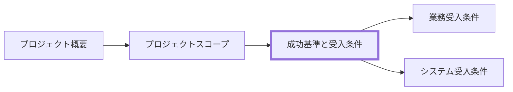

---
specdojo:
  id: specdojo:prj-success-criteria-and-acceptance-criteria-rulebook
  type: rulebook
  deliverable_type: project
  status: ready
  target_format: markdown
  recipe: specdojo:prj-success-criteria-and-acceptance-criteria-recipe
  sample: specdojo:prj-success-criteria-and-acceptance-criteria-sample
  template: specdojo:prj-success-criteria-and-acceptance-criteria-template
---

# 成功基準と受入条件 作成ルール

Success Criteria and Acceptance Criteria Documentation Rulebook

プロジェクトの業務価値に対する成功と、成果物・リリースの受入可否を、判定基準・責任者・証跡で判断するためのルールです。

## 1. 全体方針

- **対象と目的**: プロジェクトの成功基準と受入条件を対象とし、業務価値に対して誰が、いつ、どの証跡で合否を判断するかを定めます。
- **判定の区分**: 成功基準は初期公開・初期リリース、運用開始後の短期、中長期の事業・社会的成果に分けます。受入条件は価値提供を開始できる状態を判定し、公開後の利用件数や中長期成果を初期受入の必須条件にしません。
- **記載レベル**: 要求レベルの判定条件を扱い、実装詳細、個別テスト手順、設計判断は後続成果物へ委ねます。
- **共通の運用**: 役割の割り当ては適用先のメンバー定義に、`status`・承認・改訂と廃止・未決事項の引き継ぎは [[specdojo:document-metadata-standard|ドキュメントメタ情報標準]] に従います。文書の整形・lint・見出し・wikilink の検査はリポジトリの検証で扱い、業務の検証や受入条件に含めません。

## 2. 位置づけ

## 3. ファイル命名・ID規則

- **推奨配置**: `docs/ja/projects/<project-id>/020-project-definition/prj-success-criteria-and-acceptance-criteria.md`。
- **推奨 ID**: `<project-id>:prj-success-criteria-and-acceptance-criteria`（例: `prj-0001:prj-success-criteria-and-acceptance-criteria`）。
- **ファイル名**: `prj-success-criteria-and-acceptance-criteria.md`。日本語名なら `成功基準と受入条件.md`。

## 4. 推奨 Frontmatter 項目

- 許可キー・必須項目・型は [[specdojo:document-metadata-standard|ドキュメントメタ情報標準]] と `docs/specdojo/schemas/v1/deliverable-frontmatter.schema.yaml` を正本とします。
- `type` は `project`、`rulebook` は `specdojo:prj-success-criteria-and-acceptance-criteria-rulebook` とします。
- `based_on` には根拠とした `prj-scope` と、期待効果の根拠にした `prj-overview` を記載します。成果物カタログに `depends_on` がある場合はその推移閉包内に限定します。

## 5. 本文要件

見出し順・表・記入欄の骨組みは Frontmatter で宣言した template を正本とし、ここでは各章の内容要件を定めます。

- **判定対象と適用範囲（必須）**: 対象、対象外、判定段階、初期受入に必須とする条件が判別できること。
- **成功基準・受入条件（各必須）**: 業務価値から条件・判定・測定または証跡・責任者を追跡できること。具体的な記載項目は「記述ガイド」に従います。
- **判定手順と証跡（必須）**: 条件ごとの確認順・判定時期・証跡の保存先・確認者・承認者を示し、合格基準との照合から受入可否の判断まで辿れること。否決時は是正内容、再確認する条件 ID、再判定時期を定めます。
- **例外条件と未解決事項（任意）**: 論点、判定への影響、保留条件、当面の扱いを示します。未確定の閾値は _UNDECIDED_: で示し、初期受入を進められるかを明記します。

## 6. 記述ガイド

### 6.1. 共通

- 成功基準と受入条件は別表にし、各条件に少なくとも一つの業務価値を対応付けます。
- 業務価値は利用者・業務に期待する効果や状態とし、対象利用者、利用場面、期待効果のいずれかが読み取れる表現にします。
- 各条件は測定可能で再現可能な表現にします。

### 6.2. 成功基準

- 初期公開・初期リリースでは代表利用者による作業完遂、短期では利用・定着・直接的改善、中長期では事業・社会的成果への寄与を扱います。
- 公開後にしか測定できない成功基準も、判定時期と確認者を定めて成功基準の表に残します。
- 定量指標だけでなく、運用定着や利用者受容などの定性条件も確認方法を明示します。閾値には測定対象、単位、母数または比較対象を記載します。
- 外部要因を受ける成果は、当該プロジェクトだけの因果と断定せず、利用前後の変化と寄与を確認します。
- 低コスト、費用負担の軽減、無償提供などを業務価値に置く場合は、少なくとも追加の現金支出、人の作業時間、継続的な運用負荷を分けて測定します。既存資産、寄付、無償枠を使う場合は評価上の扱いを定め、人の無償労働への負荷転嫁を成功とみなしません。

推奨表（成功基準）:

| ID  | 対応する業務価値 | 条件 | 判定基準 | 測定方法 | 判定時期 | 確認者 |
| --- | ---------------- | ---- | -------- | -------- | -------- | ------ |

### 6.3. 受入条件

- `種別` 列で受入観点（利用者視点、文書体系、実践の型、技術的受入、品質、公開適性など）を分類します。技術的条件は、支援する業務価値と区別し、確認者を明示します。
- 条件は「対象・操作または確認・期待結果」で書き、合格基準と証跡（参照先ファイル、ログ、記録等）を対応付けます。
- 確認者は条件の充足と証跡を確認し、承認者はその結果から受入可否を判断します。

推奨表（受入条件）:

| ID  | 対応する業務価値 | 種別 | 条件 | 合格基準 | 証跡 | 確認者 | 承認者 |
| --- | ---------------- | ---- | ---- | -------- | ---- | ------ | ------ |

## 7. 禁止事項

| 項目                                                           | 理由                                       |
| -------------------------------------------------------------- | ------------------------------------------ |
| 業務価値と対応しない成功基準または受入条件                     | 何のための判定か追跡できないため           |
| 成果物数、機能数、作業完了率だけを業務価値として扱う           | 利用者や事業に生じる変化を判定できないため |
| 公開後の成功基準を未解決事項へ移し、測定責任を定めない         | 成功の判定が初期受入だけで終わるため       |
| 中長期の事業・社会的成果を短期の利用件数だけで置き換える       | プロジェクトの最終目的を矮小化するため     |
| 測定方法なしの閾値記載                                         | 再現性が担保できないため                   |
| 現金支出の削減だけで低コストと判定し、作業・運用負荷を除外する | 人への負荷転嫁を成功と誤認するため         |
| 確認者または承認者不在の受入判定                               | 確認責任または最終責任が不明確になるため   |
| 証跡なしの合格宣言                                             | 監査と追跡ができないため                   |
