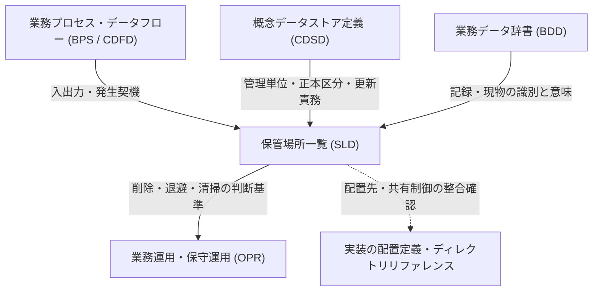

---
specdojo:
  id: specdojo:sld-rulebook
  type: rulebook
  deliverable_type: data
  status: ready
  target_format: markdown
  recipe: not-needed
  sample: specdojo:sld-sample
  template: not-needed
  based_on:
    - specdojo:rulebook-authoring-standard
---

# 保管場所一覧（SLD）作成ルール

Storage Location Definition (SLD) Documentation Rules

業務で扱う現物・紙帳票・電子データ・実行時ファイルの保管場所について、置くもの・共有の有無・寿命・消してよいか（削除・処分の可否と条件）を定義する基準を定めます。

## 1. 全体方針

- **目的と適用範囲**: `sld-*.md` を対象とします。店舗・倉庫の棚や金庫、紙台帳の保管場所、リポジトリ内のディレクトリ、端末ローカルの状態領域、作業用 worktree、一時ディレクトリなど、「どこに何が置かれ、共有されるか、いつまで残し、消してよいか」を判断する必要がある保管場所を網羅します。
- **正本参照と責務境界**: 概念上の管理単位・正本区分・更新責務は概念データストア定義（CDSD）、データ項目の構造は業務データ辞書（BDD）や schema、ディレクトリ構造や CLI の詳細はリファレンス・実装を正本とします。SLD はそれらを場所ごとの保管物・共有範囲・寿命・削除可否の観点で整理し、正本の詳細を再掲しません。
- **記載レベル**: 一覧の1行は、共有範囲・寿命・削除可否の判断が同じになる保管場所の区分とします。個々のファイル名を全列挙せず、誤削除や放置を防げる粒度でまとめます。
- **実践の型の構成**: 標準6列と5章構成が本 rulebook で定まり、骨組みを別ファイルにすると二重管理になるため、`recipe` と `template` は `not-needed` とします。
- **共通の運用**: 役割の割り当ては適用先のメンバー定義に、`status` の昇格と承認、改訂と廃止、未決事項の登録簿への引き継ぎは [[specdojo:document-metadata-standard|ドキュメントメタ情報標準]] に従い、本書と成果物で言い直しません。文書の整形・lint はリポジトリの検証で扱い、成果物の業務の検証に含めません。

## 2. 位置づけ

SLD は、CDSD の管理単位と業務プロセス仕様の業務の流れを受け、それらがどの物理的・論理的な場所に置かれ、どう共有・保持・処分されるかを定義します。[[specdojo:deliverables-reference|成果物リファレンス]] の種別名は「保管場所定義（`sld`）」で、個別文書のタイトルと本文では「保管場所一覧」と呼びます。



リポジトリ内の文書配置は [[specdojo:docs-structure-guide|ドキュメント構成ガイド]] に従います。

## 3. ファイル命名・ID規則

- **ファイル名**: `sld-<term>.md` とし、`<term>` は対象システム・業務領域を表す英小文字の kebab-case とします（例: `sld-specdojo.md`、`sld-inventory.md`）。
- **文書 ID**: プロダクト仕様の成果物は `sld-<term>`、プロジェクト固有の成果物は `<project-id>:sld-<term>` とし、成果物カタログの宣言と一致させます。旧来の `sll-` プレフィックスは新規に採番しません（他文書で言及済みの未作成 ID に限り、移行関係を明記して対応付けます）。
- **文書タイトル（H1）**: `# 保管場所一覧（<対象領域または対象システム>）` とします。

## 4. 推奨 Frontmatter 項目

許可キー・必須項目・型制約は [[specdojo:document-metadata-standard|ドキュメントメタ情報標準]] と `docs/specdojo/schemas/v1/deliverable-frontmatter.schema.yaml` を正本とします。

- `specdojo.type` は `data`、`specdojo.rulebook` は `specdojo:sld-rulebook` とします。
- `specdojo.based_on` には実際に読んで直接の根拠とした作成済み文書（対応する `cdsd-*` 等）の ID を記載します。成果物カタログに `depends_on` がある場合はその推移閉包内に限定し、未作成文書を含めません。

```yaml
---
specdojo:
  id: sld-specdojo
  type: data
  status: draft
  rulebook: specdojo:sld-rulebook
  based_on:
    - cdsd-planning
    - cdsd-execution
    - cdsd-sharing
---
```

## 5. 本文要件

本文は次の5章構成を標準とします。

| 章                               | 必須     | 内容・受入条件                                                                                                             |
| -------------------------------- | -------- | -------------------------------------------------------------------------------------------------------------------------- |
| 概要                             | 必須     | 対象領域、誰がどの判断に使うか、対象範囲。隣接仕様との分担は「関連仕様・実装配置との対応と検証」にまとめ、ここで再掲しない |
| 保管場所一覧                     | 必須     | 全保管場所を標準6列で定義し、置くもの・共有の有無・寿命・消してよいかと削除前の条件が判別できること                        |
| 削除・退避・復旧の判断基準       | 必須     | 削除可否の区分ごとの扱いと、誤削除・残存した状態・消失への場面別の対処、復旧の経路と連絡先を示すこと                       |
| 関連仕様・実装配置との対応と検証 | 必須     | 隣接仕様との分担と保管場所の対応を1つの表にまとめ、業務上の受入確認の手順と合格条件を辿れること                            |
| 確認事項と変更影響               | 条件付き | 未決事項・前提の欠落・保管場所の追加や変更があるときに置き、論点と影響（当面の扱い）を示す                                 |

「確認事項と変更影響」を条件付きとするのは、未決事項も変更予定もない領域で空の章を作らせないためです。

### 5.1. 保管場所一覧の標準列

「保管場所一覧」の表は、次の6列をこの順序で配置します。物理的な場所と論理的な場所（またはリポジトリ内と端末ローカル）の両方を含む場合は、同じ6列で表を分けるか、区分が分かる順に並べます。

| 列名                   | 内容・判断条件                                                                                                                              |
| ---------------------- | ------------------------------------------------------------------------------------------------------------------------------------------- |
| 保管場所               | 場所の論理名と、物理的な設置場所またはディレクトリパス・環境変数パターン（例: `docs/ja/projects/<id>/execution/`、`${XDG_STATE_HOME}/...`） |
| 置くもの               | 保管する現物・帳票・ファイル群と、その役割（正本・履歴・派生ビュー・ロック・一時データ等）。代表単位で示す                                  |
| 関連プロセス・操作     | その場所にものを置く・参照する・回収する業務プロセスまたはコマンド（複数ある場合は「、」で区切る）                                          |
| 共有の有無             | `Git 共有（追跡対象）`、`共有なし（.gitignore・各環境で再生成）`、`共有なし（端末ローカル）`、`店舗内共有（施錠保管）` 等の区分と共有範囲   |
| 寿命・管理頻度         | 置かれてから消える・移動するまでの期間（恒久、タスク実行中、日次・月次等）と、確認・清掃・ローテーションの契機                              |
| 削除・処分の可否と条件 | `削除不可` / `条件付き削除可` / `削除可`（物理現物は `処分不可` / `条件付き処分可` / `即時処分可`）の区分と、削除前の条件・再生成手段       |

セルは判断に要る要点だけにし、手順は「削除・退避・復旧の判断基準」の場面別の表へ寄せます。

### 5.2. 削除・退避・復旧の判断要件

- 場所ごとの削除前の条件は「保管場所一覧」の表を正とし、ほかの章では表を参照して言い直しません。
- 区分ごとの扱いとして、`削除不可` の場所が不要になったときに消す代わりに採る手順（`deprecated` 化、アーカイブ領域や別の保管場所への移動、保持期間満了後の承認手続き等）を示します。
- `条件付き削除可` の場所で条件を満たせないときの扱い（残して持ち越す、責任者へ連絡する等）を示します。
- 場面別の対処として、誤削除、異常終了で残ったロックや作業領域、消失・破損、容量逼迫などの場面ごとに、確認と対処の手順、担当と連絡先を表にします。`削除可` の場所は削除後の再生成コマンドまたは再作成の契機を示します。

### 5.3. 関連仕様・実装配置との対応と検証要件

- 依存する CDSD の各管理単位と STSD の状態が、どの保管場所に対応するか（CDSD 側で未登録の管理単位があればその扱い）を追跡できるようにします。
- ソフトウェア・リポジトリの保管場所を扱う場合は、パス解決や共有除外を担う実装モジュール・設定ファイル（例: `.gitignore`、パス解決関数、ディレクトリレイアウトリファレンス）との対応を示します。関数本体や schema 全文は転記しません。
- 受入確認では、次の観点ごとに手順と合格条件を定義します。
  1. **配置と技術制約の一致**: パス区分、Git 追跡と除外、端末ローカルや worktree の分離方式が実装・リファレンスと一致すること。欠落・破損時の実装の挙動が削除可否と矛盾しないこと。
  2. **記録・状態の網羅**: `depends_on` の CDSD 等で定義された記録・管理単位に保管場所の欠落がなく、保持・共有の業務要件と矛盾しないこと。
  3. **削除・復旧判断の実効性**: すべての保管場所について、消してよいか、消す前の確認事項、消した後の影響または再生成手順が特定できること。

### 5.4. 未決事項と変更影響の要件

- 保管先や保持期間が未確定の項目は推測で確定せず、`_UNDECIDED_` または `_TODO_` を付して「確認事項と変更影響」に論点と影響を書きます。管理台帳の区分・担当・判断時期の列は設けず、追跡は登録簿で行います。
- 保管場所の新設・パス変更・共有区分の変更では、CDSD、ディレクトリリファレンス、`.gitignore`、ビルド・再生成処理、バックアップ・清掃手順への波及を影響として書きます。

## 6. 記述ガイド

完成例の全体像は Frontmatter の `sample` で宣言された sample を参照してください。各章の記述では次の判断基準と良い例・悪い例に従います。

### 6.1. 概要

- **判断基準**: 誰がどの運用・設計判断に使う一覧で、何を対象範囲とするかが冒頭で分かること。
- **良い例**: 「リポジトリ内の正本文書・実行履歴・派生ビューと、端末ローカルの状態ファイル・worktree・一時ディレクトリの保管境界を定義し、清掃や障害復旧時に消してよい場所と残すべき場所を判別できるようにする。」
- **悪い例**: 「SpecDojo のディレクトリ一覧を示す。」（誰の何の判断に使うかが分からない）

### 6.2. 保管場所一覧

- **判断基準**: 標準6列がすべて具体化され、「共有の有無」に共有手段（Git 追跡、`.gitignore`、端末固有など）、「削除・処分の可否と条件」に区分と条件が書かれていること。
- **良い例**: 「`docs/**/generated/` および `.specdojo/doc-index.json` ／ 派生 Markdown ビューと文書索引 ／ `specdojo build`、`index build` ／ 共有なし（`.gitignore` で除外し各環境で生成） ／ ビルド時に再生成 ／ `削除可`。`specdojo build` で再生成できる」
- **悪い例**: 「`generated` フォルダ ／ 生成ファイル ／ ビルド ／ なし ／ 随時 ／ 消してよい」（パス範囲、共有除外の仕組み、削除後の復旧手段が曖昧）

### 6.3. 削除・退避・復旧の判断基準

- **判断基準**: 場面ごとに「何を確認し、どう対処し、誰へ連絡するか」が行動レベルで書かれ、削除前の条件は一覧の表を参照していること。
- **良い例**: 「`exec run` が異常終了して `execution/exec/.locks/` にロックが残った ／ 同じリポジトリで `exec run` が動いていないことを確かめてから削除する。稼働中に消すと二重実行で実行記録が壊れる ／ DEV」
- **悪い例**: 「ロックファイルは状況に応じて注意して削除する。」（確認条件も誤削除時の影響も分からない）

### 6.4. 関連仕様・実装配置との対応と検証

- **判断基準**: 根拠となる CDSD の管理単位や実装ファイル（パス解決・共有設定）を特定し、保管場所との対応と検証の手順が1か所で分かること。
- **良い例**: 「実行履歴領域（`execution/runs/`、`execution/conventions/`）は [[cdsd-execution|概念データストア定義（プロジェクト実行）]] の実行記録と `src/shared/run-records.ts` のパス解決に対応し、Git 追跡対象の正本として保持する。」
- **悪い例**: 「実装のソースコード一式と整合していることを確認する。」（どの仕様・どの実装モジュールと対応するか追跡できない）

### 6.5. 確認事項と変更影響

- **判断基準**: 上位仕様（CDSD 等）で未決の事項を隠さず引き継ぎ、決まったときに本書のどの行・どの実装へ影響するかが分かること。
- **良い例**: 「`_UNDECIDED_`: 監視結果・費用作業記録の保管先パスと保持期間（[[cdsd-execution|概念データストア定義（プロジェクト実行）]] の未決事項）。決まったら「保管場所一覧」へ行を足す。」
- **悪い例**: 未決の保管場所を推測で確定パスとして書き込む、または未決事項があるのに「特になし」と書く。

## 7. 禁止事項

| 禁止パターン                                                               | 理由                                                                                   |
| -------------------------------------------------------------------------- | -------------------------------------------------------------------------------------- |
| 「置くもの」「共有の有無」「寿命」「消してよいか」のいずれかを欠いた行定義 | 運用者が誤削除や放置の判断を誤る原因になるため                                         |
| 「適宜削除」「状況に応じて管理」など条件のない削除可否記述                 | 削除前の確認事項や再生成手段を判断できず、正本データや未統合 worktree の消失を招くため |
| 削除前の条件を「保管場所一覧」以外の章で言い直すこと                       | 同じ条件が複数か所に書かれ、改訂時に食い違うため                                       |
| 概念データストアの属性一覧・JSON Schema・ソースコード実装の全文転記        | CDSD・BDD・schema・実装との二重管理になり、正本更新時に不整合が発生するため            |
| 未決の保管先や保持期間を根拠なく推測で確定記載すること                     | 合意されていない運用制約を既成事実化し、後続の設計・実装と衝突するため                 |
| 文書の整形・lint の実行を業務の受入確認に含めること                        | リポジトリの検証と業務の検証が混ざり、保管・削除の判断を確かめる手順が埋もれるため     |
