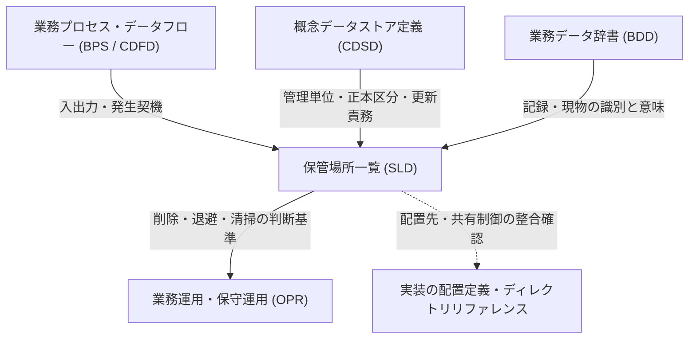

---
specdojo:
  id: specdojo:sld-rulebook
  type: rulebook
  deliverable_type: data
  status: draft
  target_format: markdown
  recipe: not-needed
  sample: specdojo:sld-sample
  template: not-needed
  based_on:
    - specdojo:rulebook-authoring-standard
---

# 保管場所一覧（SLD）作成ルール

Storage Location Definition (SLD) Documentation Rules

業務で扱う現物・紙帳票・電子データ・実行時ファイルが置かれる物理的または論理的な保管場所について、置くもの・共有の有無・寿命・消してよいか（削除・処分の可否と条件）を定義する基準を定めます。
BA・OPS が日常運用の保管・清掃・処分の判断境界を合意し、ARC・DEV が概念データストアや実装上の配置先と整合させ、QE が欠落・矛盾を検証できる一覧を作ります。

## 1. 全体方針

- **目的と適用範囲**: 業務分析・システム設計・運用設計で参照する `sld-*.md` を対象とします。店舗・倉庫の棚や金庫、紙台帳の保管場所、リポジトリ内のディレクトリ、端末ローカルの状態領域、作業用 worktree、一時ディレクトリなど、人が「どこに何が置かれ、共有されるか、いつまで残し、消してよいか」を判断する必要がある保管場所を網羅します。
- **正本参照と責務境界**: 概念上のデータ管理単位・正本区分・更新責務は概念データストア定義（CDSD）、データ項目の構造・型・許容値は業務データ辞書（BDD）や schema、ディレクトリ構造や CLI の詳細仕様はリファレンス・実装を正本として参照します。SLD はそれらを「場所ごとの保管物・共有範囲・寿命・削除可否」の観点で横断的に整理し、正本の詳細構造を再掲しません。
- **記載レベル**: 一覧の1行は、共有範囲・寿命・削除可否の判断が同一となる保管場所の区分とします。個々のファイル名や一時変数をすべて列挙せず、運用者や開発者が誤削除や放置を防げる粒度でまとめます。
- **確定と変更**: BA・OPS が保管運用の妥当性、ARC・DEV が CDSD および実装配置との一致、QE が受入条件の検証可能性を確認します。`status: ready` への昇格および廃止・置換は人間の PO が最終承認します。

### 1.1. 対象者と確認する内容

| Role code | 作成・確認・利用の責務                                                                                                     |
| --------- | -------------------------------------------------------------------------------------------------------------------------- |
| ARC       | 保管場所の区分がシステム構成・ディレクトリ配置・外部依存・ロックや分離機構の実装と一致しているかを確認する                 |
| BA        | 概念データストア（CDSD）や業務プロセスで扱う記録・現物が漏れなく保管場所に対応付けられ、業務上の保持要件を満たすか確認する |
| OPS       | 日常運用・障害復旧・容量逼迫時に、消してよい場所と残すべき場所、削除前確認条件と再生成手順を迷わず判断できるか確認する     |
| DEV       | 実装が参照・出力するパス解決ロジック、`.gitignore` 等の共有制御、一時領域やロックの扱いと矛盾がないか確認する              |
| QE        | 標準列の網羅性、CDSD・実装との対応、削除可否の条件と復旧手段の検証可能性を照合する                                         |
| PM        | 未決の保管方針・保持期間や移行作業の担当・判断時期を計画へ接続し、課題・リスク・変更要求・決定事項を管理台帳へつなぐ       |
| PO        | 保管・共有・保持・処分の業務方針と公開範囲を最終合意し、人間の判断として `status: ready` への昇格や改廃を承認する          |

成果物内で「店主代表」「店番担当」「運用管理者」などの業務呼称を使う場合は、適用先の組織定義の `Role code` に対応付けます。

## 2. 位置づけと用語定義

SLD は、概念データストア定義（CDSD）が定義する「管理単位と更新責務」および業務プロセス仕様が定義する「業務の流れ」を受け、それらが実際にどの物理的・論理的領域に配置され、どう共有・保持・処分されるかを定義します。成果物カタログ種別（[[specdojo:deliverables-reference|成果物リファレンス]]）における種別名は「保管場所定義（`sld`）」であり、個別文書のタイトルおよび本文では「保管場所一覧」と呼称します。



| 用語                   | 定義                                                                                                                                             |
| ---------------------- | ------------------------------------------------------------------------------------------------------------------------------------------------ |
| 保管場所               | 現物・紙媒体・電子ファイル・ディレクトリが置かれる物理的または論理的な区画。共有範囲・寿命・削除可否の判断単位で区分する                         |
| 置くもの               | その保管場所に格納される現物、帳票、設定、履歴、派生生成物、ロック、一時ファイル等の対象物。対応する概念データストアや代表パスパターンを併記する |
| 共有の有無             | 複数人・複数端末・Git リポジトリ等で共有されるか、端末ローカル・作業ブランチ固有・個人手元にとどまるかの区分と共有手段                           |
| 寿命・管理頻度         | 置かれたものが存在する期間（恒久保持、タスク実行中のみ、プロセス稼働中のみ、日次・月次サイクル等）および棚卸・清掃・ローテーションの周期         |
| 削除・処分の可否と条件 | 運用者や開発者がその場所の中身を消してよいかの区分（`削除不可` / `条件付き削除可` / `削除可`）と、削除前に確認すべき条件・削除後の復旧または影響 |

メタ情報・改訂と廃止の扱いは [[specdojo:document-metadata-standard|ドキュメントメタ情報標準]]、リポジトリ内の文書配置は [[specdojo:docs-structure-guide|ドキュメント構成ガイド]] に従います。

## 3. ファイル命名・ID規則

- **ファイル名**: `sld-<term>.md` とし、`<term>` は対象システム・業務領域を表す英小文字の kebab-case とします（例: `sld-specdojo.md`、`sld-inventory.md`）。
- **文書 ID**: プロダクト仕様の成果物は `sld-<term>`、プロジェクト固有の成果物は `<project-id>:sld-<term>` とし、成果物カタログの宣言と一致させます。新規作成・改訂では `sld-` プレフィックスを使用し、旧来の `sll-` プレフィックスを新規に採番しません（既存の未作成予定 ID として他文書で言及されている場合のみ、移行関係を明記して対応付けます）。
- **文書タイトル（H1）**: `# 保管場所一覧（<対象領域または対象システム>）` とします。

## 4. 推奨 Frontmatter 項目

許可キー・必須項目・型制約は [[specdojo:document-metadata-standard|ドキュメントメタ情報標準]] および `docs/specdojo/schemas/v1/deliverable-frontmatter.schema.yaml` を正本とします。

- `specdojo.type` は `data`、`specdojo.rulebook` は `specdojo:sld-rulebook` とします。
- `specdojo.status` は新規作成・agent 編集時は `draft` とします。
- `specdojo.based_on` には実際に読んで直接の根拠とした作成済み文書（対応する `cdsd-*` 等）の ID を記載します。成果物カタログに `depends_on` がある場合はその推移閉包内に限定し、未作成文書を含めません。

```yaml
---
specdojo:
  id: sld-specdojo
  type: data
  status: draft
  rulebook: specdojo:sld-rulebook
  based_on:
    - cdsd-planning
    - cdsd-execution
    - cdsd-sharing
  supersedes: []
---
```

## 5. 本文要件

本文は次の5章構成を標準とします。H1 は文書名のみに使い、`##`〜`####` の見出しには階層ごとの連番と末尾のピリオドを付けます（例: `## 1.`、`### 1.1.`、`#### 1.1.1.`）。表はヘッダー・区切り行・データ行を連続させ、途中に空行を入れません。

| 章                               | 必須     | 内容・受入条件                                                                                                                     |
| -------------------------------- | -------- | ---------------------------------------------------------------------------------------------------------------------------------- |
| 概要                             | 必須     | 対象領域、想定読者（`Role code`）と利用場面、解決する運用・設計上の課題、対象範囲と隣接仕様（CDSD・BDD・実装リファレンス）との分担 |
| 保管場所一覧                     | 必須     | 対象領域の全保管場所を標準6列で定義し、置くもの・共有の有無・寿命・消してよいかが漏れなく判別できること                            |
| 削除・退避・復旧の判断基準       | 必須     | 削除可否の区分ごとの判断条件、誤削除や孤立ロック・残存作業領域への対処、再生成・復旧方法とエスカレーション先を示すこと             |
| 関連仕様・実装配置との対応と検証 | 必須     | 概念データストア（CDSD）や実装の配置定義・共有設定との対応関係、および各ロールの受入確認・検証手順を辿れること                     |
| 確認事項と変更影響               | 条件付き | 未決事項（`_TODO_` / `_UNDECIDED_`）、前提の欠落、保管場所追加・変更時の影響範囲、管理台帳（PJR）への追跡候補と公開承認条件を示す  |

### 5.1. 保管場所一覧の標準列

「保管場所一覧」の表は、次の6列をこの順序で配置します。対象領域に物理的な場所と論理的な場所（またはリポジトリ内と端末ローカル）の両方が含まれる場合は、同一の標準6列で表を分けるか、区分が分かる順序で並べます。

| 列名                   | 内容・判断条件                                                                                                                              |
| ---------------------- | ------------------------------------------------------------------------------------------------------------------------------------------- |
| 保管場所               | 場所の論理名と、物理的な設置場所またはディレクトリパス・環境変数パターン（例: `docs/ja/projects/<id>/execution/`、`${XDG_STATE_HOME}/...`） |
| 置くもの               | 保管する現物・帳票・ファイル群と、その役割（正本・履歴・派生ビュー・ロック・一時データ等）。多数のファイルを個別に全列挙せず代表単位で示す  |
| 関連プロセス・操作     | その場所にものを置く・参照する・回収する業務プロセスまたはコマンド・処理（複数ある場合は「、」で区切る）                                    |
| 共有の有無             | `Git 共有（追跡対象）`、`共有なし（.gitignore・各環境で再生成）`、`共有なし（端末ローカル）`、`店舗内共有（施錠保管）` 等の区分と共有範囲   |
| 寿命・管理頻度         | 置かれてから消える・移動するまでの期間（恒久、タスク実行中、プロセス実行中、日次・月次等）と、確認・清掃・ローテーションの契機              |
| 削除・処分の可否と条件 | `削除不可` / `条件付き削除可` / `削除可`（物理現物の場合は `処分不可` / `条件付き処分可` / `即時処分可`）の区分と、削除前条件・再生成手段   |

### 5.2. 削除・退避・復旧の判断要件

- 一覧の「削除・処分の可否と条件」で示した3区分（`削除不可` / `条件付き削除可` / `削除可`）について、運用者（OPS）や開発者（DEV）が迷いやすい境界ケースの判断基準を定義します。
- `削除不可` の場所について、不要化・廃止時に直接削除する代わりに採るべき正規手順（ステータスの `deprecated` 化、アーカイブ領域への退避、法定・監査保持期間満了後の承認手続き等）を示します。
- `条件付き削除可` の場所（実行ロック、未統合の可能性がある作業用 worktree、返品・保留箱など）について、削除前に必ず確認する状態（稼働中プロセスの有無、未マージ差分の有無、PO・責任者の確認有無）を明記します。
- `削除可` の場所（派生生成ビュー、索引キャッシュ、一時ディレクトリなど）について、削除後に必要となる再生成コマンドまたは再作成契機を示します。

### 5.3. 関連仕様・実装配置との対応と検証要件

- 依存する概念データストア定義（`cdsd-*`）の各管理単位が、本書のどの保管場所に対応するか（および CDSD 側で未登録・整備予定の管理単位があればその対応関係）を追跡できるようにします。
- ソフトウェア・リポジトリの保管場所を扱う場合は、パス解決や共有除外を担う実装モジュール・設定ファイル（例: `.gitignore`、パス解決関数、ディレクトリレイアウトリファレンス）との対応を示します。実装コードの関数本体や schema 全文は転記しません。
- 受入確認として、次の4観点の合格条件と確認手段を定義します。
  1. **ARC・DEV（配置と技術制約の一致）**: 保管場所のパス区分、Git 追跡／除外設定、端末ローカルや worktree の分離方式が実装およびリファレンスと一致していること。
  2. **BA（要求・データストアの網羅）**: `depends_on` の CDSD 等で定義された記録・管理単位に保管場所の欠落がなく、保持・共有の業務要件と矛盾しないこと。
  3. **OPS（削除・保持判断の明確性）**: すべての保管場所について、消してよいか、消す前の確認事項、消した後の影響または再生成手順が特定できること。
  4. **QE（文書品質と整合性検証）**: 標準6列・必須章の充足、参照リンクの解決、およびリポジトリ標準の整形・lint（本リポジトリでは `npx prettier --write <対象.md>`、`npm run lint:md`、`npm run lint:fm`）がエラーなく通過すること。

### 5.4. 未決事項・変更管理・公開判断の要件

- 保管先や保持期間が未確定の項目は推測で確定せず、`_UNDECIDED_` または `_TODO_` を付して「確認事項と変更影響」に記録します。計画済み作業は Schedule、既発の問題は課題（`issue`）、未発生の懸念はリスク（`risk`）、承認を要する仕様変更は変更要求（`change-request`）、合意した方針は決定記録（`decision`）として管理台帳（PJR）への転記候補と担当 `Role code`・判断時期を示します。
- 保管場所の新設・パス変更・共有区分の変更を行う場合は、CDSD、ディレクトリリファレンス、`.gitignore`、ビルド・再生成処理、バックアップ・清掃手順への波及を ARC・DEV・OPS が確認します。
- 公開および `status: ready` への昇格は、BA・ARC・DEV・OPS・QE の確認完了後、未決事項の影響と公開範囲を提示したうえで人間の PO が判断します。agent が独断で `ready` に変更することは禁止します。

## 6. 記述ガイド

完成例の全体像は [[specdojo:sld-sample|保管場所一覧のサンプル]] を参照してください。各章の記述では次の判断基準と良い例・悪い例に従います。

### 6.1. 概要

- **判断基準**: 誰がどの運用・設計判断に使う一覧であり、CDSD（概念上の管理単位）やリファレンス（ディレクトリ構造の詳細）とどう役割分担するかが冒頭で分かること。
- **良い例**: 「リポジトリ内の正本文書・実行履歴・派生ビューと、端末ローカルの状態ファイル・worktree・一時ディレクトリの保管境界を定義し、OPS・DEV が清掃や障害復旧時に消してよい場所と残すべき場所を判別できるようにする。概念上の管理単位と更新責務は CDSD を参照する。」
- **悪い例**: 「SpecDojo のディレクトリ一覧を示す。」（誰の何の判断に使うか、CDSD やディレクトリリファレンスとの違いが分からない）

### 6.2. 保管場所一覧

- **判断基準**: 標準6列がすべて具体化され、「共有の有無」に共有手段（Git 追跡、`.gitignore`、端末固有など）、「削除・処分の可否と条件」に可否区分と条件・復旧方法が明記されていること。
- **良い例**: 「`docs/**/generated/` および `.specdojo/doc-index.json` ／ カタログ・台帳・実行結果の派生 Markdown ビューと文書索引 ／ `specdojo build`、`index build` ／ 共有なし（`.gitignore` で除外し各環境で生成） ／ ビルド時に再生成 ／ `削除可`。削除しても正本 YAML・Markdown から `specdojo build` で完全再生成できる」
- **悪い例**: 「`generated` フォルダ ／ 生成ファイル ／ ビルド ／ なし ／ 随時 ／ 消してよい」（パス範囲、共有除外の仕組み、削除後の復旧手段が曖昧で運用判断に使えない）

### 6.3. 削除・退避・復旧の判断基準

- **判断基準**: 「いつ・何を確認すれば消せるか」「消した後にどう戻すか」「絶対に消してはいけない理由と代替手段は何か」が場面別に行動レベルで書かれていること。
- **良い例**: 「`execution/exec/.locks/` のロックファイルは `条件付き削除可` とする。`exec run` プロセスが異常終了してロックが残存した場合のみ、同一リポジトリで実行中の `exec run` プロセスが存在しないことを確認したうえで削除する。稼働中に削除すると二重実行により実行記録が破損する。」
- **悪い例**: 「ロックファイルは状況に応じて注意して削除する。」（確認条件も誤削除時の影響も分からず、事故を防げない）

### 6.4. 関連仕様・実装配置との対応と検証

- **判断基準**: 根拠となる CDSD の管理単位や実装ファイル（パス解決・共有設定）を具体的に特定し、それらと保管場所一覧の整合をどう検証するかが分かること。
- **良い例**: 「実行履歴領域（`execution/runs/`、`execution/conventions/`）は [[cdsd-execution|概念データストア定義（プロジェクト実行）]] の実行記録および `src/shared/run-records.ts` のパス解決に対応し、Git 追跡対象の正本として保持する。」
- **悪い例**: 「実装のソースコード一式と整合していることを確認する。」（どの仕様・どの実装モジュールと対応するか追跡できない）

### 6.5. 確認事項と変更影響

- **判断基準**: 上位仕様（CDSD 等）で未決・未整備の事項を隠さず引き継ぎ、誰がいつ判断し、決定時に本書のどの行・どの実装へ影響するかを明記すること。
- **良い例**: 「`_UNDECIDED_`: 監視結果・費用作業記録の具体的な保管先パスと保持期間。[[cdsd-execution|概念データストア定義（プロジェクト実行）]] の未決事項に対応し、運用設計フェーズで OPS・ARC が方式を比較して PO が決定する。決定後に本書の第2章へ該当行を追加する。」
- **悪い例**: 未決の保管場所を推測で確定パスとして書き込む、または未決事項があるのに「特になし」と記載する。

## 7. 禁止事項

| 禁止パターン                                                               | 理由                                                                                              |
| -------------------------------------------------------------------------- | ------------------------------------------------------------------------------------------------- |
| 「置くもの」「共有の有無」「寿命」「消してよいか」のいずれかを欠いた行定義 | 保管場所一覧の受入条件を満たさず、運用者が誤削除や放置の判断を誤る原因になるため                  |
| 「適宜削除」「状況に応じて管理」など条件のない削除可否記述                 | OPS・DEV が削除前の確認事項や再生成手段を判断できず、正本データや未統合 worktree の消失を招くため |
| 概念データストアの属性一覧・JSON Schema・ソースコード実装の全文転記        | CDSD・BDD・schema・実装との二重管理になり、正本更新時に不整合が発生するため                       |
| 未決の保管先や保持期間を根拠なく推測で確定記載すること                     | 合意されていない運用制約やディレクトリ構成を既成事実化し、後続の設計・実装と衝突するため          |
| メタ説明（「ここに対象を書く」等）のみのサンプルや表の空行分断             | 具体例の判断基準として機能せず、また Markdown の表構文規約に違反するため                          |
| agent による `status: ready` への昇格や、承認なしの正本削除方針の確定      | 最終的な業務合意と公開・処分責任は人間の PO にあり、自動処理で代替してはならないため              |

## 8. 運用ルール

- **ライフサイクル管理**: 新規作成・改訂時は `status: draft` で作成し、関連する CDSD・ディレクトリリファレンス・実装との整合確認と lint 検証を経たうえで、人間の PO の承認により `status: ready` へ昇格します。
- **実践の型（Kata）間の整合**: 本 rulebook を改訂する場合は、[[specdojo:sld-sample|保管場所一覧のサンプル]] および本 rulebook を適用する成果物（`sld-*`）の章構成・標準6列・見出し番号規約が一致していることを確認します。SLD は標準6列と5章構成が本 rulebook で明確に定まるため、`recipe` および `template` は `not-needed` とします。
