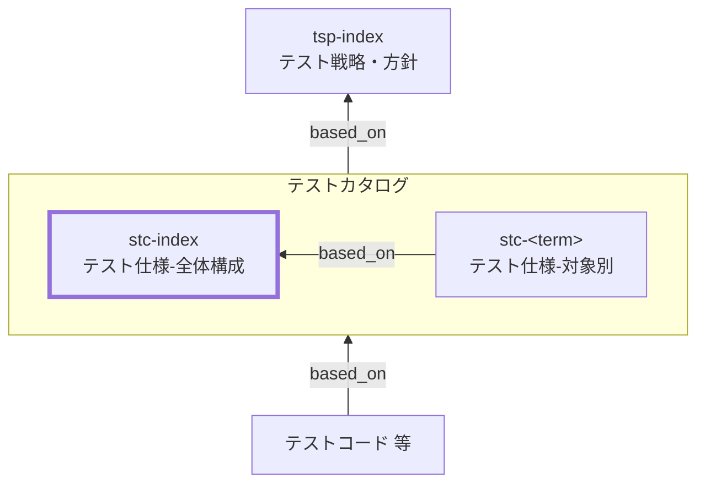

---
specdojo:
  id: specdojo:stc-index-rulebook
  type: rulebook
  deliverable_type: test
  status: draft
  recipe: not-needed
  sample: specdojo:stc-index-sample
  template: not-needed
---

# 総合テストカタログ 概要 作成ルール

System Test Catalog (STC) Index Documentation Rules

総合テストカタログの全体概要 `stc-index` に、TSP に基づく対象分割・観点/条件・環境/証跡の共通方針を定義する基準を定めます。対象別カタログは [[specdojo:stc-rulebook|総合テストカタログ 対象別 作成ルール]] に従います。

## 1. 全体方針

- `stc-index` は総合テスト共通の考え方・方針・定義の正本とし、例外と対象外を明示して責任境界を固定します。
- 責務の分担は [[specdojo:test-document-scope-standard|テストドキュメントスコープ定義標準]] に従います。個別の観点・条件・ケースは `stc-<term>`、詳細手順・具体値・実行結果はテストコード／CI／レポートを正本とします。
- `tsp-index` を根拠に、総合テストの分割基準、観点/条件の採否、環境/外部依存、共通合格基準と証跡を定めます。品質ゲート全体は TSP を参照します。
- **実践の型の構成**: 章構成と列定義、分割・採用・分配の判断手順が本書で完結するため、別の手順書や骨組みは不要とし、`recipe` と `template` は `not-needed` とします。
- **共通の運用**: 役割の割り当ては適用先のメンバー定義に、`status` の昇格と承認、改訂と廃止、未決事項の登録簿への引き継ぎは [[specdojo:document-metadata-standard|ドキュメントメタ情報標準]] に従います。文書の整形・lint はリポジトリの検証で扱い、業務の検証に含めません。

## 2. 位置づけ（他ドキュメントとの関係）



## 3. ファイル命名・ID規則

- 文書 ID は `stc-index` 固定。対象別は `stc-<term>` とします。
- ファイル名は [[specdojo:id-and-file-naming-standard|ドキュメントIDおよびファイル命名標準]] に従い、既定は `stc-index.md` とします。
- `<term>` は用語集の論理名キー（英小文字 kebab-case）を用い、表示名は H1 に日本語で記載できます。

## 4. 推奨 Frontmatter 項目

### 4.1. 設定内容

許可キー・必須項目・型制約は [[specdojo:document-metadata-standard|ドキュメントメタ情報標準]] と `docs/specdojo/schemas/v1/deliverable-frontmatter.schema.yaml` を正本とします。

- `specdojo.id` は `stc-index`、`specdojo.type` は `test` とします。
- `specdojo.rulebook` は `specdojo:stc-index-rulebook` とします。

### 4.2. 推奨ルール

- `based_on` には最低限 `tsp-index` を含めます。
- BAC/NFR/BR 等は、対象分割・環境前提・共通合格基準の判断に直接利用したものだけを列挙します。

## 5. 本文構成（標準テンプレ）

次の番号付き H2 を順序固定で配置します。「記述ガイド」の各節は、同名の本文章に対応します。

| 番号 | 見出し                                          | 必須 |
| ---- | ----------------------------------------------- | ---- |
| 1    | 本ドキュメントの目的と適用対象                  | ○    |
| 2    | テスト対象の括り方と分割基準                    | ○    |
| 3    | 対象外・除外理由（共通）                        | ○    |
| 4    | 観点の立て方（共通）                            | ○    |
| 5    | 条件の立て方（共通）                            | ○    |
| 6    | 観点/条件の採用基準と対象別への分配方針（共通） | ○    |
| 7    | 総合テスト共通の境界/環境の扱い                 | ○    |
| 8    | ケース表の共通カラム                            | ○    |
| 9    | メモ / 将来課題                                 | 任意 |

## 6. 記述ガイド

### 6.1. 本ドキュメントの目的と適用対象

- `stc-<term>` の品質・粒度・責任範囲を揃える目的と、適用する総合テストカタログ群を示します。
- UT/IT/ET/AT 固有のルールは各レベルのカタログに委ね、総合テストとの境界を示します。
- 記載粒度は判断基準・共通ルールまでとし、個別ケースの大量列挙はしません。

### 6.2. テスト対象の括り方と分割基準

`<term>` はユーザ価値・業務シナリオのまとまり（主要業務フロー、代表ユースケース、E2E 経路）とし、次の順で分割を検討します。

1. **業務/価値境界**: 開始条件から完了条件までを1シナリオとして説明できる。
2. **境界横断**: 跨ぐコンポーネント/サブシステムの経路が同質。
3. **データ境界**: 同じデータライフサイクル（作成→更新→確定等）を扱う。
4. **運用境界**: 運用手順・監視観測点・権限が概ね一致する。

1〜2ケースしかない単位は原則統合します。観点が15以上、表が60行以上、または前提データ・権限の大きく異なる経路が混在する場合は分割候補とします。

### 6.3. 対象外・除外理由（共通）

#### 6.3.1. 記述ルール

- 対象外ごとに、除外理由・代替レベル/手段・例外を下表で定義します。
- 代替欄には UT/IT/ET/AT/NFR 等、どこで担保するかを必ず記載します。
- ST で扱う例外を認める場合は、いつ・どの条件で扱うかを明記します。

#### 6.3.2. 推奨フォーマット（表）

| 対象外（やらないこと） | 除外理由 | 代替レベル/代替手段 | 例外（STで扱う条件） |
| ---------------------- | -------- | ------------------- | -------------------- |

#### 6.3.3. 典型例（記載候補）

- 厳密な性能・負荷・耐久（p95、スループット、長時間運転）
- 侵入テスト/本格的なセキュリティ診断
- 全ブラウザ/全端末の網羅互換
- 外部事業者の全障害パターン網羅（必要なら ET に委譲）

### 6.4. 観点の立て方（共通）

観点は、ユーザ/業務視点でシステム全体として保証することの切り口です。最低限、次の順に検討します。

1. 業務フローの成立（開始→完了、主要分岐）
2. 例外/リカバリ（入力不正、権限、競合、外部失敗、再実行）
3. データ整合性（コンポーネント間整合、冪等、二重処理防止）
4. 監視/運用観測（ログ相関、アラート条件、監査証跡）
5. 代表的な非機能（ST 範囲のタイムアウト、回復、限定的な性能目安）

命名は「名詞＋品質/振る舞い」（例: `業務フロー成立`、`例外時リカバリ`）とします。複数の条件を持てる粒度にまとめ、条件を作れない抽象的な観点は再定義し、同義の観点名は統合します。

### 6.5. 条件の立て方（共通）

条件を次の4要素に分解します。

- **入力**: 代表値・境界値・異常値
- **状態**: 事前データ、権限/ロール、ステータス、ライフサイクル段階
- **環境**: 設定、feature flag、外部 I/F の sandbox/スタブ状態、ネットワーク条件
- **経路**: 成功・失敗・再試行・取消等の主要分岐

代表シナリオ（正常系）→重要分岐（業務上重要・頻出・損失大）→重大例外（データ破壊・二重処理・権限逸脱）の順で追加します。原則として直積は作らず、必要な場合は理由と管理方法を明記します。

### 6.6. 観点/条件の採用基準と対象別への分配方針（共通）

#### 6.6.1. 採用基準（共通）

- 1観点＝1合否命題、1条件＝1差分（入力/状態/環境/経路）とし、複数命題を混在させません。
- 採用根拠は、業務影響大（誤処理・停止・監査不備等）、境界/例外/状態遷移の欠落による不具合リスク、上位仕様（BAC/NFR/BR 等）の要求のいずれかを示します。
- 「重要そうだから」等、根拠不明の採用はしません。

#### 6.6.2. 対象別への分配方針（共通）

- 観点/条件には、責務を持つ `stc-<term>` を主担当として1つ割り当てます。
- 複数対象に跨る場合は主担当＋従担当（参照）とし、重複割当は例外として扱います。
- 分配は業務/価値境界→境界横断→運用境界の順で判断し、対象別のケース表とトレース列で追跡できるようにします。

推奨フォーマット:

| 観点/条件 | 採用理由 | 主担当 `stc-<term>` | 従担当（任意） | 備考 |
| --------- | -------- | ------------------- | -------------- | ---- |

### 6.7. 総合テスト共通の境界/環境の扱い

実運用に近い経路を、再現性・安全性・費用を考慮して確認できる境界と環境前提を定めます。

- **環境**: 原則 ST 専用（staging 相当）とし、バージョン/設定の固定、データ namespace・初期化・後始末（削除/期限/再利用）を共通化します。
- **外部依存**: 事業者の詳細は ET に委ね、ST では代表的な成功/失敗（一時不可等）を sandbox/スタブ/疑似応答で再現します。
- **UI 操作**: 高位の最小手順とし、クリック列挙や詳細手順はテストコードへ寄せます。
- **観測点**: 画面/レスポンスに加え、DB 状態・イベント・ログ相関 ID・監査ログ等で判定できる期待値を定めます。
- **証跡**: CI run、レポート、スクリーンショット/動画、ログ相関キー、外部リクエスト ID 等の形式を定めます。
- **共通合格基準**: P0 は必須成功、P1 はリリース条件に応じ、P2 は計画的消化等、TSP に沿う判定基準を明記します。

### 6.8. ケース表の共通カラム

`stc-<term>` の条件・ケース表は全対象で同じカラム順にします。1行＝1テスト（条件×期待値が一意）とし、詳細はコードへ寄せます。

必須カラム（この順）:

- `case_id`: 対象別に一意で変更しない ID。形式は `<level>-<term>-<perspective_key>-<nnn>`、`level` は `st`（例: `st-order-place-flow-success-010`）。`perspective_key` は英小文字・数字・ハイフンの kebab-case で原則変更せず、`nnn` は3桁・10刻み（010,020,030…）を推奨します。
- `条件`: `入力:` `状態:` `環境:` `経路:` の必要な要点
- `手順（最小）`: 高位の最小手順
- `期待値`: 観測点を含む判定可能な合格条件

推奨カラム（運用必須、この順）:

- `観測点（アサーション）`: 画面/レスポンス/状態/イベント/ログ相関等
- `環境/依存`: sandbox/スタブ、設定、データ namespace 等
- `トレース`: 対象別のトレース表に置く req/spec/ac/issue 等の ID に対応する `TR-xx` 参照
- `優先度`: P0/P1/P2
- `自動化`: manual/automated/mixed
- `証跡`: CI/レポート/スクショ/動画/ログ相関キー等の参照先

### 6.9. メモ / 将来課題

未決事項は論点と影響（当面の扱い、確定時に見直す方針・列）を示します。検討例は、スモーク/回帰の分離、証跡形式の統一、データ自動生成/後始末、ケース ID 重複・必須列欠落の自動検査です。

## 7. 禁止事項

| 項目                                                         | 理由                                       |
| ------------------------------------------------------------ | ------------------------------------------ |
| `stc-index` に個別ケースを大量に列挙する                     | 個別ケースの正本は対象別カタログのため     |
| 環境前提（データ/設定/外部依存）を対象ごとに無根拠に変更する | 再現性と CI/運用の安定性が崩れるため       |
| 手順に UI 操作のクリック列挙を書く                           | 変更に弱く、テストの意図が見えなくなるため |
| 期待値を「正常に動くこと」等と曖昧に書く                     | 観測点と合格条件を特定できないため         |
| 参照がある `case_id` を後から変更する                        | トレース・証跡リンクを壊すため             |

## 8. サンプル（最小）

形式の輪郭を示す抜粋です。成果物は「本文構成（標準テンプレ）」の見出しを使います。

```yaml
---
specdojo:
  id: stc-index
  type: test
  status: draft
  rulebook: specdojo:stc-index-rulebook
  based_on: [tsp-index]
---
```

### 8.1. 本ドキュメントの目的と適用対象

駄菓子屋の販売管理システムの総合テストに適用し、対象別カタログを作る際の共通方針とします。

### 8.2. テスト対象の括り方と分割基準

販売確定→在庫減算を1つの業務シナリオとしてまとめ、権限や前提データの異なる返品経路は分割候補とします。
