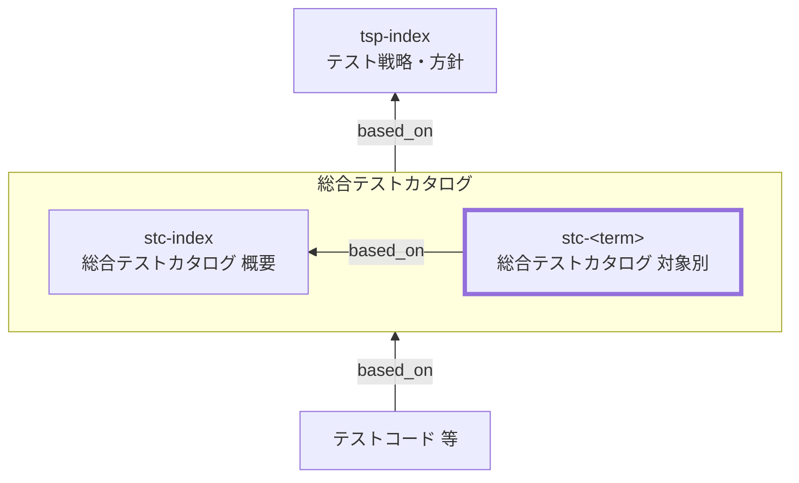

---
specdojo:
  id: specdojo:stc-rulebook
  type: rulebook
  deliverable_type: test
  status: draft
  recipe: undecided
  sample: specdojo:stc-sample
  template: undecided
---

# 総合テストカタログ 対象別 作成ルール

System Test Catalog (STC) Documentation Rules

総合テストカタログの対象別 `stc-<term>` に記載する目的・対象外・境界/環境/依存、観点×条件＝ケース、トレース、証跡の基準を定めます。共通方針は [[specdojo:stc-index-rulebook|総合テストカタログ 概要 作成ルール]] に従う `stc-index` を正本とします。

## 1. 全体方針

- **正本と責務境界**: 対象固有の情報を `stc-<term>` に集約し、共通方針（分割基準・対象外・観点/条件の立て方・環境・ケース表の共通カラム）は `stc-index` を参照して再掲しない。
- **確認の対象**: 総合テストでは、実運用に近い経路でシステム全体として業務が成立することを確かめる。
- **記載レベル**: ケースは表の1行＝1テスト（1シナリオ）とし、手順は高位の行動と観測点に寄せ、クリック列挙や画面要素の細部はテストコードへ寄せる。
- **追跡性と再現性**: すべての観点・ケースを根拠仕様（トレース）と証跡（CI・レポート・ログ相関）へ接続する。環境・テストデータ・外部依存は `stc-index` に従い、変える場合は根拠を書く。
- **確認と合意**: 目的・対象外は業務の責任者（PO・BA）と合意し、期待値・観測点・証跡は QE が、ケースとテストコードの対応は DEV が確認する。役割の割り当ては適用先のメンバー定義に、`status`・承認・改訂と廃止・未決事項の引き継ぎは [[specdojo:document-metadata-standard|ドキュメントメタ情報標準]] に従う。
- **改訂時の追従**: `stc-<term>` で目的・観点・`case_id`・`trace_key` を変えたら、テストコードと CI 証跡の参照（DEV）、`stc-index` の分配方針とトレース先仕様との対応（QE）を同じ改訂で見直す。`stc-index` の共通カラム・観点・環境前提が変わった場合は、`stc-index` の改訂担当（QE）が影響する `stc-<term>` を列挙し、各 `stc-<term>` の担当がケース表と対応するテストコードを追従させる。
- _UNDECIDED_: `recipe`・`template` の要否は未判断である（template は PJR-WYTX で扱い、recipe は QE が ready 化の判断時に決める）。sample は「本文要件」の見出し構成へ未整合であり、後続の sample の見直しで揃える。いずれも `ready` 化の前に解消する。

## 2. 位置づけ（他ドキュメントとの関係）

本書の対象は `stc-<term>` であり、`stc-index` の共通方針と `tsp-index` のテスト戦略を根拠にします。テストコードは `stc-<term>` のケースを根拠に実装します。

## 3. ファイル命名・ID規則

ID とファイル名の一般規則は [[specdojo:id-and-file-naming-standard|ドキュメントIDおよびファイル命名標準]] に従う。

- ローカル ID は `stc-<term>`（例: `stc-store-sale`）、正規 ID は `<project-id>:stc-<term>` とする。同じプロジェクト内の参照では `<project-id>:` を省略してよい。
- `<term>` は用語集の論理名キー（英小文字 kebab-case）を用いる。
- ファイル名は既定でローカル ID と同名の `stc-<term>.md` とする。日本語ファイル名は例外運用とし、使う場合は `総合テストカタログ-<対象名>.md` とする。並び順のための連番プレフィックス（`010-` 等）は任意で、ID に含めない。
- 配置先は適用先の成果物カタログで宣言した `path` に従う。
- H1 は `# 総合テストカタログ: <対象名>` とする。

## 4. 推奨 Frontmatter 項目

### 4.1. 設定内容

許可キー・必須項目・型は [[specdojo:document-metadata-standard|ドキュメントメタ情報標準]] と `docs/specdojo/schemas/v1/deliverable-frontmatter.schema.yaml` を正本とする。`specdojo.type` は `test`、`specdojo.rulebook` は `specdojo:stc-rulebook` とする。

### 4.2. 推奨ルール

- `based_on` には最低限 `tsp-index` と `stc-index` を含める。同じプロジェクト内ではローカル ID、他プロジェクトの文書は `<project-id>:<local-id>` で書く。
- 対象固有の根拠（`br-*` / `bac-*` / `spec-*` / `nfr-*` / `ac-*` / `issue-*` 等）は本文「トレース」に集約する。`based_on` にも列挙する場合は本文と整合させる。
- 内容が多く分割する場合は、`part_of` で集約ドキュメントに所属させる。

## 5. 本文要件

`stc-<term>` は以下の見出し構成を **順序固定** で配置します。

| 番号 | 見出し             | 必須 |
| ---- | ------------------ | ---- |
| 1    | 概要（`<term>`）   | ○    |
| 2    | 目的               | ○    |
| 3    | 対象外             | ○    |
| 4    | 境界/環境/依存     | ○    |
| 5    | トレース           | ○    |
| 6    | テスト観点とケース | ○    |

成果物は上表の番号・名称を `##` 見出しにする。「記述ガイド」の節番号は転記しない。「テスト観点とケース」の配下は `### 6.n. 観点: <観点>`、`#### 6.n.1. 意図`、`#### 6.n.2. 条件・ケース表` の順とする。

## 6. 記述ガイド

共通方針は `stc-index` を正本とし、本書は対象別に固有の判断だけを定める。作成後は次を順に照合して完了を確かめる。

1. `stc-index` と目的・対象外・環境/依存の扱いを照合し、例外に条件と根拠があることを確かめる。
2. 各目的に対応する観点・代表条件・重要分岐・重大例外があり、`トレース` 列の `TR-xx` がすべてトレース表に定義されていることを確かめる。
3. `case_id` が文書内で重複せず、ケースの期待値・観測点がテストコードと CI 証跡へ辿れることを確かめる。

文書の整形と Frontmatter の検査はリポジトリの検証（`lint:md`・`lint:fm`）で扱い、ケースの期待値や証跡に含めない。

### 6.1. 概要（`<term>`）

- 扱う業務シナリオ・経路を、開始条件から完了条件が想像できる形で1〜3行で書く。主要な画面・API・バッチ・イベントは任意で列挙する。
- 粒度は `stc-index` の分割基準に従う。詳細な仕様や背景はトレース先に置く。
- 良い例: 「店頭で商品を読み取り、会計を確定してレシートを発行し、在庫と売上が更新されるまでの経路」。悪い例: 「販売まわりの機能」（開始と完了が判断できない）。

### 6.2. 目的

- 保証したいことを3〜7個程度、動詞で始まる箇条書きにし、可能なら観測可能な成果（画面表示、API 応答、DB 状態、イベント、ログ相関 ID）を併記する。
- 目的は観点の上位概念であり、観点は目的を分解した切り口とする。目的に含めないものは「対象外」へ移す。
- 良い例: 「会計確定後に売上が1件だけ記録され、再送しても二重に計上されない」。悪い例: 「会計が正しく動く」（観点へ分解できず合否を判定できない）。

### 6.3. 対象外

- `stc-index` の「対象外・除外理由（共通）」と重複させず、対象固有の除外だけを示す。
- 形式は「対象外: xxx（理由: yyy、代替: zzz）」とし、代替レベル（UT/IT/ET/AT/NFR 等）を併記する。
- 例外として ST で扱う場合は、条件・根拠・環境前提（sandbox・スタブ・データ準備）を書く。

### 6.4. 境界/環境/依存

- 境界: 開始トリガ（画面・API・バッチ等）と完了条件（完了状態、発行イベント等）を書く。
- 環境・外部依存: `stc-index` の「総合テスト共通の境界/環境の扱い」に従い、対象で使う環境・テストデータの準備と後始末、依存先ごとの扱い（sandbox・スタブ・疑似応答）だけを書く。本番課金・実配送は行わない。
- 観測点: 合否を判定する対象（画面・レスポンス、DB 状態、イベント、監査ログ、相関 ID）を書く。
- 共通方針から外れる場合は、理由と再現性・費用・安全性への影響を書く。

### 6.5. トレース

根拠となる上位仕様との対応は「トレース」の表を正本とし、観点・ケース表は `trace_key`（`TR-xx`）で参照する。

| 列名        | 内容・判断条件                              |
| ----------- | ------------------------------------------- |
| `trace_key` | 観点・ケースから参照する一意なキー          |
| 仕様ID      | 根拠仕様の文書ID                            |
| 要点        | ケース作成の判断に使ったポイントを1行で示す |
| 備考        | 補足がある場合に記載する                    |

- `trace_key` は文書内で一意とし、追加順に採番する（`TR-01` 始まりの2桁を推奨）。削除しても欠番を詰めない。
- 観点・ケース表の `トレース` 列は仕様 ID を直書きせず `TR-01,TR-03` のように書く。根拠の追加時は先にトレース表へ行を追加する。

### 6.6. テスト観点とケース

ケース表のカラム・`case_id` の形式・付番は `stc-index` の「ケース表の共通カラム」に従う。本節は対象別に固有の判断だけを定める。

#### 6.6.1. 観点

- 観点は `stc-index` の「観点の立て方（共通）」に従って命名し、条件が複数ぶら下がる粒度にまとめる。
- 見出しは `観点: <観点>`（半角コロンと半角空白）とする。観点名は改善のため変更してよいが、`perspective_key` は変えない（変更が必要なら `supersedes` 等で追跡する）。
- 意図は観点ごとに「この観点で保証すること」を1〜2行で書く。

#### 6.6.2. 条件・ケース表

- 条件は `入力:` `状態:` `環境:` `経路:` の必要な要点で書き、ケースは「代表→重要分岐→重大例外」の順で増やす。
- 期待値には画面・レスポンスに加え、DB 状態・イベント・監査ログ・相関 ID などの観測点を含める。
- 証跡は CI run・レポート・ログ相関キー等へ辿れる形で書く。
- 良い例: 条件「状態: 在庫 1 個 / 経路: 会計確定を二度送信」、期待値「売上は1件、在庫は0、二度目は処理済みの応答を返す」。悪い例: 期待値「正常に会計できること」（観測点がなく合否を判定できない）。

## 7. 禁止事項

| 禁止事項                                                                       | 理由                                                       |
| ------------------------------------------------------------------------------ | ---------------------------------------------------------- |
| `stc-index` の共通方針を `stc-<term>` 側で勝手に上書きする（環境/依存/対象外） | 再現性が崩れ、レビュー・運用が困難になるため               |
| ケース表にUIクリック手順や画面要素の細部を大量に列挙する                       | 変更に弱く、意図が読めず、保守不能になるため               |
| 期待値を曖昧に書く（例：「正常に動くこと」「問題がないこと」）                 | 合否判定ができず証跡にならないため                         |
| `case_id` を変更する／再利用する                                               | トレース・証跡リンクが破壊され、履歴追跡が不能になるため   |
| `perspective_key` を観点名の修正に合わせて頻繁に変える                         | ID体系が不安定になり参照が壊れるため                       |
| 直積（全組合せ）のケースを無条件に作る                                         | ケース爆発で運用不能になるため（必要時は理由・範囲を明記） |
| トレースや証跡を持たないケースを恒久的に残す                                   | SSOTとして成立しないため（暫定は期限/理由を明記）          |
