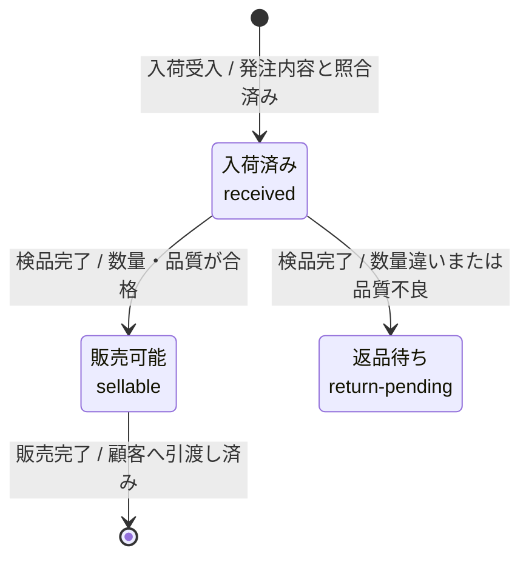
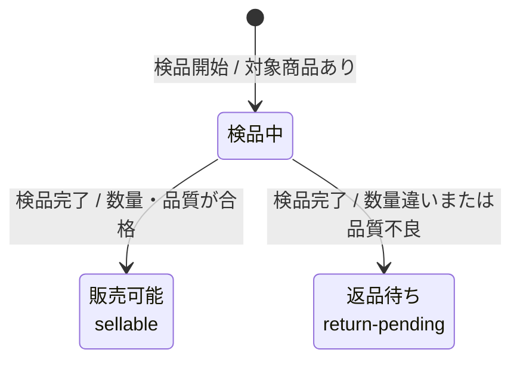

---
specdojo:
  id: specdojo:stsd-mermaid-rulebook
  type: rulebook
  deliverable_type: data
  status: draft
  target_format: markdown
  recipe: not-needed
  sample: specdojo:stsd-sample
  template: not-needed
  based_on:
    - specdojo:rulebook-authoring-standard
---

# STSD の状態遷移図を Mermaid で記述するルール

Mermaid State Diagram Rulebook for Status Definitions

STSD の「状態遷移図」を Mermaid の `stateDiagram-v2` で一貫して記述するための記法ルールです。状態の意味と成立条件は同じ STSD の「状態一覧」、各遷移の詳細は「遷移の説明」を正本とします。

## 1. 全体方針

- 一つの図は一つの業務対象の状態遷移だけを扱います。
- 状態ラベルは「表示名」の定義に従い、STSD の状態一覧にある状態名と値から構成します。
- 遷移ラベルは業務イベントと条件を示し、実装フラグ、関数、画面ページを使いません。
- 図は遷移の全体像を示し、状態の意味や条件の長い説明は図中へ埋め込みません。

## 2. 位置づけと用語定義

| 用語       | 定義                                                                                                                                                                   |
| ---------- | ---------------------------------------------------------------------------------------------------------------------------------------------------------------------- |
| 状態       | STSD の状態一覧に定義された業務状態                                                                                                                                    |
| 表示名     | 図上に表示するラベル。値がある場合は `状態名 値` の 2 行とし、1 行目は状態一覧の状態名、2 行目は状態一覧の値と完全一致させる。値が `-` の場合は状態名だけを表示する |
| `state_id` | Mermaid コード内で状態を参照する内部 ID。表示名と分けて使用し、表示する値の代わりにはしない                                                                            |
| 別名       | 表示名の状態名部分に使用する、状態一覧の状態名とは異なる名前。本 rulebook では使用しない                                                                               |
| 初期点     | ライフサイクルの開始を示す `[*]`                                                                                                                                       |
| 終了点     | ライフサイクルの終了を示す `[*]`                                                                                                                                       |
| 遷移       | `遷移元 --> 遷移先 : イベント / 条件` で示す状態変化                                                                                                                   |

分岐は疑似状態を置かず、同じ遷移元から出る複数の遷移として表します。遷移元と遷移先に使用できるのは、状態一覧にある業務状態と初期点・終了点だけです。

## 3. ファイル命名・ID規則

- 本 rulebook 単独の成果物は作成せず、`stsd-<term>.md` の「状態遷移図」に適用します。
- 状態名は日本語の名詞句にし、STSD の状態一覧と同じ表記を使います。
- イベント名は短い業務用語、条件は業務上判定可能な事実で記述します。
- 各業務状態は、状態一覧に値がある場合は `state "状態名 値" as state_id`、値が `-` の場合は `state "状態名" as state_id` で宣言します。これは別名ではありません。`state_id` は英小文字で始まる英小文字・数字・アンダースコアだけの `[a-z][a-z0-9_]*` とし、一つの Mermaid コードブロック内で一意にします。表示する値には `state_id` ではなく状態一覧の値をそのまま使います。
- 図を分割して同じ状態を複数図へ再掲する場合は、各図で `state "表示名" as state_id` を宣言し、同じ表示名と同じ `state_id` を維持します。分割図ごとに別名や異なる `state_id` を付けません。

## 4. 推奨 Frontmatter 項目

この記法ルールは STSD の一章へ包含されるため、独自の Frontmatter 項目を追加しません。STSD の `rulebook`、`status`、`based_on` などをそのまま使用します。

## 5. 本文要件

| 要素       | 必須 | 記述                                            |
| ---------- | ---- | ----------------------------------------------- |
| 宣言       | ○    | コードブロックの先頭を `stateDiagram-v2` とする |
| 業務状態   | ○    | 状態一覧の状態名・値に基づく表示名を使用する    |
| 遷移ラベル | ○    | `イベント / 条件` を記載する                    |
| 初期点     | ○    | `[*] --> 初期状態 : イベント / 条件` で示す     |
| 終了点     | 任意 | `終了状態 --> [*] : イベント / 条件` で示す     |

初期点は STSD 全体で必須とし、分割時の配置は「図の分割」に従います。終了点の要否、継続状態の扱い、省略時に「適用範囲」へ記載する内容は、[[specdojo:stsd-rulebook|ステータス定義作成ルール]] の「状態遷移図」に従います。

## 6. 記述ガイド

### 6.1. 基本構文

- 行頭は半角スペース 2 個でそろえます。
- コロンの左に遷移元と遷移先、右にイベントと条件を記載します。
- 条件が常に成立する遷移は `イベント / イベント発生時` とし、ラベルを省略しません。

### 6.2. 分岐と自己遷移

- 同じ状態・イベントから分岐する場合は、同じ遷移元から遷移先ごとに矢印を出し、各矢印へ同じイベントと相互排他的な条件を `イベント / 条件` 形式で記載します。
- 分岐を表す `<<choice>>` など、状態一覧にない疑似状態は使用しません。分岐判断の根拠は各遷移の条件と「遷移の説明」に記載します。
- 自己遷移は業務上の状態を保ったまま記録更新や再確認を行う場合だけ記載します。

次の例では、状態一覧の「検品中」の値を `-` とします。

### 6.3. 図の分割

- 状態はすべて同じ階層へ置き、親状態と下位状態を持つ複合状態は使用しません。階層化が必要な場合は、状態を持つ対象を分け、対象ごとに別の STSD を作成します。
- 業務状態が 15 を超える、遷移が 20 を超える、または一つの業務状態に接続する入出力遷移の合計が 6 を超える場合は、同じ STSD 内で図を分割します。
- 分割単位は業務フェーズまたは通常系・例外系とし、各図が扱う遷移 ID の範囲を図直前に記載します。分割した図で共有する状態は、同じ表示名と同じ `state_id` を使用します。
- 規模が閾値以下でも分割できますが、全遷移がいずれか一つの図に過不足なく対応し、図をまたぐ接続状態を明記します。
- 初期点はライフサイクルの開始遷移を扱う図に置きます。開始遷移は対応する図に一度だけ記載し、共有状態から続きを描く図には初期点を置きません。
- 到達性と終了状態・継続状態の判定は、共有状態を介して全図をつないで行います。ある図で出力遷移がなくても、他の図に出力遷移がある状態を継続状態とはみなしません。

### 6.4. 完成判定

- 状態一覧の全状態が少なくとも一つの図に登場しています。
- 図の業務状態はすべて状態一覧にあり、表示名が「表示名」の定義と一致しています。
- 終了状態は終了点 `[*]` への出力遷移を持つ状態とします。
- 初期点が一つ以上あり、各初期点から、正常系・例外系を問わず、すべての終了状態および継続状態まで遷移をたどれます。到達不能な終端は残しません。
- 状態一覧の各業務状態は、少なくとも一つの初期点から遷移をたどって到達できます。初期点から到達できない中間状態は、既存の終了状態へ接続していても残しません。
- 全遷移にイベントと条件があり、「遷移の説明」と一致しています。
- 分岐条件が重複せず、どの遷移も業務上判定できます。

## 7. 禁止事項

- 画面ページ間の移動を状態遷移として描きません。
- `if`、`&&`、`null` などの実装条件式を条件ラベルに使いません。
- enum 値、数値、フラグだけを状態名にしません。
- 状態一覧にない状態や、遷移の説明にない矢印を追加しません。
- `<<choice>>`、`<<fork>>`、`<<join>>` など、状態一覧にない疑似状態を使用しません。
- 親状態と下位状態を持つ `state` ブロックなど、複合状態を使用しません。階層化が必要な対象を一つの STSD に混在させません。
- STSD 全体から初期点を省略したり、一つのコードブロック内で同じ `state_id` を異なる状態へ割り当てたりしません。
- 分割図で共有する状態の表示名や `state_id` を図ごとに変更しません。
- 状態の意味・成立条件を図中の長文ノートへ複製しません。
