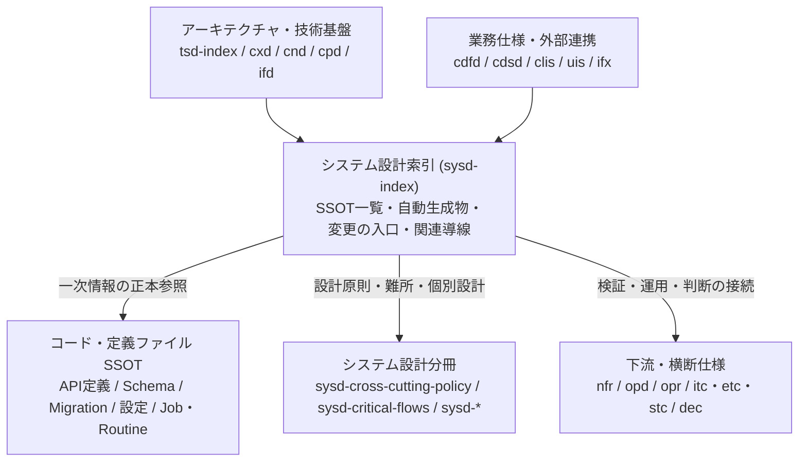

---
specdojo:
  id: specdojo:sysd-index-rulebook
  type: rulebook
  deliverable_type: architecture
  status: draft
  target_format: markdown
  recipe: not-needed
  sample: specdojo:sysd-index-sample
  template: not-needed
  based_on:
    - specdojo:rulebook-authoring-standard
---

# システム設計索引（SYSD Index）作成ルール

System Design Index (SYSD Index) Documentation Rules

システム設計情報をコードや定義ファイルへ寄せる運用（Code as Spec）を前提に、システム設計の正本（SSOT: Single Source of Truth）、自動生成物、変更の入口、関連仕様への導線を 1 箇所に集約する `sysd-index.md` の記述規約を定める。値・構文・スキーマ・実装構造の詳細は各正本へ委ね、本書では正本の所在、非該当領域の扱い、更新責任、検証経路、公開前確認の判断基準を扱う。

## 1. 全体方針

- 1 システムまたは合意したプロダクト範囲につき、システム設計の入口となる索引（`sysd-index.md`）を 1 つ置く。
- API 定義、データ契約・データベーススキーマ、モジュール境界、設定・環境変数、ジョブ・定期処理、監視・ログ・監査、ソース管理・CI/CD 境界など、設計判断と実装変更の起点になる正本（SSOT）を一覧化する。
- 対象システムに特定の構成要素（例: 常駐 HTTP API サーバー、リレーショナルデータベース、外部 APM エージェント）が存在しない場合は、行を無言で省略せず「非該当である理由」と「代替となる正本（CLI 定義、ファイルスキーマ、ローカル状態管理など）」を明記する。
- 正本から生成される派生ファイル・閲覧ビュー・ビルド成果物について、実在する生成コマンド、生成先パス、閲覧先、更新タイミングを対応付ける。
- 典型的な設計・実装変更のトリガーごとに、最初に更新する正本、追従する生成物・関連文書、および変更完了を判定する具体的な検証対象ケース・実行コマンド・期待結果を示す。
- 仕様の詳細（エンドポイント定義全文、テーブルカラム一覧、設定キー全量、ソースコード内部のクラス・関数一覧）は `sysd-index.md` に転載せず、各正本を参照する。

### 1.1. 対象者と確認する内容

| 対象者                         | 解決する課題                                               | 確認する内容                                                                       |
| ------------------------------ | ---------------------------------------------------------- | ---------------------------------------------------------------------------------- |
| アーキテクト（ARC）            | 設計情報の分散・二重管理により正本の所在が不明確になる     | システム境界、各領域の SSOT、非該当領域の根拠、周辺設計文書との構造整合            |
| 開発者（DEV）                  | 変更時にどの定義・コード・生成物を更新すべきか迷う         | 変更トリガー別の更新順序、実在する生成・検証コマンド、モジュール・スキーマの参照先 |
| 運用担当（OPS）                | 定期処理・監視・障害対応・権限境界の正本と手順を辿れない   | ジョブ・定期処理定義、ログ・証跡・保護設定の正本、運用方針（OPD）・手順（OPR）導線 |
| 業務分析担当（BA）             | 業務仕様・データフロー・外部連携と内部設計の対応が追えない | 概念データフロー図（CDFD）、CLI・画面仕様、外部インターフェース仕様（IFX）との接続 |
| プロジェクトマネージャー（PM） | 設計変更の影響範囲や未作成文書による計画リスクを見落とす   | 未作成文書・未決事項の影響範囲、変更タスクの完了判定条件、廃止文書への依存有無     |
| 品質保証担当（QE）             | 変更後の検証対象ケースや合否判定基準を特定できない         | 変更トリガーに対応するテストスイート・静的検証コマンドと期待結果（終了コード等）   |
| プロダクトオーナー（PO）       | システム構成の留保事項や公開承認の対象範囲を判断できない   | `status: draft` の留保事項、承認対象のシステム境界、公開・`ready` 昇格前の確認条件 |

## 2. 位置づけと用語定義

`sysd-index` は、技術スタックやアーキテクチャ構成図と、コード・スキーマ等の実装正本および運用・テスト仕様をつなぐシステム設計のハブとして位置づける。

| 用語         | この文書での意味                                                                                                       |
| ------------ | ---------------------------------------------------------------------------------------------------------------------- |
| SSOT（正本） | Single Source of Truth。各設計要素について最優先で更新・参照する唯一の一次情報（スキーマ、設定定義、主要実装、仕様書） |
| Code as Spec | 人手管理の設計書へ実装詳細を重複記述せず、リポジトリ内の宣言的定義ファイルや型・スキーマを仕様の正本として扱う運用方針 |
| 自動生成物   | SSOT を入力としてコマンドや CI により機械的に出力される索引、表示用ページ、静的サイト等の派生成果物                    |
| 変更の入口   | 設計・実装の変更目的（トリガー）から、最初に変更する SSOT、追従更新対象、完了検証手順を逆引きするための索引項目        |
| 非該当宣言   | 対象システムのアーキテクチャ上存在しない設計領域について、欠落ではなく対象外である理由と代替の正本を明示する記述       |

## 3. ファイル命名・ID規則

命名と配置の共通原則は [[specdojo:docs-structure-guide|ドキュメント構成ガイド]] および [[specdojo:id-and-file-naming-standard|ID・ファイル命名標準]] に従う。

- ファイル名は `sysd-index.md` とし、プロダクト文書では `docs/<lang>/product/040-system-design/sysd-index.md` に配置する。
- プロダクト文書の `id` は `sysd-index`、プロジェクト固有文書の `id` は `<project-id>:sysd-index` とする。同梱の完成例は成果物と衝突しない `specdojo:sysd-index-sample` を使う。
- 文書タイトルは Frontmatter ではなく本文先頭の H1（`# <システム名> システム設計索引（SYSD Index）` 等）に記述する。
- 略語（SSOT、SYSD、TSD、CDFD、IFX、CLIS、NFR、OPD、OPR、DEC、PJR、CPM 等）を用いる場合は、初出時または概要章で正式名称・日本語名を併記し、文書単体で意味を辿れるようにする。

## 4. 推奨 Frontmatter 項目

Frontmatter の共通原則と型制約は [[specdojo:document-metadata-standard|ドキュメントメタ情報標準]] および `docs/specdojo/schemas/v1/deliverable-frontmatter.schema.yaml` を正本とする。項目は `specdojo` キー配下に置く。

| 項目         | 必須     | 値・記述内容                                                                 |
| ------------ | -------- | ---------------------------------------------------------------------------- |
| `id`         | ○        | `sysd-index`（プロジェクト文書の場合は `<project-id>:sysd-index`）           |
| `type`       | ○        | `architecture`                                                               |
| `status`     | ○        | `draft` / `ready` / `deprecated`                                             |
| `rulebook`   | 推奨     | `specdojo:sysd-index-rulebook`                                               |
| `part_of`    | 任意     | 所属する上位アーキテクチャ文書等がある場合の文書 ID 配列                     |
| `based_on`   | 条件付き | システム境界や設計構成の直接の根拠とした上位文書（`tsd-index` 等）の ID 配列 |
| `supersedes` | 条件付き | 既存のシステム設計索引を置き換える場合の旧文書 ID 配列                       |

- `deliverable-frontmatter.schema.yaml` は `unevaluatedProperties: false` を規定しており、`title` キーは許可されないため Frontmatter に記載しない。
- `based_on` および `part_of` には実在する文書 ID のみを記載する。未作成の関連文書は Frontmatter に入れず、`未決事項・変更影響・公開前確認` 章へ記録する。

## 5. 本文要件

`template: not-needed` の系統であるため、本文の章構成と必須・条件付き必須の要件を以下のとおり定める。Markdown の `##`〜`####` には階層ごとの連番と末尾の `.` を付け、章への参照は章タイトルで示す。

| 章番号 | 章タイトル                                      | 必須・任意 | 目的と内容要件                                                                                                                          |
| ------ | ----------------------------------------------- | ---------- | --------------------------------------------------------------------------------------------------------------------------------------- |
| 1      | 概要（対象範囲・更新責任）                      | 必須       | 対象システムの範囲、Code as Spec の基本方針、ロール別（`ARC` / `DEV` / `PM` / `OPS` / `BA` / `QE` / `PO`）の更新・確認・承認責務を示す  |
| 2      | SSOT 一覧（表形式）                             | 必須       | 公開 I/F・API、データ契約・DB、モジュール境界、設定、ジョブ・定期処理、監視・ログ・保護境界等の正本パス、更新責任、検証方法を示す       |
| 3      | 自動生成物（生成コマンド/生成先/閲覧先）        | 必須       | SSOT から生成される派生ファイル・ビューの入力元、実在する生成コマンド、生成先パス、閲覧先・更新タイミング、手編集禁止の原則を示す       |
| 4      | 変更の入口（典型ケース）                        | 必須       | 代表的な変更トリガーごとに、最初に更新する SSOT、追従する生成物・関連文書、完了判定に用いる具体的な検証ケース・コマンド・期待結果を示す |
| 5      | 関連ドキュメント導線（C4 / NFR / OPD / DEC 等） | 必須       | アーキテクチャ、システム設計分冊、業務フロー、外部連携、非機能要件、運用方針・手順、テスト仕様、決定記録への導線と整備状態を示す        |
| 6      | 未決事項・変更影響・公開前確認                  | 条件付き   | 未作成文書・未決事項・他文書との不整合の影響範囲と解消条件、および `status: draft` から公開・`ready` 昇格へ進む前の確認条件を示す       |

- `未決事項・変更影響・公開前確認` 章は、文書が `status: draft` である場合、未作成の関連仕様や後続タスクへの引き継ぎ事項がある場合、またはリリース・公開前の確認基準を定義する場合に必須とする。未決事項が解消済みの場合も、公開前確認基準（各ロールの合否判定条件）を残す。

## 6. 記述ガイド

各章は次の判断基準で記述する。完成例は Frontmatter の `sample` で宣言した完成例文書を正本とし、本章には判断基準と短い対比例（良い例・悪い例）を置く。

### 6.1. 概要（対象範囲・更新責任）

- 判断基準: 対象システムの構成範囲（含む領域・含まない領域）が 1〜3 段落で分かり、更新担務（`ARC` / `DEV` / `PM` / `OPS`）だけでなく、仕様整合の確認者（`BA`）、検証・合否基準の確認者（`QE`）、およびシステム境界・留保事項の最終承認者（`PO`）の役割が明確であること。
- 文書内で使用する主要略語（SSOT、SYSD、TSD、CDFD、IFX、CLIS、NFR、OPD、OPR、DEC 等）は、この章または初出箇所で正式名称・意味を定義する。
- 良い例: 「対象は CLI 本体、静的ドキュメント生成、外部エージェント実行基盤、Git worktree 統合、定期処理（Routine / Job）である。`ARC` が全体構成と導線、`DEV` がコード・スキーマ、`PM` が実行定義、`OPS` が定期処理・保護設定の更新責任を持ち、`BA` が業務仕様・外部連携との整合確認、`QE` が検証コマンドと完了条件の合否確認、`PO` が未決事項の留保判断と `status: ready` 昇格承認を担う。」
- 悪い例: 「本システムの設計書リンク集である。担当者が適宜更新する。」対象システムの範囲、誰が何を更新・検証・承認するかが判断できない。

### 6.2. SSOT 一覧（表形式）

- 判断基準: 設計・実装・運用の各領域について「どのファイルまたは文書を正本として見ればよいか」「誰が更新責任を持つか」「どう検証するか」を一意に特定でき、存在しない領域についても非該当理由と代替の正本が明示されていること。
- 推奨列は「種別」「SSOT（正本）」「参照先」「更新責任」「検証方法・備考」とする。参照先は実在するリポジトリ相対パス（インラインコード）または実在文書の wikilink（表内では `\|` でエスケープ）で記述する。

| 確認すべき標準領域             | 記載する正本の例                                                               | 非該当の場合の記述要件                                                                                  |
| ------------------------------ | ------------------------------------------------------------------------------ | ------------------------------------------------------------------------------------------------------- |
| 公開 I/F・API（内部/外部）     | OpenAPI / AsyncAPI / GraphQL 定義、CLI コマンド定義、外部連携仕様（`ifx-*`）   | 常駐 HTTP API やイベントバスを持たない理由を明記し、CLI 定義や外部コマンド連携仕様等の代替正本を示す    |
| データ契約・DB スキーマ・移行  | `schema.prisma`、DDL / migration ファイル、JSON Schema 群、状態移行モジュール  | RDBMS を持たない理由（Git 管理下の YAML / Markdown / JSONL 永続化等）と、スキーマ検証・移行の正本を示す |
| モジュール境界・実行構成       | エントリポイント、機能別ディレクトリ境界、依存方向検査ルール、エージェント設定 | 単一バイナリやスクリプト構成の場合も、主要モジュールと責務境界の正本パスを示す                          |
| 設定・環境変数・実行既定値     | 設定ファイル、設定スキーマ、環境変数解決モジュール、コンフィグリファレンス     | ハードコード設定のみの場合も、定数定義ファイルと上書き順序の正本を示す                                  |
| バッチ・ジョブ・定期処理       | ジョブ定義（`job-*`）、定期処理定義（`rtn-*`）、スケジューラ設定、実行エンジン | 定期処理を持たない場合は「非該当（オンデマンド実行のみ）」と明記する                                    |
| 監視・ログ・監査証跡・品質評価 | 監視設定（Sentry / OpenTelemetry 等）、監査証跡スキーマ、機密検査・保護ガード  | 常駐 APM を持たない場合は、実行証跡（append-only ログ）、失敗記録、機密検査スクリプト等の代替正本を示す |
| ソース管理・CI/CD・保護境界    | Git フック定義（`lefthook.yml` 等）、ワークフロー（`.github/`）、ブランチ規約  | 手動運用の場合は、ローカル検査スクリプトとブランチ・リリース手順の正本を示す                            |

- 良い例: 「内部 HTTP / 非同期 API → 非該当（常駐 API サーバー・イベントバスを持たないローカル CLI 構成） → 公開 I/F の正本は CLI エントリ `src/specdojo.ts` および [[specdojo:command-reference|CLIコマンドリファレンス]] → `DEV` / `ARC` → `npm run typecheck`、`npm run test:unit` で検証。」
- 悪い例: API 定義や DB スキーマの行を何も書かずに省略する、または実在しない `api/openapi.yaml` を仮記入する。読み手が記載漏れか非該当かを判別できない。

### 6.3. 自動生成物（生成コマンド/生成先/閲覧先）

- 判断基準: 正本から機械生成されるすべての主要成果物について、入力元（SSOT）、実在する生成コマンド、出力先パス、閲覧方法または更新タイミングが対応付き、直接手編集してはならない境界が分かること。
- 推奨列は「生成物」「入力元（SSOT）」「生成コマンド」「生成先」「閲覧先・更新タイミング」とする。
- 生成コマンドは `package.json` の `scripts` または CLI サブコマンド定義と照合し、実在するコマンド（例: `npm run docs:generate`、`npx tsx src/specdojo.ts index build`）のみを記載する。
- 良い例: 「文書索引 → `docs/` 配下の Frontmatter・メタ情報 → `npx tsx src/specdojo.ts index build`（一括生成は `npm run docs:generate`） → `.specdojo/doc-index.json` → CLI 内部参照・リンク解決（文書追加・ID 変更時に更新、手編集禁止）。」
- 悪い例: `package.json` に存在しない `npm run docs:index` を記載する、または生成先パスを書かずに「ビルド成果物」とだけ記述する。

### 6.4. 変更の入口（典型ケース）

- 判断基準: 開発者・運用者・計画担当者が「何を変更したいか（変更トリガー）」から「最初に変更する SSOT」「追従更新する生成物・関連文書」「完了判定に使う具体的な検証対象ケース・コマンド・期待結果」をそのまま実行計画へ落とし込めること。
- 推奨列は「変更トリガー」「最初に更新する SSOT」「追従する生成物・関連文書」「検証対象ケース・実行コマンド・期待結果」とする。
- 検証欄には「代表実行を確認」「テストを通す」といった抽象表現を書かず、実行するコマンド（例: `npm run validate:schema`、`npm run test:unit`）、確認対象のテスト領域またはケース、期待される完了状態（終了コード `0`、違反 `0` 件など）を具体化する。
- 良い例: 「設定スキーマ・YAML データ契約の変更 → `docs/specdojo/schemas/v1/*.schema.yaml`、`src/shared/specdojo-config.ts` → [[specdojo:specdojo-config-reference|設定リファレンス]]、該当サンプル YAML → `npm run validate:schema` および `npm run typecheck` が終了コード `0` で通過し、`npm run test:unit` で設定読込・検証ケースが全件成功すること。」
- 悪い例: 「設定変更時 → コードとドキュメントを修正 → 代表実行で経路を検証する。」対象ファイルも完了判定基準も特定できない。

### 6.5. 関連ドキュメント導線（C4 / NFR / OPD / DEC 等）

- 判断基準: システム設計を取り巻く上下流・同階層の関連文書が体系別に整理され、実在する現行文書へのリンクと未作成文書の識別が正確に行われていること。
- 推奨列は「区分」「ドキュメント」「役割・参照目的」「状態・備考」とする。
- 実在する文書は必ず `[[id|title]]`（表内では `[[id\|title]]`）形式でリンクし、文書 ID の生文字列をそのまま放置しない。
- 未作成の文書はリンク切れ（dead wikilink）を起こさないようインラインコード `` `id` `` で表記し、状態・備考欄に `（未作成）` と代替参照先または起票状況を明記する。
- 廃止済み（`status: deprecated`）やアーカイブ・trash 配下へ移動済みの旧文書を現行導線として記載してはならない。必ず現行の後継文書（例: 旧 `cdfd-task-execution` ではなく現行の `cdfd-overview`、`cdfd-uc-schedule` 等）へ更新する。
- 良い例: 「業務データフロー（CDFD） → [[cdfd-overview\|概念データフロー図（全体概要）]]、[[cdfd-uc-register\|概念データフロー図（登録簿起票から完了まで）]]、[[cdfd-uc-schedule\|概念データフロー図（スケジュール計画から完了まで）]]、[[cdfd-uc-routine\|概念データフロー図（定期処理・自動運転）]] → 業務プロセス・データストアとシステム実行境界の対応確認 → 整備済み（旧 `cdfd-task-execution` 等は廃止済み）。」
- 悪い例: 廃止されて trash へ移動済みの文書 ID を参照し続ける、または未作成の `opd-index` を `[[opd-index]]` とリンクして検証エラーを発生させる。

### 6.6. 未決事項・変更影響・公開前確認

- 判断基準: 未作成の関連仕様、未確定の技術・運用判断、他文書に残る旧参照などの影響範囲と担当ロール・解消条件が一覧化され、さらに文書を `status: draft` から公開・`ready` 昇格へ進めるための各ロールの確認条件が明示されていること。
- 推奨列は「項目・対象」「現状と影響範囲」「担当ロール」「解消条件・次アクション」とする。
- 確定済みの仕様と未決事項を混同しないよう、必要に応じて `_TODO_:` / `_UNDECIDED_:` / `_ASSUMPTION_:` ラベルを [[specdojo:rulebook-authoring-standard|Rulebook 記述標準]] に従って使い分ける。
- 良い例: 「アーキテクチャ図（`cxd-specdojo` / `cnd-specdojo` / `cpd-specdojo-cli` / `ifd-specdojo`）未作成 → C4 レベルの視覚的な境界図が未整備であり、現状は本書の SSOT 一覧と `src/` 依存方向検査で代替している → `ARC` → カタログ定義に従い各図を作成後、本書の関連ドキュメント導線を wikilink へ更新する。」
- 悪い例: 未作成文書が複数あるにもかかわらず未決事項を記載せず、`status: draft` の承認対象や解消手順が不明なままにする。

## 7. 禁止事項

| 禁止する記述                                                                 | 理由                                                                       |
| ---------------------------------------------------------------------------- | -------------------------------------------------------------------------- |
| API エンドポイント定義、DB カラム定義、設定キー全量、内部クラス詳細の転載    | 各 SSOT（スキーマ・コード・個別仕様）との二重管理と陳腐化を招くため        |
| API・DB・監視等の標準領域を非該当理由なしに無言で省略する記述                | 記載漏れかアーキテクチャ上の非該当かを読み手やレビュアーが判別できないため |
| `package.json` や CLI に実在しないコマンド・スクリプト名の記載               | 開発者や CI が手順を実行できず、変更・検証計画が破綻するため               |
| 廃止済み（`deprecated` / trash 移動済み）文書の現行導線としての参照          | 後続タスクが誤った仕様を根拠に設計・実装してしまうため                     |
| 実在文書をリンクせず生 ID で放置する記述、または未作成文書への wikilink 設置 | 文書間の追跡性を損ない、`lint:md` / `lint:fm` のリンク解決違反になるため   |
| 「代表実行を確認」「テストを実施」等の対象・期待結果を欠いた抽象的な検証記述 | `PM` や `QE` が変更タスクの完了判定を行えないため                          |
| Frontmatter への `title` キーの記載                                          | `deliverable-frontmatter.schema.yaml` のスキーマ制約に違反するため         |
| rulebook 本文への `サンプル` 章の設置や sample / recipe / template のリンク  | 完成例は sample へ外出しし、対応関係は Frontmatter で宣言する規約のため    |

## 8. 運用ルール

- SSOT のファイルパス、スキーマ配置、生成コマンド（`package.json` の `scripts` 等）、または関連設計文書の構成・ID が変わった場合は、同一変更単位で `sysd-index.md` を更新する。
- `sysd-index.md` または本 rulebook・sample を編集した際は、`npx prettier --write` で整形したうえで、`npm run lint:md`、`npm run lint:fm`、`npm run validate:catalog`（カタログ変更を伴う場合）により見出し規約・Frontmatter・リンク整合を検証する。
- 成果物の改訂・廃止、置き換え（`supersedes`）、非推奨化（`deprecated`）および影響追跡は、[[specdojo:document-metadata-standard|ドキュメントメタ情報標準]] の「文書の改訂・廃止とライフサイクル変更管理」に従う。`ARC` はアーキテクチャ・システム設計分冊・外部連携契約、`DEV` は実装・スキーマ・生成コマンド、`OPS` は定期処理・監視・運用手順、`BA` は業務フロー・CLI 仕様、`QE` はテスト仕様と検証コマンドへの影響を確認し、`PM` が追従タスクを管理、`PO` が公開および `status: ready` への昇格・廃止を最終承認する。エージェントは人間の `PO` 承認なしに `status` を `ready` へ変更しない。
