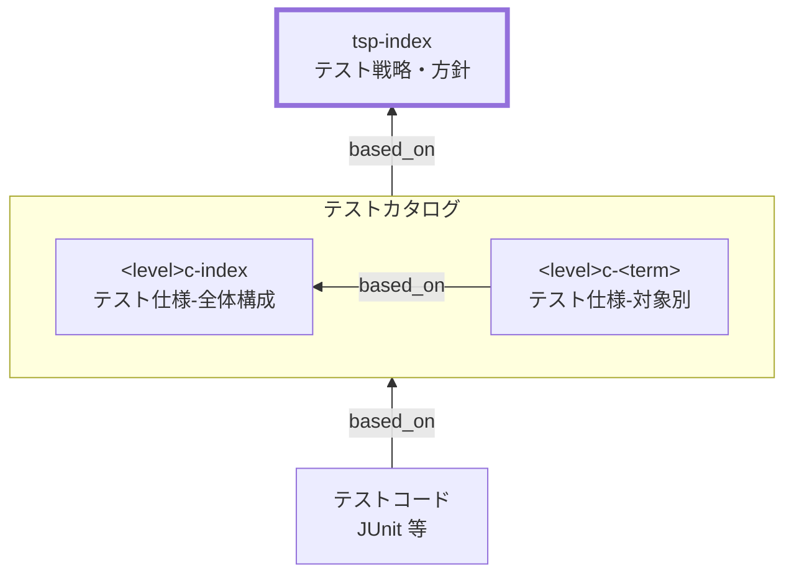

---
specdojo:
  id: specdojo:tsp-index-rulebook
  type: rulebook
  deliverable_type: test
  status: draft
  recipe: undecided
  sample: specdojo:tsp-index-sample
  template: undecided
---

# テスト戦略・方針 作成ルール

Test Strategy and Policy (TSP) Index Documentation Rules

テスト設計者・実施者・受入判断者が、各テストレベルの目的・範囲・体制と入口／出口条件（品質ゲート）を合意するための記述基準を定めます。

## 1. 全体方針

- テスト戦略は全体の考え方・分配、テスト方針は各レベル・領域での具体的な判断基準を指します。
- TSP は BAC/SAC 等を根拠に、テスト全体の方針・品質ゲート・観点/条件設計の共通原則を定義します。責務の境界は [[specdojo:test-document-scope-standard|テストドキュメントスコープ定義標準]] に従います。
- レベル共通の採用基準・分配方針は `*c-index`、対象別の観点→ケース化と証跡リンクは `*c-<term>`、具体値・網羅展開・実行結果はテストコード/CI成果物を正とします。
- 原則 `tsp-index` 1本とし、分割時は「ファイル命名・ID規則」に従います。
- 共通の記述原則・禁止事項は [[specdojo:rulebook-authoring-standard|Rulebook 記述標準]] に従います。
- **共通の運用**: 役割の割り当ては適用先のメンバー定義に、`status` の昇格と承認、改訂と廃止、未決事項の登録簿への引き継ぎは [[specdojo:document-metadata-standard|ドキュメントメタ情報標準]] に従います。文書の整形・lint はリポジトリの検証で扱い、業務の検証に含めません。

## 2. 位置づけと用語定義

### 2.1. 位置づけ（他ドキュメントとの関係）



`<level>`はテストレベル（ut:単体、it:内部結合、et:外部結合、st:総合、at:受入）

### 2.2. 用語定義

| 用語                   | 定義                                               |
| ---------------------- | -------------------------------------------------- |
| 回帰（リグレッション） | 変更後も既存機能が成立することを確認する試験       |
| スタブ                 | 対象外の依存を置き換え、決めた応答を返す代替実装   |
| モック                 | 依存の呼び出し回数・引数・順序を検証できる代替実装 |
| スモーク               | 基本動作の成立を確認する簡易試験                   |

## 3. ファイル命名・ID規則

ID 命名ルールは [[specdojo:id-and-file-naming-standard|ドキュメントIDおよびファイル命名標準]] に従います。

- `id`: 小文字ハイフン形式で `tsp-<term>` の構造とします。
  - **デフォルト: `tsp-index`** （全体方針の入口・概説）
  - 分割が必要な場合：方針の対象範囲が分かる ID を使用
    - 例: `tsp-nfr-testing`（非機能試験方針）
    - 例: `tsp-regression`（回帰方針）
  - 個別方針が多数になった場合：`tsp-index` を別途置きナビゲーション用とする（オプション）
- ファイル名は `tsp-<番号>-<短い日本語名>.md`（例: `tsp-0010-全体方針.md`）等の一意な名前を推奨。

## 4. 推奨 Frontmatter 項目

### 4.1. 設定内容

許可キー・必須項目・型制約は [[specdojo:document-metadata-standard|ドキュメントメタ情報標準]] と `docs/specdojo/schemas/v1/deliverable-frontmatter.schema.yaml` を正本とします。

- メタ情報は `specdojo:` 配下に置き、`type: test`、`rulebook: specdojo:tsp-index-rulebook` を指定します。

### 4.2. 推奨ルール

- `part_of`: 分割した個別方針から集約ドキュメント `tsp-index` を指定します。
- `based_on`: 方針の根拠となる主要仕様（BAC/NFR/SAC/DECなど）を列挙し、スコープを明確にする。

## 5. 本文構成（標準テンプレ）

各 TSP は以下の見出しを **この順で** 記載します。

1. 概要
2. テストレベル一覧（目的/範囲/体制）と観点/条件設計の共通原則
3. スコープ（対象/対象外）
4. テスト環境・テストデータ（スタブ/モック方針を含む）
5. 入口／出口条件（品質ゲート）
6. 自動化・回帰方針（任意だが推奨）
7. 不具合管理方針（任意）
8. 品質メトリクス（任意）
9. メモ / 将来課題

## 6. 記述ガイド

### 6.1. 概要

- 1〜3文で「何の品質を、どの範囲に対して、どのように担保するか（全体方針）」を書きます。
- 可能なら対象仕様（BAC/NFR/主要機能）を言及し、`based_on` と整合させます。

### 6.2. テストレベル一覧

テストレベルは **一覧表** で定義します。

#### 6.2.1. 最小（必須）

最小構成（必須）の列は次の4列です。

| 列             | 目的                                           |
| -------------- | ---------------------------------------------- |
| テストレベル   | 単体/結合/システム/受け入れ等                  |
| 目的           | そのレベルで何を保証したいか                   |
| 範囲           | 対象（例: モジュール/画面/API/バッチ/外部I/F） |
| 実施体制・備考 | テストの実施主体、ツール、自動化方針、除外など |

#### 6.2.2. 推奨（責任分界を明確化）

各レベルの責任分界は一覧表で明文化します。「目的」「範囲」「実施体制・備考」に収まらない場合は、次の推奨列を追加します。

| 列                         | 目的                       |
| -------------------------- | -------------------------- |
| 保証すること（合格の意味） | 合格によって保証できること |
| やらないこと（非目的）     | 他レベルへ委ねること       |

例（外部I/Fの責任分界）:

| テストレベル   | 保証すること（合格の意味）                                | やらないこと（非目的）                                               | 前提（下位で保証済み）              |
| -------------- | --------------------------------------------------------- | -------------------------------------------------------------------- | ----------------------------------- |
| 単体テスト     | I/Fデータの生成・変換・検証が仕様どおり                   | 実ネットワークの導通、相手側の状態差分による挙動                     | ドメイン/計算/検証の網羅            |
| 外部結合テスト | 認証・要求/応答形式とタイムアウト等の代表エラー対処が成立 | 相手側の内部整合・SLA・全機能の保証。一貫テストは導通/スモークに限定 | 内部結合で主要フローが成立          |
| 総合/受入      | BAC/SACの主要シナリオと合意範囲の外部I/Fを含むE2Eが成立   | 相手側の障害・性能・データ品質の全面保証                             | 外部結合でI/F契約と代表エラーが成立 |

#### 6.2.3. 観点/条件設計の共通原則（必須）

観点/条件は、次の原則で定義します。

| 項目     | ルール                                                                                                            | 最低限の記述要素                                                                |
| -------- | ----------------------------------------------------------------------------------------------------------------- | ------------------------------------------------------------------------------- |
| 定義粒度 | 1観点は「1つの合否命題」で定義する（1行に複数命題を混在させない）。1条件は「状態/入力の差分を表す1単位」とする。  | 観点名、条件名、期待結果を 1:1:1 で対応づける                                   |
| 分類     | 観点/条件は最低限「正常・境界・例外・状態（遷移）」で分類する。非機能や運用起因が重要な場合は追加分類を定義する。 | 分類名、採用理由、どのレベルで担保するか                                        |
| 判定軸   | 判定は「期待結果」「観測点」「合格条件」の3点で定義する。                                                         | 期待結果（何が起きるか）、観測点（どこで確認するか）、合格条件（Pass/Fail基準） |

### 6.3. スコープ（対象/対象外）

- 対象（含む）
- 対象外（除外）
- 除外の理由（任意）

例:

- 対象: 主要業務フロー（販売/発注/入荷/棚卸）、主要 API、主要バッチ
- 対象外: 外部サービス自体の SLA（外部契約に委ねる）、外部端末の物理故障

### 6.4. テスト環境・テストデータ

- 環境区分（例: 開発/内部結合/外部結合/総合/受入）と用途
- データ方針（匿名化、代表データ量、マスタの扱い）
- 外部I/Fの扱い（実接続/スタブ/モック、切り替え方針）
- 外部I/Fの範囲（導通/契約/データ内容/業務一貫性）と、どこまでを対象にするか（下表）
- スタブ/モック選択基準（共通戦略）
  - 外部I/Fは原則スタブ（契約確認目的ならサンドボックス優先）
  - 内部依存はテストレベルに応じて、単体/内部結合はモック・限定実接続、総合/受入は実接続を優先
  - タイミング/リトライ/冪等性の検証が目的なら、実接続または動的挙動を再現できるスタブを使用
  - 性能・スループット検証では実接続を基本とし、代替する場合は計測対象・誤差許容を明記

外部I/F（他システム連携）の範囲合意（チェックリスト）:

| 観点                 | 対象にしたときに確認すること（例）                                        | 備考                             |
| -------------------- | ------------------------------------------------------------------------- | -------------------------------- |
| 導通                 | 到達/認証/疎通（スモーク）                                                | ネットワーク・認証・疎通の成立   |
| 契約（コントラクト） | スキーマ、必須項目、コード値、エラー形式、タイムアウト/リトライ、冪等性等 | 外部結合での主要対象になりやすい |
| データ内容           | 生成根拠・変換・丸め/桁/NULLの扱い                                        | 主に自システム側の責務           |
| 業務一貫性           | 外部システムを含むE2E整合                                                 | 範囲を限定して合意するのが現実的 |

合意文の例:

- 外部I/Fとのテストは、外部結合で「導通＋契約（代表エラーを含む）」、総合/受入で「主要シナリオのスモーク」までを対象とする。
- 外部システムを含む業務一貫性の網羅は対象外とし、相手側の品質は契約と運用合意（SLA等）に委ねる。

### 6.5. 入口／出口条件（品質ゲート）

各レベルの開始前提・完了条件・判定根拠を次の列で定義します。

| フェーズ/テストレベル | 入口条件（開始条件） | 出口条件（完了条件）   | エビデンス（根拠）       |
| --------------------- | -------------------- | ---------------------- | ------------------------ |
| 採用する各レベル      | 前提・準備完了条件   | 合格基準・残課題の扱い | レポート・ログ・判定記録 |

- 出口条件には「未解決不具合の扱い（重大度別の許容）」を含めます。
- 非機能の出口条件は、可能なら NFR/SAC と接続します（例: 「全 NFR を満たす」）。

### 6.6. 自動化・回帰方針（任意）

- 自動化の優先領域（例: ドメインロジック、計算、バリデーション、回帰）
- 手動で行う領域（例: UX の探索、端末差異、教育/運用リハーサル）
- 回帰の基本方針（例: 変更影響のある領域は自動回帰を必須）

### 6.7. 不具合管理方針（任意）

- 重大度（例: Blocker/Critical/Major/Minor）と判断観点（業務影響/回避可否）
- 収束基準（出口条件との関係）
- 既知不具合の扱い（残課題/例外承認/ロールバック条件）

### 6.8. 品質メトリクス（任意）

合意が必要な場合のみ、最小限のメトリクスを定義します。

- 例: 自動テストの実行結果（Pass率）、主要シナリオの実施状況、重大不具合件数、性能の合否（NFR達成状況）

### 6.9. メモ / 将来課題

- 未確定の前提（例: ピーク時の定義、想定データ量、外部依存の SLA）
- 将来追加したい試験（例: DR 訓練、長期運用での監査手順、非機能の拡充）
- 未決の論点がスコープ・環境・品質ゲートのどこに影響し、決定までどう扱うかを記載します。

### 6.10. よくある誤りと対策

| 誤り                         | 対策                                            |
| ---------------------------- | ----------------------------------------------- |
| テストレベルの役割分担が曖昧 | 「目的/範囲/体制」を表で固定する                |
| スコープが書かれていない     | 「スコープ（対象/対象外）」を参照して不足を補う |
| 入口/出口条件がない          | 品質ゲート（開始/完了条件）を表で定義する       |
| 自動化の範囲が不明           | 自動化領域と手動領域を分けて記述する            |
| 不具合が残ったまま“完了”扱い | 重大度別許容と例外承認ルールを出口条件に含める  |

## 7. 禁止事項

| 項目                         | 理由                                                                       |
| ---------------------------- | -------------------------------------------------------------------------- |
| クリック/画面遷移の逐語列挙  | 業務行為・入力・期待結果として要約し、方針の判断を読み取れるようにするため |
| 個別テストケースの大量列挙   | `*c-<term>`、テストコード、CI成果物の責務であるため                        |
| 前提なしの数値（条件が不明） | 合意不能、再現不能                                                         |

## 8. サンプル（最小）

### 8.1. メタ情報

```yaml
---
specdojo:
  id: tsp-index
  type: test
  status: draft
  rulebook: specdojo:tsp-index-rulebook
---
```

### 8.2. 概要

駄菓子屋販売管理システムを単体→内部結合→外部結合→総合→受入の順に確認し、品質ゲートと BAC/SAC に対応する証跡で合否を判定する。対象範囲は「スコープ（対象/対象外）」に示す。

### 8.3. テストレベル一覧

| テストレベル   | 目的                         | 範囲                                           | 実施体制・備考                                           |
| -------------- | ---------------------------- | ---------------------------------------------- | -------------------------------------------------------- |
| 単体テスト     | ドメインロジックの正確性担保 | 計算・バリデーション・分岐                     | 開発者。自動化必須。外部I/Fはモック                      |
| 内部結合テスト | 社内モジュール連携の担保     | 画面→API→サービス→DB（テスト用）               | 開発者。主要フローの最短経路を確認                       |
| 外部結合テスト | 外部I/F境界の担保            | 決済I/F、ファイル連携（スタブ/サンドボックス） | 開発者・テスト担当。タイムアウト/リトライ/重複防止を重視 |
| 総合テスト     | E2E成立の確認                | 販売→在庫→発注→入荷→棚卸→レポート              | テスト担当・業務担当。代表データ量で実運用相当を確認     |
| 受け入れテスト | BAC/SACで合否判定            | 受入シナリオ（BAC/SAC準拠）                    | 業務担当。承認をもって完了                               |

#### 8.3.1. 観点/条件設計の共通原則（例）

| 項目     | ルール（例）                                                                                      |
| -------- | ------------------------------------------------------------------------------------------------- |
| 定義粒度 | 決済要求の妥当性を1観点とし、必須項目の欠落を1条件、検証エラー応答を期待結果とする                |
| 分類     | 正常・境界・例外・状態（遷移）を採用。決済タイムアウトは例外に分類し外部結合で担保する            |
| 判定軸   | タイムアウト後の再送で二重決済が発生しないことを、決済履歴の取引ID別件数が1件であることで判定する |

### 8.4. スコープ（対象/対象外）

- 対象（含む）
  - 販売（会計確定/取消/返品）、在庫（引当/減算/不足判定/補充/棚卸差異）、発注・入荷、レポート
  - 外部決済・帳票I/Fの正常系と代表エラー系
  - 主要非機能（性能/可用性/セキュリティ）は NFR を根拠に確認する
- 対象外（除外）
  - 外部決済事業者自体の品質（SLA/障害そのもの）
  - 端末・回線の物理故障
  - 画面文言・見た目の網羅

### 8.5. テスト環境・テストデータ（方針）

- 環境
  - 開発: 単体/一部結合（モック中心）
  - 結合: テスト用DB＋外部I/Fスタブ
  - 総合/受入: 本番相当＋外部I/Fサンドボックス（または合意した代替）
- テストデータ
  - 個人情報を含む実データは使用しない（匿名化/ダミー）
  - 総合テストで代表データ量を使用（例: 商品1,000、在庫10,000、日次売上1,000取引）
  - マスタは固定スナップショットで再現性を担保

### 8.6. 入口／出口条件（例）

| フェーズ/テストレベル | 入口条件（開始条件）                                 | 出口条件（完了条件）                                                               | エビデンス（根拠）               |
| --------------------- | ---------------------------------------------------- | ---------------------------------------------------------------------------------- | -------------------------------- |
| 単体テスト            | 対象機能の実装が完了しレビュー済                     | 失敗 0 件、Blocker/Critical 0 件                                                   | CIの単体テストレポート           |
| 内部結合テスト        | 単体テストが安定している                             | 主要フロー（販売/在庫/発注）が成立し、Blocker/Critical 0 件                        | 結合テスト結果レポート           |
| 外部結合テスト        | 外部I/F仕様が確定し、スタブ/サンドボックスが利用可能 | 正常系＋代表エラー系（タイムアウト/リトライ/重複防止）が成立し、観測点が揃っている | I/F試験結果、ログ/監視記録       |
| 総合テスト            | 結合テストが完了している                             | BACに紐づく主要シナリオが完了し、重大不具合 0 件、NFR/SACに紐づく非機能が合格      | 総合テスト結果、性能試験レポート |
| 受け入れテスト        | 総合テストの出口条件を満たす                         | 受入条件（BAC/SAC）が承認される                                                    | 受入判定記録、指摘一覧           |

### 8.7. 自動化・回帰方針（例）

- 自動化の中心は単体テストと内部結合の主要経路とする
- 販売（会計確定）/在庫引当/発注点判定は変更時の自動回帰を必須とする
- UIのE2Eは主要シナリオ最小限＋探索で補完する

### 8.8. 成果物（エビデンス）の最小セット（例）

「入口／出口条件（例）」のエビデンス列を最小セットとする。受入判定記録には承認と残課題の扱いを含める。

### 8.9. メモ / 将来課題

- ピーク時条件（同時数・データ量）の確定
- 外部決済の障害時（代替運用/ロールバック）の合意
