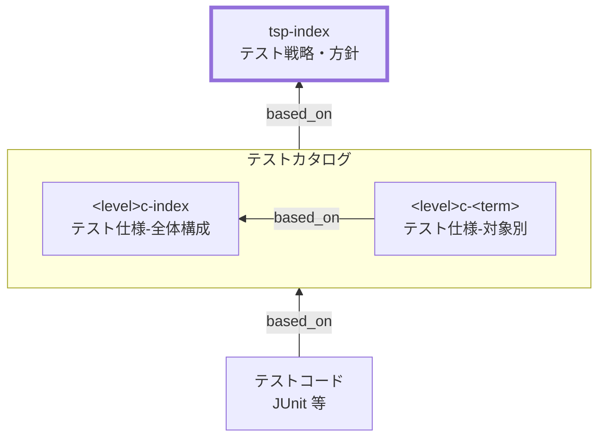

---
specdojo:
  id: specdojo:tsp-index-rulebook
  type: rulebook
  deliverable_type: test
  status: draft
  recipe: undecided
  sample: specdojo:tsp-index-sample
  template: undecided
---

# テスト戦略・方針 作成ルール

Test Strategy and Policy (TSP) Index Documentation Rules

テスト設計者・実施者・受入判断者が、各テストレベルの目的・範囲・体制と入口／出口条件（品質ゲート）を合意するための記述基準を定めます。

## 1. 全体方針

- テスト戦略は全体の考え方と各レベルへの分配、テスト方針は各レベル・領域での判断基準を指します。TSP は両方を1つの文書で扱います。
- TSP は業務受入条件（BAC）・システム受入条件（SAC）・非機能要件（NFR）を根拠に、テスト全体の方針・品質ゲート・観点/条件設計の共通原則を定義します。責務の境界は [[specdojo:test-document-scope-standard|テストドキュメントスコープ定義標準]] に従います。
- レベル共通の採用基準・分配方針は `<level>c-index`、対象別の観点→ケース化と証跡リンクは `<level>c-<term>`、具体値・網羅展開・実行結果はテストコード/CI成果物を正とし、TSP へ転記しません。
- 共通の記述原則・禁止事項は [[specdojo:rulebook-authoring-standard|Rulebook 記述標準]] に従います。
- **共通の運用**: 役割の割り当ては適用先のメンバー定義に、`status` の昇格と承認、改訂と廃止、未決事項の登録簿への引き継ぎは [[specdojo:document-metadata-standard|ドキュメントメタ情報標準]] に従います。文書の整形・lint はリポジトリの検証で扱い、業務の検証に含めません。
- **追従対象と担当**: BAC・SAC・NFR を改訂したときは、TSP の出口条件と環境の前提を見直します（担当: QE、承認: PO）。TSP を改訂したときは、`<level>c-index`・`<level>c-<term>` へ反映します（担当: QE、DEV）。担当の Role code は適用先のメンバー定義に合わせます。

## 2. 位置づけと用語定義

### 2.1. 位置づけ（他ドキュメントとの関係）

`<level>` はテストレベルを表します（ut: 単体、it: 内部結合、et: 外部結合、st: 総合、at: 受入）。TSP 本文のテストレベル名もこの5つの名称（単体テスト・内部結合テスト・外部結合テスト・総合テスト・受入テスト）に統一します。

### 2.2. 用語定義

| 用語                   | 定義                                                                                            |
| ---------------------- | ----------------------------------------------------------------------------------------------- |
| BAC                    | 業務受入条件。[[specdojo:bac-rulebook\|業務受入条件 作成ルール]] に従う成果物                   |
| SAC                    | システム受入条件。[[specdojo:sac-rulebook\|システム受入条件仕様（SAC）作成ルール]] に従う成果物 |
| NFR                    | 非機能要件。[[specdojo:nfr-index-rulebook\|非機能要件インデックス 作成ルール]] に従う成果物     |
| 回帰（リグレッション） | 変更後も既存機能が成立することを確認するテスト                                                  |
| スタブ                 | 対象外の依存を置き換え、決めた応答を返す代替実装                                                |
| モック                 | 依存の呼び出し回数・引数・順序を検証できる代替実装                                              |
| スモーク               | 基本動作の成立を確認する簡易テスト                                                              |

## 3. ファイル命名・ID規則

ID 命名ルールは [[specdojo:id-and-file-naming-standard|ドキュメントIDおよびファイル命名標準]] に従います。

- `id` は小文字ハイフン形式の `tsp-<term>` とし、既定は `tsp-index` の1本とします。
- `tsp-index` は分割の有無にかかわらず全体方針（本文要件の全必須章）を保持します。ナビゲーション専用の文書にはしません。
- 非機能テストや回帰など、独立して合意・更新する方針だけを個別方針として分割し、対象範囲が分かる ID を付けます（例: `tsp-nfr-testing`、`tsp-regression`）。分割した場合は `tsp-index` の該当章に要約と個別方針への参照を残します。
- ファイル名は `<id>.md` とし、配置は成果物カタログの宣言に合わせます。

## 4. 推奨 Frontmatter 項目

### 4.1. 設定内容

許可キー・必須項目・型制約は [[specdojo:document-metadata-standard|ドキュメントメタ情報標準]] と `docs/specdojo/schemas/v1/deliverable-frontmatter.schema.yaml` を正本とします。

- メタ情報は `specdojo:` 配下に置き、`type: test`、`rulebook: specdojo:tsp-index-rulebook` を指定します。

### 4.2. 推奨ルール

- `part_of`: 分割した個別方針から `tsp-index` を指定します。
- `based_on`: 方針の根拠となる BAC・SAC・NFR などの主要仕様を列挙し、スコープの根拠を明確にします。

## 5. 本文要件

本文は次の見出しを **この順で** 配置します。

| 章                                        | 必須 | 内容・受入条件                                                                                                      |
| ----------------------------------------- | ---- | ------------------------------------------------------------------------------------------------------------------- |
| 概要                                      | ○    | 何の品質を、どの範囲に対して、どう担保するかを1〜3文で示し、`based_on` の根拠仕様と整合すること                     |
| テストレベル一覧と観点/条件設計の共通原則 | ○    | 採用するレベルごとに目的・範囲・実施体制を表で示し、観点/条件の定義粒度・分類・判定軸の共通原則を定めること         |
| スコープ（対象/対象外）                   | ○    | 対象と対象外を列挙し、対象外には委ねる先（契約・運用合意・他レベル等）を示すこと                                    |
| テスト環境・テストデータ                  | ○    | 環境区分と用途、データ方針、外部I/Fの扱いと範囲、スタブ/モックの選択基準を示すこと                                  |
| 入口／出口条件（品質ゲート）              | ○    | 採用する全レベルについて、入口条件・出口条件・エビデンス・判定者を表で示し、出口条件が pass / fail を判定できること |
| 自動化・回帰方針                          | 推奨 | 自動化する領域・手動で行う領域・回帰の必須範囲を示すこと                                                            |
| 不具合管理方針                            | 任意 | 重大度の区分と判断観点、収束基準、既知不具合の扱いと例外承認者を示すこと。出口条件で重大度を使う場合は必須とする    |
| 品質メトリクス                            | 任意 | 合意が必要な場合に限り、指標と目標値・判定時点を示すこと                                                            |
| メモ / 将来課題                           | 任意 | 未確定の前提と将来追加するテストを、影響する章と決定までの扱いとともに示すこと                                      |

### 5.1. テストレベル一覧の列

| 列                         | 必須 | 内容                                                       |
| -------------------------- | ---- | ---------------------------------------------------------- |
| テストレベル               | ○    | 「位置づけ」で定めた5つの名称のうち採用するもの            |
| 目的                       | ○    | そのレベルで何を保証するか                                 |
| 範囲                       | ○    | 対象（例: モジュール/画面/API/バッチ/外部I/F）             |
| 実施体制・備考             | ○    | 実施主体（Role code または組織定義の役割名）、ツール、除外 |
| 保証すること（合格の意味） | 推奨 | 合格によって保証できること                                 |
| やらないこと（非目的）     | 推奨 | 他レベルへ委ねること                                       |
| 前提（下位で保証済み）     | 推奨 | 下位レベルの合格で成立済みとみなす事項                     |

推奨列は、外部I/Fなどでレベル間の責任分界が「目的」「範囲」に収まらない場合に追加します。

### 5.2. 観点/条件設計の共通原則

| 項目     | ルール                                                                                                            | 最低限の記述要素                                                                |
| -------- | ----------------------------------------------------------------------------------------------------------------- | ------------------------------------------------------------------------------- |
| 定義粒度 | 1観点は「1つの合否命題」とし、1行に複数命題を混在させない。1条件は「状態/入力の差分を表す1単位」とする。          | 観点名、条件名、期待結果を 1:1:1 で対応づける                                   |
| 分類     | 観点/条件は最低限「正常・境界・例外・状態（遷移）」で分類する。非機能や運用起因が重要な場合は追加分類を定義する。 | 分類名、採用理由、どのレベルで担保するか                                        |
| 判定軸   | 判定は「期待結果」「観測点」「合格条件」の3点で定義する。                                                         | 期待結果（何が起きるか）、観測点（どこで確認するか）、合格条件（Pass/Fail基準） |

### 5.3. 入口／出口条件の列と判定要件

| 列                   | 内容                                                                        |
| -------------------- | --------------------------------------------------------------------------- |
| テストレベル         | 採用する各レベル                                                            |
| 入口条件（開始条件） | 開始してよい前提・準備完了条件                                              |
| 出口条件（完了条件） | 合格基準と、未解決不具合の重大度別の許容件数                                |
| エビデンス（根拠）   | 判定に使うレポート・ログ・判定記録                                          |
| 判定者               | 出口を判定する Role code。例外承認がある場合は例外承認者の Role code も示す |

- 出口条件は件数・重大度の上限・合格率など、エビデンスから pass / fail を判定できる表現にします。
- 非機能の出口条件は、根拠となる NFR・SAC の ID と合格基準に接続します。接続できる要求がない場合は、代わりの合格基準（指標・閾値・測定条件）と、その基準を採る根拠・合意者を記載します。
- 重大度別の許容に例外を設ける場合は、例外を承認する Role code と、承認時に残課題をどこへ引き継ぐかを示します。

## 6. 記述ガイド

完成例の全体像は Frontmatter の `sample` で宣言された sample を参照してください。各章の記述では次の判断基準と良い例・悪い例に従います。

### 6.1. 概要

- 判断基準: 対象システム、担保する品質、レベルの進め方、合否の根拠を読み取れるかで判断します。範囲の詳細は「スコープ（対象/対象外）」に任せます。
- **良い例**: 「駄菓子屋販売管理システムを単体→内部結合→外部結合→総合→受入の順に確認し、各レベルの品質ゲートと BAC/SAC に対応する証跡で合否を判定する。」
- **悪い例**: 「システムを十分にテストする。」（何をどの根拠で判定するかが分からない）

### 6.2. テストレベル一覧と観点/条件設計の共通原則

- 判断基準: 隣り合うレベルで目的や範囲が重なっていないか、重なる場合に「やらないこと」で委ね先が示されているかで判断します。共通原則は対象別カタログで観点を立てるときに迷わない具体さで書きます。
- **良い例**: 「外部結合テスト ／ 外部I/F境界の担保 ／ レシート印刷コマンド連携・復元用保管サービス（検証用領域） ／ DEV・QE。タイムアウト時の再送で二重印刷や保管漏れが起きないことを重視」
- **悪い例**: 「結合テスト ／ 連携の確認 ／ 全体 ／ 担当者」（内部結合と外部結合の区別がなく、範囲と実施主体が特定できない）

### 6.3. スコープ（対象/対象外）

- 判断基準: 対象外の各項目に、品質をだれが・何で担保するか（外部契約、運用合意、他レベル）が添えられているかで判断します。
- **良い例**: 「対象外: 復元用保管サービス自体の可用性（提供事業者の提供条件に委ね、障害時の業務継続は運用手順で扱う）」
- **悪い例**: 「対象外: 外部システム」（何を除外し、だれが担保するかが分からない）

### 6.4. テスト環境・テストデータ

- 判断基準: 環境ごとに外部I/Fを実接続・スタブ・サンドボックスのどれで扱うか、データの再現性と個人情報の扱いが決まっているかで判断します。
- スタブ/モックの選択基準は次を既定とし、外れる場合は理由を書きます。
  - 外部I/Fは原則スタブとし、契約確認が目的ならサンドボックスを優先する。
  - 単体/内部結合はモック・限定実接続、総合/受入は実接続を優先する。
  - タイミング・リトライ・冪等性・性能の検証では、実接続または動的挙動を再現できるスタブを使い、代替する場合は計測対象と誤差許容を明記する。
- 外部I/Fは「導通」「契約（スキーマ・コード値・エラー形式・タイムアウト/リトライ・冪等性）」「データ内容」「業務一貫性」のどこまでをどのレベルで扱うかを合意文で示します。
- **良い例**: 「外部I/Fは外部結合で導通＋契約（代表エラーを含む）、総合/受入で主要シナリオのスモークまでを対象とし、外部システムを含む業務一貫性の網羅は対象外とする。」
- **悪い例**: 「外部I/Fは適宜スタブを使う。」（どのレベルで何を確認するかが判定できない）

### 6.5. 入口／出口条件（品質ゲート）

- 判断基準: 表の各行だけで、判定者がエビデンスを見て pass / fail を決められるかで判断します。
- **良い例**: 「総合テスト ／ 外部結合の出口条件を満たす ／ BAC に紐づく主要シナリオがすべて合格、Blocker/Critical 0 件、SAC の応答時間基準を満たす ／ 総合テスト結果、性能テストレポート ／ 判定: QE、例外承認: PM」
- **悪い例**: 「総合テスト ／ 準備ができたら ／ 品質が十分 ／ 結果報告」（開始・完了の基準も判定者もない）

### 6.6. 自動化・回帰方針

- 判断基準: 変更時に回帰を必須とする領域が名指しされ、手動に残す領域とその理由が分かるかで判断します。
- **良い例**: 「会計確定・在庫引当・発注点判定は変更時の自動回帰を必須とし、UI の E2E は主要シナリオに限って探索テストで補う。」
- **悪い例**: 「可能な限り自動化する。」（どこを必須にするかが決まらない）

### 6.7. 不具合管理方針

- 判断基準: 重大度の区分が業務影響と回避可否で判断でき、出口条件の許容件数と対応しているかで判断します。
- **良い例**: 「Critical: 会計確定ができず回避手段がない。総合テストの出口では 0 件。既知不具合を残す場合は PM が例外承認し、課題管理簿へ引き継ぐ。」
- **悪い例**: 「重大な不具合は直してからリリースする。」（重大の基準も例外の承認者もない）

### 6.8. 品質メトリクス

- 判断基準: 指標ごとに目標値と判定時点があり、出口条件と矛盾しないかで判断します。合意が要らない指標は置きません。
- **良い例**: 「主要シナリオの実施率: 総合テスト出口時点で 100%」
- **悪い例**: 「テストのカバレッジを高める。」（目標値と判定時点がない）

### 6.9. メモ / 将来課題

- 判断基準: 未決の論点ごとに、影響する章と決定までの扱いが書かれているかで判断します。
- **良い例**: 「`_UNDECIDED_`: ピーク時の同時会計数。決まるまで総合テストの性能条件は日次売上1,000取引で仮置きする（入口／出口条件に影響）。」
- **悪い例**: 「性能は後で考える。」（どの章の判定に影響し、それまでどう扱うかが分からない）

## 7. 禁止事項

| 項目                         | 理由                                                                       |
| ---------------------------- | -------------------------------------------------------------------------- |
| クリック/画面遷移の逐語列挙  | 業務行為・入力・期待結果として要約し、方針の判断を読み取れるようにするため |
| 個別テストケースの大量列挙   | `<level>c-<term>`、テストコード、CI成果物の責務であるため                  |
| 前提なしの数値（条件が不明） | 合意不能、再現不能                                                         |
| 判定者のない出口条件         | 品質ゲートを通過したかをだれが決めるかが定まらず、合意対象にならないため   |
