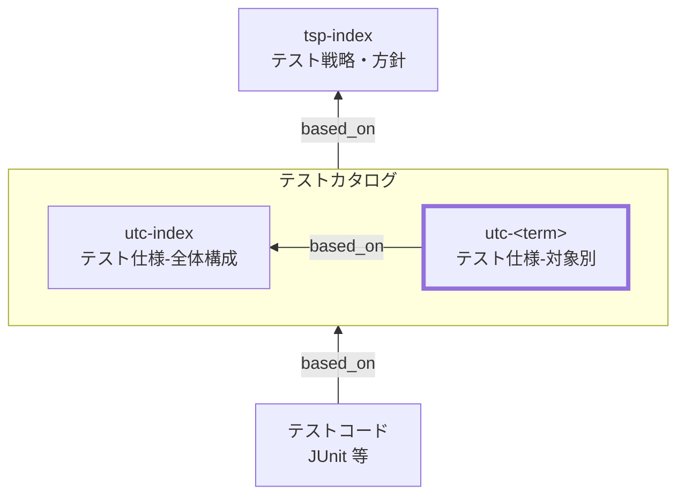

---
specdojo:
  id: specdojo:utc-rulebook
  type: rulebook
  deliverable_type: test
  status: draft
  recipe: undecided
  sample: specdojo:utc-sample
  template: undecided
---

# 単体テストカタログ 対象別 作成ルール

Unit Test Catalog (UTC) Documentation Rules

単体テストカタログ（UTC）の対象別 `utc-<term>` に記載する責務・境界・依存、観点×条件＝ケース、トレース、証跡の基準を定めます。

## 1. 全体方針

- **正本と責務境界**: 対象固有の情報を `utc-<term>` に集約し、共通方針は `utc-index` を参照する。
- **決定性**: 対象の責務を決定的に検証するため、実DB／実通信／実UIを原則排除する。例外は条件と根拠を示す。
- **記載レベル**: ケースは表の1行＝1テストとし、判定可能な手順・期待値を書く。大量のデータや詳細な操作はテストコードへ寄せる。
- **追跡性**: すべての観点・ケースを根拠仕様とテストコード／CI証跡へ接続する。
- **共通の運用**: 役割の割り当ては適用先のメンバー定義に、`status`・承認・改訂と廃止・未決事項の引き継ぎは [[specdojo:document-metadata-standard|ドキュメントメタ情報標準]] に従う。文書の整形・lint はリポジトリの検証で扱い、業務の受入確認に含めない。
- **改訂時の追従**: `utc-<term>` で責務・観点・`case_id`・`trace_key` を変えたら、テストコード、CI証跡の参照、`utc-index` の分配方針、トレース先仕様との対応を同じ改訂で見直す。`case_id` を廃止する場合は欠番として残し、対応するテストコードを削除または移管する。
- _UNDECIDED_: `recipe`・`template` の要否は未判断である（template は PJR-WYTX で扱う）。sample は「本文要件」の見出し構成へ未整合であり、後続の sample の見直しで揃える。いずれも ready 化前に解消する。

## 2. 位置づけ（他ドキュメントとの関係）

## 3. ファイル命名・ID規則

- `id` は `utc-<term>`（kebab-case。例: `utc-inventory`）。
- ファイル名は `utc-010-単体テストカタログ-<term>.md` 等（例: `utc-010-単体テストカタログ-在庫.md`）。
- `<term>` は用語集(GL)の論理名キー（英小文字kebab-case）を用いる。表示名は H1 / ファイル名で日本語を使用してよい。

## 4. 推奨 Frontmatter 項目

### 4.1. 設定内容

許可キー・必須項目・型は [[specdojo:document-metadata-standard|ドキュメントメタ情報標準]] と `docs/specdojo/schemas/v1/deliverable-frontmatter.schema.yaml` を正本とする。`specdojo.type` は `test`、`specdojo.rulebook` は `specdojo:utc-rulebook` とする。タイトルは H1 に `単体テストカタログ: <対象名>` と記載する。

### 4.2. 推奨ルール

- `based_on` は観点の根拠仕様を列挙し、原則 `[tsp-index, utc-index]` を最低限とする。
- 対象固有の根拠（`br-*` / `bac-*` / `spec-*` / `nfr-*` 等）は本文「トレース」に集約する。機械処理のため `based_on` にも列挙する場合は本文と整合させる。
- 内容が多く分割する場合は、`part_of` で集約ドキュメントに所属させる。

## 5. 本文要件

個別 UTC（`utc-<term>`）は以下の見出し構成を **順序固定** で配置します。

| 番号 | 見出し             | 必須 |
| ---- | ------------------ | ---- |
| 1    | 概要（`<term>`）   | ○    |
| 2    | 責務               | ○    |
| 3    | 対象外             | ○    |
| 4    | 境界/依存          | ○    |
| 5    | トレース           | ○    |
| 6    | テスト観点とケース | ○    |

成果物は上表の番号・名称を `##` 見出しにする。「記述ガイド」の節番号は転記しない。「テスト観点とケース」の配下は `### 6.n. 観点: <観点>`、`#### 6.n.1. 意図`、`#### 6.n.2. 条件・ケース表` の順とする。

## 6. 記述ガイド

共通方針は `utc-index` を正本とし、本書は対象別に固有の判断だけを定める。受入確認では次を順に照合する。

1. `utc-index` と責務・対象外・依存の扱いを照合し、例外に条件と根拠があることを確かめる。
2. 各責務に対応する観点・代表条件・境界条件・重大例外と、トレース先の仕様が一致することを確かめる。
3. ケースの条件・手順・期待値・観測点をテストコードと照合し、依存を制御して同じ合否を再現でき、CI証跡へ辿れることを確かめる。

### 6.1. 概要（`<term>`）

- 対象を責務のまとまりとして1〜3行で説明し、レビューア・実装者・テスト実装者が前提を把握できるようにする。
- 粒度は `utc-index` の分割基準に従う。詳細な仕様や背景はトレース先に置く。
- 良い例: 「売上登録サービス。買い物かごの明細から合計金額を計算し、在庫を引き当てて売上を確定する」。悪い例: 「売上関連の処理」（責務の境目が判断できない）。

### 6.2. 責務

- 保証すべき責務を3〜7個程度、動詞で始まる箇条書きにする（例: 入力を検証する／業務ルールを適用する／状態遷移を行う／エラーコードを返す）。
- 戻り値・例外・状態更新・依存呼び出しなど観測可能な成果を可能なら併記する。責務に含めないものは「対象外」へ移す。
- 良い例: 「在庫が不足する明細があれば `OutOfStockError` を返し、売上を確定しない」。悪い例: 「在庫を適切に扱う」（観測点がなく観点へ分解できない）。

### 6.3. 対象外

- `utc-index` の「対象外・除外理由（共通）」と重複させず、別モジュール・別termの責務など対象固有の除外だけを示す。
- 形式は「対象外: xxx（理由: yyy、代替: zzz）」を推奨し、代替レベル（IT/ET/E2E/NFR等）を併記する。
- UTで扱う例外には条件・根拠・依存の制御方法（Mock等）を書く。

### 6.4. 境界/依存

- 境界は対象の入口／出口（公開API、関数、クラス、モジュール）を示す。
- 依存の扱いは `utc-index` の「単体テスト共通の境界/依存の扱い」に従い、対象で使う依存と制御方法（例: 時刻は固定クロック注入）だけを書く。
- 共通方針から外れる場合は、理由と再現性・速度・保守性への影響を書く。

### 6.5. トレース

根拠となる上位仕様との対応は「トレース」の表を正本とし、観点・ケース表は `trace_key`（`TR-xx`）で参照する。

| 列名        | 内容・判断条件                              |
| ----------- | ------------------------------------------- |
| `trace_key` | 観点・ケースから参照する一意なキー          |
| 仕様ID      | 根拠仕様の文書ID                            |
| 要点        | ケース作成の判断に使ったポイントを1行で示す |
| 備考        | 補足がある場合に記載する                    |

- `trace_key` は文書内で一意とし、追加順に採番する（`TR-01` 始まりの2桁を推奨）。並べ替えや削除で振り直さず、欠番を詰めない。
- 仕様IDの改名・統合・分割でもキーを維持し、対応先を更新する。
- 観点・ケース表の `トレース` 列は仕様IDを直書きせず `TR-02` / `TR-01,TR-03` のように記載する。根拠の追加時は先にトレース表へ行を追加する。

### 6.6. テスト観点とケース

ケース表のカラム・`case_id` の形式・付番は `utc-index` の「ケース表の共通カラム」に従う。本節は対象別に固有の判断だけを定める。

#### 6.6.1. 観点

- 観点は `utc-index` の「観点の立て方（共通）」に従って命名し、条件が複数ぶら下がる粒度にまとめる。
- 見出しは `観点: <観点>`（半角コロンと半角空白）とする。観点名は改善のため変更してよいが、`perspective_key` は変えない（変更が必要なら `supersedes` 等で追跡する）。
- 意図は観点ごとに「この観点で保証すること」を1〜2行で書く。

#### 6.6.2. 条件・ケース表

- ケースは「代表→境界→重大例外」の順で増やし、直積（全組合せ）を避ける。
- 手順は API・関数呼び出し等の抽象手順で書き、期待値には観測点（戻り値・例外・状態・依存呼び出し）を含める。
- 証跡はテストコードのパスとCI実行結果へ辿れる形で書く。
- 良い例: 条件「入力: 在庫 0 の商品を 1 個」、期待値「`OutOfStockError` を返し、在庫は変化しない」。悪い例: 期待値「エラーにならないこと」（合否を判定できない）。

## 7. 禁止事項

| 禁止事項                                                                             | 理由                                                       |
| ------------------------------------------------------------------------------------ | ---------------------------------------------------------- |
| `utc-index` の共通方針を `utc-<term>` 側で勝手に上書きする（依存の扱い・対象外など） | UT全体の一貫性が崩れ、レビュー・保守が困難になるため       |
| ケース表にUIクリック手順を大量に列挙する                                             | 意図が読めず変更に弱くなるため（UTの責務逸脱）             |
| 期待値を曖昧に書く（例: 「エラーにならないこと」「正常に動くこと」）                 | 合否判定ができず証跡にならないため                         |
| `case_id` を変更する／再利用する                                                     | トレース・証跡リンクが破壊され、履歴追跡が不能になるため   |
| `perspective_key` を観点名の修正に合わせて頻繁に変える                               | ID体系が不安定になり参照が壊れるため                       |
| 直積（全組合せ）のケースを無条件に作る                                               | ケース爆発で運用不能になるため（必要時は理由・範囲を明記） |
| トレースや証跡を持たないケースを恒久的に残す                                         | SSOTとして成立しないため（例外は暫定として明記）           |
