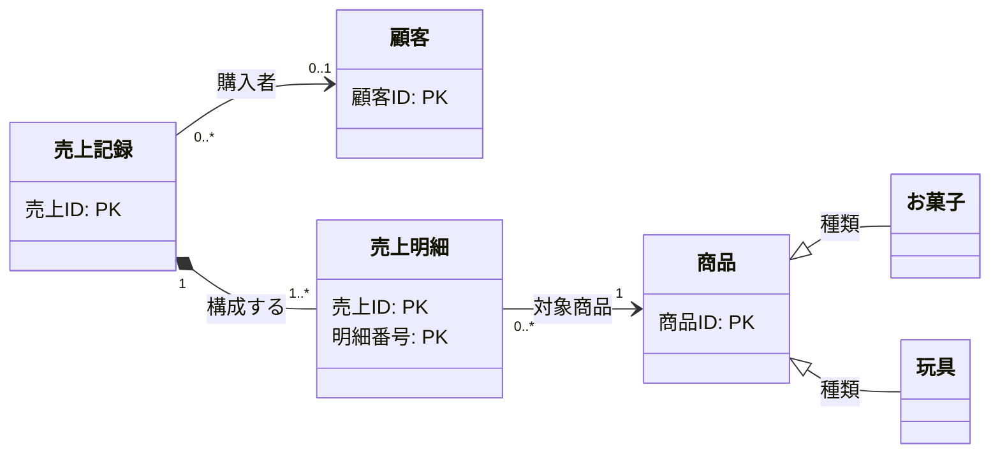

---
specdojo:
  id: specdojo:ccd-sample
  type: data
  status: draft
  rulebook: specdojo:ccd-mermaid-rulebook
---

# 概念クラス図 サンプル

## 1. 目的と適用範囲

駄菓子屋きぬやの店主代表と開発担当が、販売した商品と購入者を同じ単位で追跡できるよう、商品・顧客・売上記録・売上明細の識別と関連を定義する。技術メンターは設計時の管理単位の確認に、同行レビュー担当はキーと関連の整合性確認に用いる。

### 1.1. 対象領域と扱う時点

- 単一店舗の店頭販売を対象とし、確定済みの売上記録を扱う。入力途中・取消済みの取引は含めない。会計確定までの操作は [[specdojo:clis-sample|販売管理 CLI 仕様]] を参照する。
- 商品は販売する種類の単位で管理し、一個ずつの現物とは区別する。商品・売上記録・売上明細の業務上の意味は [[specdojo:bdd-sample|業務データ辞書（駄菓子屋の販売管理）]] に従う。
- 在庫、発注、つけ残高の集計、決済サービスの応答は対象外とする。購入者との関連は扱うが、代金回収の履歴は本図に含めない。

### 1.2. 識別と辞書の境界

図には主キーを示し、販売単価・数量などの定義の正本は販売管理の辞書とその参照先とする。顧客台帳と商品の特殊化については、既存辞書で確認できた対応と未照合の範囲を「参照業務データ辞書」に示す。

## 2. 概念クラス図

お菓子と玩具は商品の下位概念であり、商品IDを継承する。同じ商品の別レコードを作る意味ではなく、独立した主キーは追加しない。特殊化の辞書定義は未照合である。

## 3. 関連定義と多重度の根拠

### 3.1. 関連ごとの成立条件

多重度は図の起点側・先側の順に示す。

| 関連（起点 - 先）   | 関係種別 | 多重度           | 役割名   | 業務上の理由・根拠                                                                                                                                                                      |
| ------------------- | -------- | ---------------- | -------- | --------------------------------------------------------------------------------------------------------------------------------------------------------------------------------------- |
| 商品 - お菓子       | 継承     | —                | 種類     | お菓子は販売対象の商品として識別・参照される種類であり、売上明細との関連も引き継ぐ。商品の構成部品ではない。                                                                            |
| 商品 - 玩具         | 継承     | —                | 種類     | 玩具も商品として販売・追跡する種類であり、商品と別の識別単位を設けない。お菓子と玩具の分類境界は辞書整備時に確認する。                                                                  |
| 売上記録 - 売上明細 | 親子     | `1` 対 `1..*`    | 構成する | 明細は必ず一つの売上記録に属し、単独で管理しない。確定済み売上には一行以上必要で、複数商品の購入では複数行になる。入力途中の明細0件は対象時点の外にある。                               |
| 売上明細 - 商品     | 参照     | `0..*` 対 `1`    | 対象商品 | 明細一行の販売対象は必ず一つの商品。同じ商品は複数の販売・明細に現れ、未販売の商品も管理するため、商品に対応する明細は0件以上となる。商品は売上とは別の管理単位として残す。             |
| 売上記録 - 顧客     | 参照     | `0..*` 対 `0..1` | 購入者   | 一回の販売で特定する購入者は一人まで。一見客の現金販売では特定しない。顧客は購入前に登録でき、繰り返し購入できるため、対応する売上は0件以上となる。つけ販売の必須条件は次節で限定する。 |

### 3.2. 図だけでは表せない整合性条件

- 売上明細は売上IDと明細番号の組で一意にする。明細番号は別の売上で再利用でき、商品IDだけで明細をまとめない。同じ商品を複数行で販売しても各行を識別できる。
- 売上明細の参照先商品と、購入者を指定した売上の参照先顧客が存在することを確認する。過去の販売を追跡できるよう、商品の名称・価格の変更によって参照先の識別を変えない。親子の線は業務上の所属を表し、保存ファイルの削除連動は定めない。
- 売上と顧客の任意関連は全販売に対する許容範囲である。[[specdojo:bdd-sample|業務データ辞書（駄菓子屋の販売管理）]] の売上記録に従い、つけ販売では請求先の顧客を必須とする。購入者未指定を現金販売と読み替えない。

## 4. 参照業務データ辞書

作成済み辞書と照合したキーの対応を示す。「未定義」は既存辞書に該当する概念がない状態、「未作成」は参照予定の辞書自体がない状態を表す。

| エンティティ | 主キーの対応                                                                                       | 参照先業務データ辞書                                                                                           |
| ------------ | -------------------------------------------------------------------------------------------------- | -------------------------------------------------------------------------------------------------------------- |
| 商品         | 商品ID → `product_id`。店舗で管理する商品の範囲で一意                                              | [[specdojo:bdd-sample\|業務データ辞書（駄菓子屋の販売管理）]] の商品                                           |
| お菓子・玩具 | 商品の `product_id` を継承。商品全体と同じ識別範囲を使い、種類ごとに同じIDを別商品へ割り当てない   | [[specdojo:bdd-sample\|業務データ辞書（駄菓子屋の販売管理）]] の商品キーのみ照合済み。下位概念は未定義         |
| 顧客         | 顧客ID → 売上記録の参照項目 `customer_id`。顧客台帳内で一意とする想定だが、台帳のキーは未照合      | 予定 ID `specdojo:bdd-customer`（未作成）。既存の [[specdojo:bdd-sample\|販売管理の辞書]] では顧客台帳は対象外 |
| 売上記録     | 売上ID → `sale_id`。店舗の販売全体で一意                                                           | [[specdojo:bdd-sample\|業務データ辞書（駄菓子屋の販売管理）]] の売上記録                                       |
| 売上明細     | 売上ID・明細番号 → `sale_id`・`line_number` の複合主キー。明細番号単独の一意性は一回の販売内に限る | [[specdojo:bdd-sample\|業務データ辞書（駄菓子屋の販売管理）]] の売上明細                                       |

## 5. 未解決事項

| 論点                   | 影響・現在の扱い                                                                                                                                                              | 解消責務・確認条件                                                                                                                                                              |
| ---------------------- | ----------------------------------------------------------------------------------------------------------------------------------------------------------------------------- | ------------------------------------------------------------------------------------------------------------------------------------------------------------------------------- |
| 商品の特殊化の辞書定義 | 商品キーとの対応は確認済みだが、お菓子・玩具の分類境界は既存辞書で未定義。図の継承は維持し、分類の網羅性・排他性は断定しない                                                  | 開発担当が辞書への定義追加案を作成し、店主代表が分類境界を確認する。技術メンターが継承するキーと関連を照合できた時点で解消する                                                  |
| 顧客台帳との照合       | _ASSUMPTION_: 予定辞書 `specdojo:bdd-customer` で顧客IDを台帳内の一意キーとする。売上側の参照名は確認済みだが、参照先のキー・識別範囲は未照合。顧客関連を確定済みとは扱わない | 開発担当が顧客辞書を整備し、店主代表が購入者の特定単位を確認する。技術メンターが `customer_id` の対応・一意性・参照先の存在条件と、つけ販売時の必須条件を照合した時点で解消する |
