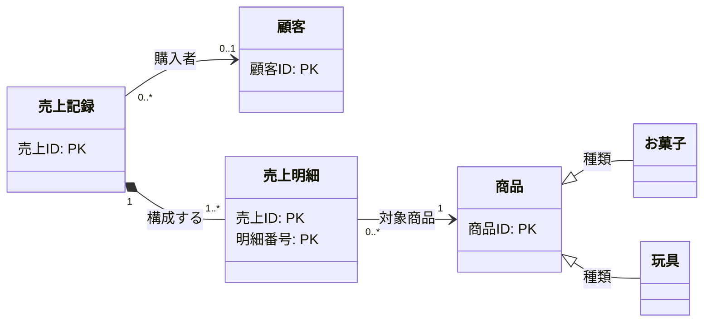

---
specdojo:
  id: specdojo:ccd-sample
  type: data
  status: draft
  rulebook: specdojo:ccd-mermaid-rulebook
---

# 概念クラス図 サンプル

## 1. 目的と適用範囲

本書は、駄菓子屋の販売管理業務における主要エンティティ間の関係・構造を定義した概念クラス図（CCD）の完成サンプルである。
本図ではエンティティの識別キー（主キー）と関連（意味・多重度・関係種別）のみを扱い、各属性の業務的意味や詳細仕様は業務データ辞書（`bdd-sales-management`）を参照する。

## 2. 概念クラス図

## 3. 関連定義と多重度の根拠

| 関連（起点 - 先）   | 関係種別 | 多重度        | 役割名   | 業務上の理由・根拠                                                                                          |
| ------------------- | -------- | ------------- | -------- | ----------------------------------------------------------------------------------------------------------- |
| 商品 - お菓子       | 継承     | -             | 種類     | お菓子は商品の特殊化（is-a）であり、賞味期限などの個別特性を持つが、商品としての基本性質を引き継ぐため      |
| 商品 - 玩具         | 継承     | -             | 種類     | 玩具は商品の特殊化（is-a）であり、対象年齢などの個別特性を持つが、商品としての基本性質を引き継ぐため        |
| 売上記録 - 売上明細 | 親子     | 1 対 1..\*    | 構成する | 売上記録は1件以上の売上明細を必ず含んで確定する。明細は売上記録に属して初めて成立し、単独では存在しないため |
| 売上明細 - 商品     | 参照     | 0..\* 対 1    | 対象商品 | 売上明細1行は必ず1つの販売対象商品を参照する。未販売の商品は明細から参照されないため0件以上となる           |
| 売上記録 - 顧客     | 参照     | 0..\* 対 0..1 | 購入者   | 会員購入時は顧客が特定されるが、一般の来店客（一見客）による購入時は顧客が紐づかない（0件）ため             |

## 4. 参照業務データ辞書

本図に登場するエンティティの主キー以外の属性（名称、金額、日付、分類など）の詳細定義は、以下の業務データ辞書（bdd）に定義されている。

| エンティティ | 主キー           | 主キー以外の主属性             | 参照先業務データ辞書   |
| ------------ | ---------------- | ------------------------------ | ---------------------- |
| 商品         | 商品ID           | 商品名、標準販売価格、商品区分 | `bdd-sales-management` |
| お菓子       | （親から継承）   | 賞味期限、アレルギー情報       | `bdd-sales-management` |
| 玩具         | （親から継承）   | 対象年齢、安全基準マーク       | `bdd-sales-management` |
| 顧客         | 顧客ID           | 氏名、電話番号、会員ランク     | `bdd-sales-management` |
| 売上記録     | 売上ID           | 売上日時、合計金額、支払方法   | `bdd-sales-management` |
| 売上明細     | 売上ID, 明細番号 | 販売単価、販売数量、小計金額   | `bdd-sales-management` |

## 5. 未解決事項

現時点で未解決の事項はない。
