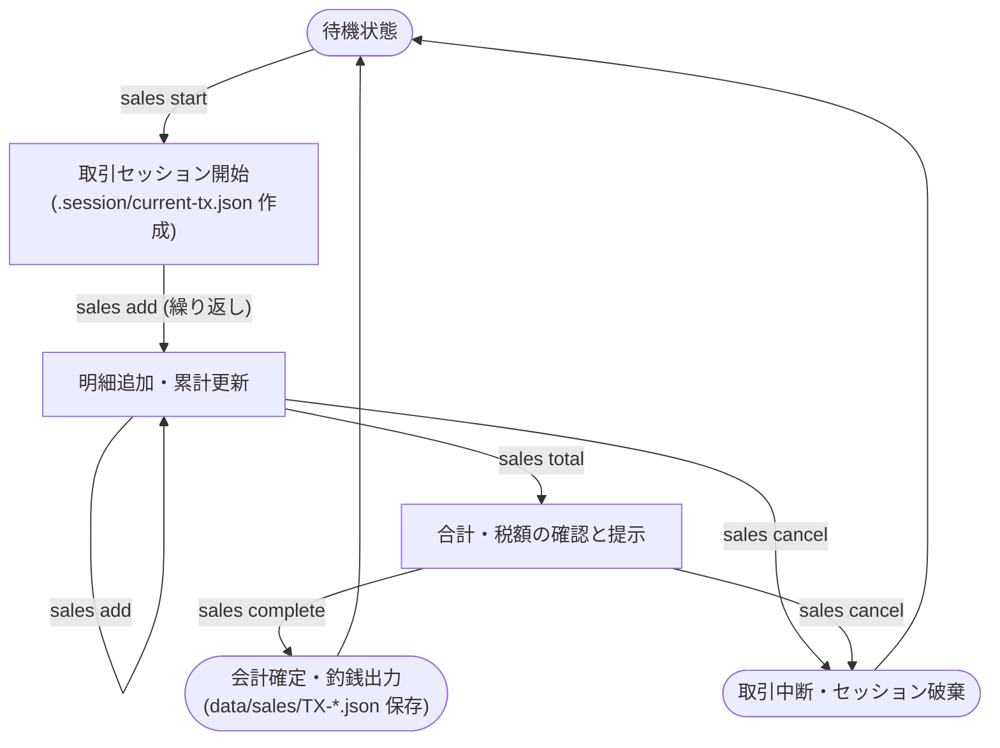

---
specdojo:
  id: specdojo:clis-sample
  type: ui
  status: draft
  rulebook: specdojo:clis-rulebook
  part_of: []
  based_on: []
---

# 駄菓子屋きぬや 販売管理 CLI 仕様

## 1. 概要

駄菓子屋きぬやの店舗端末において、店員・店主が来店客の購入する駄菓子の登録、合計金額と税額の確認、会計確定と釣銭の提示、および販売実績ファイルの記録を行うための CLI 操作群である。

## 2. 利用目的と対象ユーザー

- 対象ユーザー: 駄菓子屋きぬやの店員、店主
- 利用目的:
  - 来店客がレジへ持参した駄菓子を順次読み取りまたはコード入力し、購入明細を一時取引セッションへ追加する。
  - 小計・消費税・合計請求金額を算出して来店客に提示し、預かり金から釣銭を計算して会計を確定する。
  - 販売実績を販売データファイルとして安全に確定保存し、店舗の売上集計および在庫管理へ反映する。
  - 誤登録や購入キャンセルの際には、取引セッションを安全に破棄して待機状態に戻す。

## 3. 操作の流れ

対面販売における標準的なコマンド実行の流れは以下のとおりである。

1. **販売取引開始**: `sales start` を実行し、新規取引セッションを発行して一時セッションファイルを作成する。
2. **購入明細追加**: `sales add` で商品コードと数量を指定し、明細を追加する（購入点数分繰り返す）。
3. **合計金額確認**: `sales total` を実行し、小計・消費税・合計請求金額を確認して来店客へ提示する。
4. **会計完了**: `sales complete` で来店客から受領した預かり金額を入力し、会計を確定して釣銭金額を出力するとともに、販売実績ファイルを保存する。
5. **例外（取引中断）**: 誤登録や購入キャンセルの場合は `sales cancel` で進行中の取引セッションを破棄し、初期の待機状態へ戻る。

## 4. 操作とコマンド参照

各コマンドの利用目的および操作の意味を定義する。コマンド構文、引数、オプション、フラグの詳細仕様は正本となるコマンドリファレンスを参照する。

| 操作名   | 対象コマンド     | 利用目的・操作の意味                                             | 正本リファレンス                      |
| -------- | ---------------- | ---------------------------------------------------------------- | ------------------------------------- |
| 取引開始 | `sales start`    | 新規の販売取引セッションを開始し、取引番号を発行する             | `kinuya-cli-reference#sales-start`    |
| 明細追加 | `sales add`      | 現在の取引セッションに商品コードと販売数量を追加する             | `kinuya-cli-reference#sales-add`      |
| 合計確認 | `sales total`    | 取引中の全明細、小計、消費税額、合計請求金額を表示する           | `kinuya-cli-reference#sales-total`    |
| 会計完了 | `sales complete` | 預かり金を登録し、釣銭計算、会計確定、販売実績ファイルを出力する | `kinuya-cli-reference#sales-complete` |
| 取引取消 | `sales cancel`   | 進行中の取引セッションを破棄し、追加明細を破棄して待機状態に戻す | `kinuya-cli-reference#sales-cancel`   |

## 5. 出力と生成ファイルの要点

各コマンドの標準出力の表示要点、および実行によって作成・更新されるファイルの要点を定義する。

### 5.1. 標準出力の表示要点

| コマンド         | 表示項目名         | 表示内容の要点                                                                      | 備考                 |
| ---------------- | ------------------ | ----------------------------------------------------------------------------------- | -------------------- |
| `sales start`    | セッション開始通知 | 発行された取引番号（例: `TX-20261108-0012`）と開始時刻                              | セッション待機中表示 |
| `sales add`      | 追加明細行         | 商品名、単価（税込）、数量、明細小計、現在の累計合計金額                            | 1行サマリー          |
| `sales total`    | 取引集計表         | 明細一覧、商品点数合計、小計、消費税額（10%対象・8%軽減税率対象の内訳）、請求合計額 | 来店客への提示金額   |
| `sales complete` | 会計確定サマリー   | 取引番号、請求合計金額、預かり金額、釣銭金額、取引完了状態（`COMPLETED`）           | 釣銭の手渡し確認     |
| `sales cancel`   | 取引破棄通知       | 破棄した取引番号とセッション終了メッセージ                                          | 待機状態復帰         |

### 5.2. 生成・更新ファイルの要点

| コマンド         | ファイルパス                         | 種別             | 内容の要点                                                               | ライフサイクル                                |
| ---------------- | ------------------------------------ | ---------------- | ------------------------------------------------------------------------ | --------------------------------------------- |
| `sales start`    | `.session/current-tx.json`           | 一時ファイル     | 取引番号、開始日時、空の明細配列、セッション状態（`OPEN`）               | `sales complete` または `sales cancel` で削除 |
| `sales add`      | `.session/current-tx.json`           | 一時ファイル更新 | 追加された商品コード、商品名、単価、数量、現在小計の追記                 | 明細追加ごとに更新                            |
| `sales complete` | `data/sales/TX-YYYYMMDD-NNNN.json`   | 正本レコード     | 取引番号、完了日時、全明細、小計、税額内訳、合計額、預かり金、釣銭額     | 永続保存（売上正本）                          |
| `sales complete` | `receipts/receipt-YYYYMMDD-NNNN.txt` | レシートテキスト | 店名、日時、取引番号、購入明細、合計金額、受領金額、釣銭の印字用テキスト | 印字・電子控え用                              |

## 6. 終了コードとエラー表示・利用者の次の手

各コマンドが返す終了コード区分、異常時の標準エラー出力表示要点、原因、および利用者が回復するための具体的なアクションを定義する。

### 6.1. 終了コード体系

| 終了コード | 区分                 | 意味                                                                     |
| ---------- | -------------------- | ------------------------------------------------------------------------ |
| 0          | 正常終了             | コマンドの処理が正常に完了した                                           |
| 1          | ユーザー入力エラー   | 指定された引数・オプション・入力値の形式または業務制約に誤りがある       |
| 2          | セッション状態エラー | 取引セッションの未開始、二重開始、またはセッション状態とコマンドの不整合 |
| 3          | システム・環境エラー | ファイル I/O 障害、商品マスタ読み込み不可、または端末ストレージ障害      |

### 6.2. 代表的なエラー表示と利用者の次の手

| エラー事象               | 終了コード | 表示要点                                                                      | 原因                                                                          | 利用者の次の手（回復アクション）                                                                |
| ------------------------ | ---------- | ----------------------------------------------------------------------------- | ----------------------------------------------------------------------------- | ----------------------------------------------------------------------------------------------- |
| 商品コード未登録         | 1          | `エラー: 商品コード [XXXX] はマスタに登録されていません`                      | バーコードの読み取り不良または存在しないコードの入力                          | コード番号の打ち間違いを確認するか、商品一覧コマンドで正式コードを確認して再入力する            |
| 販売数量不正             | 1          | `エラー: 販売数量には 1 以上 999 以下の整数を指定してください`                | 0以下の数値、1000以上の数値、または小数を指定した                             | 1以上999以下の正しい数量を指定して再実行する                                                    |
| 在庫数不足               | 1          | `エラー: 在庫数が不足しています (現在庫: N個, 要求: M個)`                     | 入力された販売数量が店舗の現在庫数を超えている                                | 数量を現在庫数以下に修正して再入力するか、バックヤード在庫を確認して補充登録を行う              |
| 預かり金額不足           | 1          | `エラー: 預かり金が不足しています (請求額: X円, 預かり: Y円, 不足: Z円)`      | 請求合計金額未満の預かり金額を入力した                                        | 来店客から不足分の代金を追加で受領し、正しい預かり金額を入力して再実行する                      |
| 取引セッション未開始     | 2          | `エラー: 販売取引が開始されていません。先に 'sales start' を実行してください` | `sales start` を実行せずに `add` / `total` / `complete` / `cancel` を実行した | 先に `sales start` コマンドを実行して取引セッションを開始する                                   |
| 取引二重開始             | 2          | `エラー: 進行中の取引セッションが存在します (取引番号: TX-XXXX)`              | 前の取引を完了または中止せずに `sales start` を再実行した                     | 進行中の取引を `sales complete` で完了させるか、`sales cancel` で破棄してから新規取引を開始する |
| セッションファイル破損   | 2          | `エラー: 一時セッションファイルが破損しています (.session/current-tx.json)`   | プロセス強制終了等によりセッション JSON が破損した                            | `sales cancel` でセッションファイルを初期化するか、手動で該当ファイルを削除して再開する         |
| 売上ファイル書き込み失敗 | 3          | `致命的エラー: 販売実績ファイルの保存に失敗しました (data/sales/)`            | ディスク空き容量不足または保存先ディレクトリの書き込み権限不足                | ディスク空き容量およびディレクトリ権限を確認・解消した後、再度 `sales complete` を実行する      |

## 7. メモ / 将来課題

- 将来課題: バーコードリーダーによる連続スキャン時に、シェルを再起動せず対話的プロンプトで `sales add` を自動連打するインタラクティブモード（`sales scan`）の追加検討。
- 将来課題: 電子マネー・QRコード決済端末と連動したキャッシュレス決済サブコマンド（`sales pay cashless`）の拡張。
