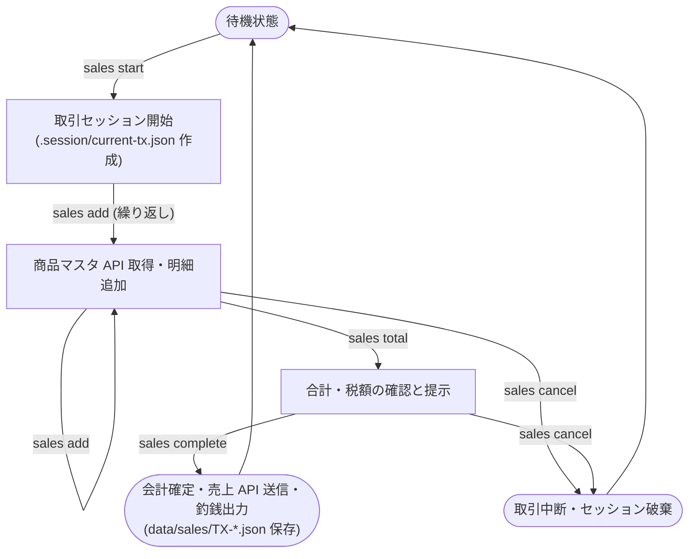

---
specdojo:
  id: specdojo:clis-sample
  type: ui
  status: draft
  rulebook: specdojo:clis-rulebook
  part_of: []
  based_on: []
---

# 駄菓子屋きぬや 販売管理 CLI 仕様

## 1. 概要

駄菓子屋きぬやの店舗端末において、店員・店主が来店客の購入する駄菓子の登録、合計金額と税額の確認、会計確定と釣銭の提示、本部 API との連携（商品マスタ取得・売上送信）、およびローカル販売実績バックアップの記録を行うための CLI 操作群である。

## 2. 利用目的と対象ユーザー

- 対象ユーザー: 駄菓子屋きぬやの店員、店主
- 利用目的:
  - 来店客がレジへ持参した駄菓子コードを入力し、本部 API から最新の商品マスタを取得して購入明細を一時取引セッションへ追加する。
  - 小計・消費税・合計請求金額を算出して来店客に提示し、対話プロンプトで預かり金を入力して釣銭を計算し、会計を確定する。
  - 会計確定時に本部売上 API へ販売実績を送信し、同時にローカルの販売実績バックアップファイルとレシートテキストを保存する。
  - 誤登録や購入キャンセルの際には、取引セッションを安全に破棄して待機状態に戻す。

## 3. 操作の流れ

対面販売における標準的なコマンド実行の流れは以下のとおりである。

1. **販売取引開始**: `sales start` を実行し、新規取引セッションを発行して一時セッションファイルを作成する。
2. **購入明細追加**: `sales add` で商品コードと数量を指定し、本部商品マスタ API から最新の単価・品名を取得して明細に追加する（購入点数分繰り返す）。
3. **合計金額確認**: `sales total` を実行し、小計・消費税・合計請求金額を確認して来店客へ提示する。
4. **会計完了**: `sales complete` で来店客から受領した預かり金額を対話入力し、会計を確定して釣銭金額を出力するとともに、本部売上 API へ売上実績を送信し、ローカルの販売実績バックアップファイルを保存する。
5. **例外（取引中断）**: 誤登録や購入キャンセルの場合は `sales cancel` で進行中の取引セッションを破棄し、初期の待機状態へ戻る。

## 4. 操作とコマンド参照

各コマンドの利用目的および操作の意味を定義する。コマンド構文、引数、オプション、フラグの詳細仕様は正本となるコマンドリファレンスを参照する。

| 操作名   | 対象コマンド     | 利用目的・操作の意味                                                                  | 正本リファレンス                      |
| -------- | ---------------- | ------------------------------------------------------------------------------------- | ------------------------------------- |
| 取引開始 | `sales start`    | 新規の販売取引セッションを開始し、取引番号を発行する                                  | `kinuya-cli-reference#sales-start`    |
| 明細追加 | `sales add`      | 現在の取引セッションに商品コードと販売数量を追加する（本部 API から商品マスタを取得） | `kinuya-cli-reference#sales-add`      |
| 合計確認 | `sales total`    | 取引中の全明細、小計、消費税額、合計請求金額を表示する                                | `kinuya-cli-reference#sales-total`    |
| 会計完了 | `sales complete` | 預かり金を対話登録し、釣銭計算、会計確定、本部 API へ売上送信、販売実績ファイルを出力 | `kinuya-cli-reference#sales-complete` |
| 取引取消 | `sales cancel`   | 進行中の取引セッションを破棄し、追加明細を破棄して待機状態に戻す                      | `kinuya-cli-reference#sales-cancel`   |

## 5. 入力と出力の要点

各コマンドが受け取る入力情報（小節「5.1. 入力情報」）および実行によって外へ送り出す出力情報（小節「5.2. 出力情報」）の要点を定義する。

### 5.1. 入力情報

| コマンド                                                     | 種類         | 対象                                                   | 役割                                                                                                 | 正本参照                       | ない／壊れている／届かないときの扱い                               | 対応エラー事象                                                                                     |
| ------------------------------------------------------------ | ------------ | ------------------------------------------------------ | ---------------------------------------------------------------------------------------------------- | ------------------------------ | ------------------------------------------------------------------ | -------------------------------------------------------------------------------------------------- |
| `sales start`, `sales add`, `sales total`, `sales complete`  | ファイル     | `config/store-config.yaml`                             | 店舗基本設定（店舗コード、税率、API エンドポイント URL）                                             | `kinuya-store-config-schema`   | 既定設定で進む（破損時はエラーで停止）                             | 店舗設定ファイル破損                                                                               |
| `sales add`, `sales complete`                                | 環境変数     | `KINUYA_API_KEY`                                       | 本部 API 認証トークン（用途のみ記載、値は書かない）                                                  | なし                           | エラーで停止                                                       | 本部 API 認証キー未設定                                                                            |
| `sales add`                                                  | API の応答   | 本部商品マスタ取得 API (`GET /api/v1/products/{code}`) | 指定された商品コードの最新単価・品名・税率区分データの取得                                           | `ifx-api-kinuya-products.yaml` | エラーで停止（つながらない・時間切れ・拒否）                       | 商品マスタ API 接続失敗 / 商品マスタ API タイムアウト / 商品マスタ API 認証拒否 / 商品コード未登録 |
| `sales add`, `sales total`, `sales complete`, `sales cancel` | ファイル     | `.session/current-tx.json`                             | 進行中取引セッションの一時状態                                                                       | `kinuya-session-schema`        | エラーで停止                                                       | 取引セッション未開始 / セッションファイル破損                                                      |
| `sales complete`                                             | 対話での入力 | 預かり金額入力プロンプト (`受領金額 (円):`)            | 来店客から受領した預かり金額の入力                                                                   | なし                           | 再入力を促す（請求金額未満または数値以外は再プロンプト）           | 預かり金額不足 / 預かり金入力不正                                                                  |
| `sales complete`                                             | API の応答   | 本部売上登録 API 応答 (`POST /api/v1/sales`)           | 本部売上登録の確定結果・受付番号（`receipt_id`）の受領（取得と更新の両方を行うため出力情報にも記載） | `ifx-api-kinuya-sales.yaml`    | エラーで停止（ローカルに未送信データを保持して後で再送可能にする） | 売上登録 API 接続失敗 / 売上登録 API タイムアウト / 売上登録 API 認証拒否                          |

### 5.2. 出力情報

| コマンド         | 種類                 | 対象                                    | 役割                                                                                                           | 正本参照                       | 備考                                          |
| ---------------- | -------------------- | --------------------------------------- | -------------------------------------------------------------------------------------------------------------- | ------------------------------ | --------------------------------------------- |
| `sales start`    | 標準出力             | セッション開始通知                      | 発行された取引番号（例: `TX-20261108-0012`）と開始時刻の表示                                                   | なし                           | セッション待機中表示                          |
| `sales add`      | 標準出力             | 追加明細行                              | 商品名、単価（税込）、数量、明細小計、現在の累計合計金額の要約表示                                             | なし                           | 1行サマリー                                   |
| `sales total`    | 標準出力             | 取引集計表                              | 明細一覧、商品点数合計、小計、消費税額（10%対象・8%軽減税率対象の内訳）、請求合計額の表示                      | なし                           | 来店客への提示金額                            |
| `sales complete` | 標準出力             | 会計確定サマリー                        | 取引番号、請求合計金額、預かり金額、釣銭金額、取引完了状態（`COMPLETED`）の表示                                | なし                           | 釣銭の手渡し確認                              |
| `sales cancel`   | 標準出力             | 取引破棄通知                            | 破棄した取引番号とセッション終了メッセージの表示                                                               | なし                           | 待機状態復帰                                  |
| 全コマンド       | 標準エラー           | エラーメッセージ                        | 異常終了時に入力誤り、セッション状態不整合、通信障害等の原因と利用者の次の手を表示                             | なし                           | 異常終了時に出力                              |
| `sales start`    | 作る／変えるファイル | `.session/current-tx.json`              | 取引番号、開始日時、空の明細配列、セッション状態（`OPEN`）の一時ファイル作成                                   | `kinuya-session-schema`        | `sales complete` または `sales cancel` で削除 |
| `sales add`      | 作る／変えるファイル | `.session/current-tx.json`              | 追加された商品コード、商品名、単価、数量、現在小計の追記（一時ファイル更新）                                   | `kinuya-session-schema`        | 明細追加ごとに更新                            |
| `sales complete` | API への送信         | 本部売上登録 API (`POST /api/v1/sales`) | 取引番号、完了日時、明細一覧、小計、税額、合計額、決済結果の送信（取得と更新の両方を行うため入力情報にも記載） | `ifx-api-kinuya-sales.yaml`    | 外部本部システムの状態更新                    |
| `sales complete` | 作る／変えるファイル | `data/sales/TX-YYYYMMDD-NNNN.json`      | 取引番号、完了日時、全明細、金額、API 受付番号を記録した販売実績バックアップ正本                               | `kinuya-sales-record-schema`   | 永続保存（ローカルバックアップ）              |
| `sales complete` | 作る／変えるファイル | `receipts/receipt-YYYYMMDD-NNNN.txt`    | 店名、日時、取引番号、購入明細、合計金額、受領金額、釣銭の印字用テキスト                                       | `kinuya-receipt-format-schema` | 印字・電子控え用                              |

## 6. 終了コードとエラー表示・利用者の次の手

各コマンドが返す終了コード区分、異常時の標準エラー出力表示要点、原因、および利用者が回復するための具体的なアクションを定義する。

### 6.1. 終了コード体系

| 終了コード | 区分                 | 意味                                                                     |
| ---------- | -------------------- | ------------------------------------------------------------------------ |
| 0          | 正常終了             | コマンドの処理が正常に完了した                                           |
| 1          | ユーザー入力エラー   | 指定された引数・オプション・入力値の形式または業務制約に誤りがある       |
| 2          | セッション状態エラー | 取引セッションの未開始、二重開始、またはセッション状態とコマンドの不整合 |
| 3          | 外部 API・通信エラー | 本部 API との通信失敗（未接続、タイムアウト、認証拒否等）                |
| 4          | システム・環境エラー | ファイル I/O 障害、設定ファイル破損、または端末ストレージ障害            |

### 6.2. 代表的なエラー表示と利用者の次の手

| エラー事象                  | 終了コード | 表示要点                                                                           | 原因                                                                          | 利用者の次の手（回復アクション）                                                                  |
| --------------------------- | ---------- | ---------------------------------------------------------------------------------- | ----------------------------------------------------------------------------- | ------------------------------------------------------------------------------------------------- |
| 本部 API 認証キー未設定     | 1          | `エラー: 本部 API 認証キーが設定されていません (環境変数 KINUYA_API_KEY)`          | 環境変数 `KINUYA_API_KEY` が未定義または空文字                                | ターミナルまたは起動設定で `export KINUYA_API_KEY=<キー>` を設定して再実行する                    |
| 店舗設定ファイル破損        | 4          | `エラー: 店舗設定ファイルの形式が不正です (config/store-config.yaml)`              | `config/store-config.yaml` の構文エラーまたは設定値不正                       | 設定ファイルの構文エラーを修正するか、設定ファイルを一旦削除して既定値で再生成させる              |
| 商品コード未登録            | 1          | `エラー: 商品コード [XXXX] は本部マスタに登録されていません`                       | 本部商品マスタに存在しないコードを指定した（API 応答: 404）                   | コード番号の打ち間違いを確認するか、商品一覧コマンドで正式コードを確認して再入力する              |
| 商品マスタ API 接続失敗     | 3          | `通信エラー: 商品マスタ取得 API に接続できません (https://api.kinuya.example.com)` | ネットワーク切断、本部サーバ停止、または DNS 解決失敗（つながらない）         | 端末のネットワーク接続および LAN ケーブルを確認し、本部稼働状況を確認して再試行する               |
| 商品マスタ API タイムアウト | 3          | `通信エラー: 商品マスタ取得 API の応答が時間切れとなりました (30秒)`               | ネットワーク輻輳または本部サーバの高負荷による応答遅延（時間切れ）            | 少し時間を置いてから `sales add` を再実行する                                                     |
| 商品マスタ API 認証拒否     | 3          | `通信エラー: 商品マスタ取得 API の認証に失敗しました (403 Forbidden)`              | `KINUYA_API_KEY` の有効期限切れまたは権限不足（拒否）                         | 本部システム管理者に問い合わせて有効な API キーを再発行・設定する                                 |
| 販売数量不正                | 1          | `エラー: 販売数量には 1 以上 999 以下の整数を指定してください`                     | 0以下の数値、1000以上の数値、または小数を指定した                             | 1以上999以下の正しい数量を指定して再実行する                                                      |
| 預かり金額不足              | 1          | `エラー: 預かり金が不足しています (請求額: X円, 預かり: Y円, 不足: Z円)`           | 請求合計金額未満の預かり金額を入力した                                        | 来店客から不足分の代金を追加で受領し、正しい預かり金額を入力して再実行する                        |
| 預かり金入力不正            | 1          | `エラー: 預かり金額には正の整数値を入力してください`                               | 数字以外の文字や記号を入力した                                                | 正しい金額（半角数字）を入力して再試行する                                                        |
| 取引セッション未開始        | 2          | `エラー: 販売取引が開始されていません。先に 'sales start' を実行してください`      | `sales start` を実行せずに `add` / `total` / `complete` / `cancel` を実行した | 先に `sales start` コマンドを実行して取引セッションを開始する                                     |
| 取引二重開始                | 2          | `エラー: 進行中の取引セッションが存在します (取引番号: TX-XXXX)`                   | 前の取引を完了または中止せずに `sales start` を再実行した                     | 進行中の取引を `sales complete` で完了させるか、`sales cancel` で破棄してから新規取引を開始する   |
| セッションファイル破損      | 2          | `エラー: 一時セッションファイルが破損しています (.session/current-tx.json)`        | プロセス強制終了等によりセッション JSON が破損した                            | `sales cancel` でセッションファイルを初期化するか、手動で該当ファイルを削除して再開する           |
| 売上登録 API 接続失敗       | 3          | `通信エラー: 売上登録 API への送信に失敗しました (データはローカルに保持)`         | 会計完了時に本部 API へのネットワークが遮断された（つながらない）             | 売上データは `data/sales/` に未送信として保持されているため、通信復旧後に `sales sync` を実行する |
| 売上登録 API タイムアウト   | 3          | `通信エラー: 売上登録 API への送信が時間切れとなりました (データはローカルに保持)` | 本部サーバへのリクエスト送信タイムアウト（時間切れ）                          | 会計レシートを発行のうえ、通信復旧後に売上同期コマンドで再送する                                  |
| 売上登録 API 認証拒否       | 3          | `通信エラー: 売上登録 API により送信が拒否されました (403 Forbidden)`              | 店舗アカウント停止または API キー失効（拒否）                                 | 管理者へ連絡のうえ、API キーを更新して未送信データを再同期する                                    |
| 売上ファイル書き込み失敗    | 4          | `致命的エラー: 販売実績バックアップファイルの保存に失敗しました (data/sales/)`     | ディスク満杯または保存先ディレクトリの書き込み権限不足                        | ディスク空き容量およびディレクトリ権限を確認・解消した後、再度 `sales complete` を実行する        |

## 7. メモ / 将来課題

- 将来課題（オフライン運用）: 本部 API と通信できない障害時に、ローカルキャッシュの商品マスタを用いて一時的に販売を継続し、通信復帰後に未送信売上を一括同期するオフライン同期機能（`sales sync`）の追加検討。
- 将来課題（バーコードリーダー連続スキャン）: バーコードリーダーによる連続スキャン時に、シェルを再起動せず対話的プロンプトで `sales add` を自動連打するインタラクティブモード（`sales scan`）の追加検討。
- 将来課題（キャッシュレス対応）: 電子マネー・QRコード決済端末と連動したキャッシュレス決済サブコマンド（`sales pay cashless`）の拡張。
