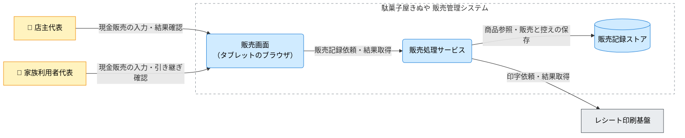

---
specdojo:
  id: specdojo:cnd-sample
  type: architecture
  status: draft
  rulebook: specdojo:cnd-rulebook
  part_of: []
  based_on: []
  supersedes: []
---

# 駄菓子屋きぬや 販売管理システム C4コンテナ図

## 1. 概要

ノートと店主の記憶に頼る販売記録は、家族が店番を代わると記録漏れや確認の手間が生じる。[[specdojo:prj-overview-sample|プロジェクト概要]] の「まず記録する」方針を受け、店主代表と家族利用者代表が同じ手順で現金販売を記録し、販売結果とレシート発行状況を引き継ぐための構成を示す。入力、永続記録、物理印字の境界を定義し、配備設計と結合検証へ渡す。

単一店舗・タブレット1台を対象とする学習用の完成例である。在庫・つけ管理への拡張、EC、本格会計、仕入れ先との連携、キャッシュレス決済は本図の対象外とする。構文・データ項目・物理ホストの設計は各詳細仕様へ委ねる。

上位図 `cxd-kinuya-sales-web` は未同梱であり、`based_on` は未接続とする。[[specdojo:cxd-sample|販売管理 CLI のコンテキスト図]] と [[specdojo:clis-sample|販売管理 CLI 仕様]] は本部 API を利用する別の学習用構成で、本図のタブレット画面と店舗側保存の直接の設計根拠にはしない。

ARC が構成案を担当し、BA は両利用者と販売・引き継ぎの場面、DEV は実行単位と接続、QE は観測結果、OPS は店舗への配備と運用条件を確認する。PO を担う店主代表が対象範囲と残るリスクを判断する。実行・配備と接続の仮定は「Container（コンテナ）」と「Relationship（関係・連携契約）」に示し、店舗で合意した実構成とは扱わない。

## 2. C4コンテナ図（Mermaid）

矢印は主たる利用・依頼・参照の向きで、返される結果も同じ関係に含む。来店客への商品の引き渡しと現金授受は店番担当が行い、来店客は画面を直接操作しないため Person に含めない。

## 3. 要素と境界の定義

### 3.1. 対象システムとシステム境界

境界内は販売操作の受付、金額計算、商品参照、販売と控えの保存、会計・印字結果の表示を担う。物理印字と機器制御はレシート印刷基盤へ、現金授受と保留取引の判断は店番担当・店主代表へ委ねる。ネットワークや機器を所有する範囲と、この責務の境界を混同しない。

### 3.2. Person（人・ロール）

| Person（図中ラベル） | 利用目的・接点                                   | 判断・確認の責務                                                   |
| -------------------- | ------------------------------------------------ | ------------------------------------------------------------------ |
| 店主代表             | 販売画面で販売を記録し、保留取引を確認する       | 現金と記録を照合し、結果不明や確定後の訂正を判断する               |
| 家族利用者代表       | 同じ販売画面で店番を引き継ぎ、購入明細を入力する | 商品、請求額、釣銭、印字状態を確認し、未解決の取引を店主代表へ渡す |

開発担当と同行レビュー担当は設計・検証に関わるが、通常の店頭操作の Person には含めない。

### 3.3. Container（コンテナ）

| コンテナ（図中ラベル）           | 責務                                                   | 技術区分・実行配備の前提                                                                                                   |
| -------------------------------- | ------------------------------------------------------ | -------------------------------------------------------------------------------------------------------------------------- |
| 販売画面（タブレットのブラウザ） | 明細・預かり金の入力を受け、会計と印字の結果を表示する | ブラウザアプリ。表示中の明細だけを販売成立の根拠にしない。構築した画面資材をタブレットから利用する                         |
| 販売処理サービス                 | 金額を計算し、販売記録と控えを保存して印字を依頼する   | _ASSUMPTION_: 店舗側で動くサービス。画面からは HTTP で利用し、ストアへはファイル入出力、印刷基盤へは外部コマンドで接続する |

販売画面と販売処理サービスは異なる実行単位である。商品検索・金額計算・保存はサービス内部の責務であり、本図では別コンテナに分割しない。具体的な言語・ライブラリ・バージョンは選定しない。

### 3.4. Data Store（データストア）

| ストア（図中ラベル） | 保持する情報・正本                                                                   | アクセスと生成物の境界                                                                                                                                     |
| -------------------- | ------------------------------------------------------------------------------------ | ---------------------------------------------------------------------------------------------------------------------------------------------------------- |
| 販売記録ストア       | 商品情報、販売実績、レシート控え、印字結果の記録。販売と印字の照合に使う店舗側の記録 | _ASSUMPTION_: 販売処理サービスが読み書きするファイル群。画面と印刷基盤は直接更新しない。控えは販売実績から作る派生物で、控えの再印刷を販売の再登録としない |

商品情報の更新・取込経路とバックアップは本例では設計していない。既存ノートの移行、他システムと共有する DB・schema、本部 API との統合はこの案に含めない。保存場所・アクセス条件は `kinuya-infra-design`、記録構造は `kinuya-record-schema` へ引き継ぐ。

### 3.5. External Software System（外部システム）

| 外部システム（図中ラベル） | 利用条件・責任分界                                                                           | 不在・障害時の影響                                                                                     |
| -------------------------- | -------------------------------------------------------------------------------------------- | ------------------------------------------------------------------------------------------------------ |
| レシート印刷基盤           | 保存済み控えの印字時だけ使用する店舗側の外部コマンド・ドライバ。プリンタ制御と物理印字を担う | 未印字または印字結果不明になり得る。印字失敗だけで販売記録を取り消さず、店番担当が控えと紙面を照合する |

印刷基盤は販売処理サービスと同じ実行環境に置く案だが、管理する責務が異なるため境界外とする。外部決済・会計サービスへの接続は本図にはない。

### 3.6. Relationship（関係・連携契約）

正本欄の参照名は、本例の詳細設計へ渡す未同梱の架空文書名である。

| 関係 ID  | 起点 → 終点                                         | 図中ラベル                   | 方式・条件と情報の要点                                                             | 詳細の正本                      |
| -------- | --------------------------------------------------- | ---------------------------- | ---------------------------------------------------------------------------------- | ------------------------------- |
| `REL-01` | 店主代表 → 販売画面（タブレットのブラウザ）         | 現金販売の入力・結果確認     | タブレットでの操作。明細・預かり金を入力し、会計・印字結果を確認する               | `kinuya-sales-screen`           |
| `REL-02` | 家族利用者代表 → 販売画面（タブレットのブラウザ）   | 現金販売の入力・引き継ぎ確認 | 同じ画面を交代して利用。未解決の取引と記録を確認する                               | `kinuya-sales-screen`           |
| `REL-03` | 販売画面（タブレットのブラウザ） → 販売処理サービス | 販売記録依頼・結果取得       | _ASSUMPTION_: 店内 HTTP。明細と会計要求を渡し、取引の記録・印字状態を受け取る      | `kinuya-sales-api`              |
| `REL-04` | 販売処理サービス → 販売記録ストア                   | 商品参照・販売と控えの保存   | _ASSUMPTION_: ローカルファイル入出力。商品を参照し、販売と控え・印字状態を保存する | `kinuya-record-schema`          |
| `REL-05` | 販売処理サービス → レシート印刷基盤                 | 印字依頼・結果取得           | _ASSUMPTION_: 外部コマンド。保存した控えを渡して印字結果を受け取る                 | `kinuya-print-command-contract` |

## 4. 技術前提・制約と検証観点

### 4.1. 技術前提・制約

- _ASSUMPTION_: 販売成立はサービス側で販売実績の保存を確認して判断する。画面の表示更新、販売の保存、物理印字は別の結果として扱う。
- 画面資材を構築・配布する工程と、営業中に `REL-03`〜`REL-05` を通る工程を区別する。営業中の構築ツール起動は想定しない。
- 応答欠落では受付済みの可能性があるため、自動再送や画面での再入力によって二重販売を作らない契約が必要である。オフライン同期・再試行・排他制御の保証は本図では置かない。
- 店舗側サービスとファイル保存先への到達性を通常販売の前提とする。通信不能時の販売継続、HTTP の認証・保護、印刷コマンドの機器アクセス権は未確定であり、「メモ / 将来課題」で判断までの利用制限を扱う。

### 4.2. コンテナ間・外部依存の検証対象

以下は検証設計へ渡す期待結果であり、実装・実機で確認済みの保証ではない。QE は同じ取引を画面、保存実績、控え、紙面で照合する。各行の条件をすべて満たせば Pass、違反があれば Fail とし、観測方法や回復契約が未整備なら未判定として受入を保留する。

| 確認区分                 | 対象関係・境界     | 観測する結果                                                                                                                                           | 主確認ロール |
| ------------------------ | ------------------ | ------------------------------------------------------------------------------------------------------------------------------------------------------ | ------------ |
| 正常販売と引き継ぎ       | `REL-01`〜`REL-04` | 両利用者が同じ購入明細を入力すると、参照した商品・単価に基づく請求額と保存実績が一致する。交代後も同じ取引の成立・印字状態を確認できる                 | BA / QE      |
| 正常印字                 | `REL-05`           | 保存済み控えと紙面の取引・明細・請求額が一致し、画面で販売成立と印字完了を別々に識別できる                                                             | QE / DEV     |
| 通信の応答欠落           | `REL-03`           | 保存後に応答を失っても未受付・完了と断定せず、対象取引と照合待ちを表示する。同じ販売を自動再送せず、店主代表へ取引を引き継げる                         | QE / ARC     |
| 保存先の障害             | `REL-04`           | 読取不能時は商品を取得できたと扱わない。書込不能・中断時は販売成立を通知せず、対象取引と保存できた範囲を識別する。途中保存の照合・回復方式は課題へ渡す | QE / DEV     |
| 印刷基盤の不在・結果不明 | `REL-05`           | 未導入は未印字、送信後の時間切れは結果不明として通知し、販売成立と控えを維持する。店番担当が紙面を照合し、控えの手動再印刷で販売実績が増えない         | QE / DEV     |

文書検査は [[specdojo:cnd-rulebook|C4コンテナ図作成ルール]] の「検証・承認前の確認」に従い、`<対象.md>` を `docs/ja/specdojo/samples/cnd-sample.md` として実行する。QE は終了コード、全図の検査結果、生成 SVG の文字・矢印・境界の目視結果をレビューへ残す。内容面では、境界を含む全要素の定義と `REL-01`〜`REL-05` の端点・ラベルが図と表で一致すれば Pass とし、欠落・余剰・不一致は Fail とする。

## 5. メモ / 将来課題

| 対象・論点             | 影響範囲                                                                  | 担当ロール | 解消条件・引き継ぎ先                                                                                                                                                                                                                                           |
| ---------------------- | ------------------------------------------------------------------------- | ---------- | -------------------------------------------------------------------------------------------------------------------------------------------------------------------------------------------------------------------------------------------------------------- |
| 上位図・配備案との照合 | 上位図と実配置が未確認。`based_on` は未接続                               | ARC        | `kinuya:pjr-a001-sales-placement` へ引き継ぐ。配備設計着手前に `cxd-kinuya-sales-web` と `kinuya-infra-design` でタブレット・店舗側サービス・印刷基盤の境界と配置を照合し、DEV / OPS が店舗での実行可能性を確認、PO が採用案を判断する                         |
| 入出力と記録の正本     | `REL-01`〜`REL-05`。画面、API、記録、印刷の契約が未同梱                   | DEV        | `kinuya:pjr-a002-sales-contracts` へ引き継ぐ。結合実装着手前に `kinuya-sales-screen`、`kinuya-sales-api`、`kinuya-record-schema`、`kinuya-print-command-contract` を整備し、ARC が各端点の責務と図の整合を確認すれば完了。構文・設定値・記録項目は各正本に置く |
| 応答欠落・保存中断     | `REL-03`・`REL-04`。取引識別、重複排除、照会、途中記録の扱いが未確定      | ARC        | `kinuya:pjr-a003-sales-recovery` へ引き継ぐ。契約整備後、受入開始前に DEV と照合・回復方式を定め、QE が受付済み・未受付・不明の期待結果を検証設計へ反映する。PO の判断までは結果不明の取引を自動再送せず、当該経路の受入を保留する                             |
| 運用と接続条件         | 商品情報の更新、バックアップ、HTTP の保護、機器接続、通信不能時の店頭対応 | OPS        | `kinuya:pjr-a004-sales-operations` へ引き継ぐ。店舗試行前に ARC / DEV と `kinuya-infra-design`・`kinuya-sales-operations` を整え、復元・接続不能・二重印字の確認結果を示す。BA が店番担当の引き継ぎを確認し、PO が営業への影響を許容するまで実運用を開始しない |

表の文書名と課題 ID は未同梱の架空の引き継ぎ先である。PM は各作業を上表の判断時点までに計画し、PO の採用・保留・差し戻しを `kinuya:pjr-a005-sales-approval` に集約する。本例では未決事項が残り、構成案として `draft` を維持する。

承認前に ARC は上位境界と詳細契約の照合結果、QE は文書検査・描画確認と結合対象の判定、BA は両利用者の正常販売・保留時の引き継ぎの確認結果、OPS は配備・復旧条件をそろえる。PO が残る仮定の影響と後続作業の制限を含めて承認を記録した後、人間が `ready` への昇格を判断する。OPS は承認対象と公開対象の一致を確認する。文書の承認と店舗での実運用開始はそれぞれ判断する。

構成・接続の変更時の窓口は ARC とする。ARC が上位図、`cpd-kinuya-sales-service`、`kinuya-infra-design` と本図を照合し、DEV が関係表の詳細契約、QE が該当する検証対象を追従させる。PM は課題と承認記録を更新し、QE は変更した Mermaid を正本として「検証・承認前の確認」の検査・SVG 再生成を行う。PO の再判断後、OPS が承認済みの版を公開する。
