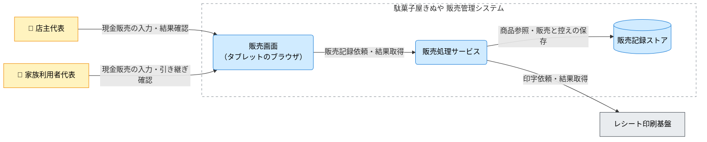

---
specdojo:
  id: specdojo:cnd-sample
  type: architecture
  status: draft
  rulebook: specdojo:cnd-rulebook
  part_of: []
  based_on: []
  supersedes: []
---

# 駄菓子屋きぬや 販売管理システム C4コンテナ図

## 1. 概要

店主代表と家族利用者代表が、同じ手順で店頭の現金販売を記録し、販売結果とレシート発行状況を確認するための構成を示す。タブレット上の販売画面、販売処理サービス、販売記録ストアの境界を定義し、画面での入力と永続記録、物理印字を区別する。

単一店舗・タブレット1台を対象とする学習用の完成例である。在庫・つけ管理への拡張、EC、本格会計、仕入れ先との連携、キャッシュレス決済は本図の対象外とする。構文・データ項目・物理ホストの設計は各詳細仕様へ委ねる。

実行・配備と接続の仮定は「Container（コンテナ）」と「Relationship（関係・連携契約）」に示す。これらは本例の配備案であり、店舗で合意した実構成ではない。

## 2. C4コンテナ図（Mermaid）

矢印は主たる利用・依頼・参照の向きで、返される結果も同じ関係に含む。来店客への商品の引き渡しと現金授受は店番担当が行い、来店客は画面を直接操作しないため Person に含めない。

## 3. 要素と境界の定義

### 3.1. 対象システムとシステム境界

境界内は販売操作の受付、金額計算、商品参照、販売と控えの保存、会計・印字結果の表示を担う。物理印字と機器制御はレシート印刷基盤へ、現金授受と保留取引の判断は店番担当・店主代表へ委ねる。ネットワークや機器を所有する範囲と、この責務の境界を混同しない。

### 3.2. Person（人・ロール）

| Person（図中ラベル） | 利用目的・接点                                   | 判断・確認の責務                                                   |
| -------------------- | ------------------------------------------------ | ------------------------------------------------------------------ |
| 店主代表             | 販売画面で販売を記録し、保留取引を確認する       | 現金と記録を照合し、結果不明や確定後の訂正を判断する               |
| 家族利用者代表       | 同じ販売画面で店番を引き継ぎ、購入明細を入力する | 商品、請求額、釣銭、印字状態を確認し、未解決の取引を店主代表へ渡す |

開発担当と同行レビュー担当は設計・検証に関わるが、通常の店頭操作の Person には含めない。

### 3.3. Container（コンテナ）

| コンテナ（図中ラベル）           | 責務                                                   | 技術区分・実行配備の前提                                                                                                   |
| -------------------------------- | ------------------------------------------------------ | -------------------------------------------------------------------------------------------------------------------------- |
| 販売画面（タブレットのブラウザ） | 明細・預かり金の入力を受け、会計と印字の結果を表示する | ブラウザアプリ。表示中の明細だけを販売成立の根拠にしない。構築した画面資材をタブレットから利用する                         |
| 販売処理サービス                 | 金額を計算し、販売記録と控えを保存して印字を依頼する   | _ASSUMPTION_: 店舗側で動くサービス。画面からは HTTP で利用し、ストアへはファイル入出力、印刷基盤へは外部コマンドで接続する |

販売画面と販売処理サービスは異なる実行単位である。商品検索・金額計算・保存はサービス内部の責務であり、本図では別コンテナに分割しない。具体的な言語・ライブラリ・バージョンは選定しない。

### 3.4. Data Store（データストア）

| ストア（図中ラベル） | 保持する情報・正本                                                                   | アクセスと生成物の境界                                                                                                                                     |
| -------------------- | ------------------------------------------------------------------------------------ | ---------------------------------------------------------------------------------------------------------------------------------------------------------- |
| 販売記録ストア       | 商品情報、販売実績、レシート控え、印字結果の記録。販売と印字の照合に使う店舗側の記録 | _ASSUMPTION_: 販売処理サービスが読み書きするファイル群。画面と印刷基盤は直接更新しない。控えは販売実績から作る派生物で、控えの再印刷を販売の再登録としない |

商品情報の更新・取込経路とバックアップは本例では設計していない。ストアは外部の本部システムや DB 製品の導入を意味しない。物理的な保存場所・ファイル構造は `kinuya-record-schema` の整備へ渡す。

### 3.5. External Software System（外部システム）

| 外部システム（図中ラベル） | 利用条件・責任分界                                                                           | 不在・障害時の影響                                                                                     |
| -------------------------- | -------------------------------------------------------------------------------------------- | ------------------------------------------------------------------------------------------------------ |
| レシート印刷基盤           | 保存済み控えの印字時だけ使用する店舗側の外部コマンド・ドライバ。プリンタ制御と物理印字を担う | 未印字または印字結果不明になり得る。印字失敗だけで販売記録を取り消さず、店番担当が控えと紙面を照合する |

印刷基盤は販売処理サービスと同じ実行環境に置く案だが、管理する責務が異なるため境界外とする。外部決済・会計サービスへの接続は本図にはない。

### 3.6. Relationship（関係・連携契約）

正本欄の参照名は、本例の詳細設計へ渡す未同梱の架空文書名である。

| 関係 ID  | 起点 → 終点                                         | 図中ラベル                   | 方式・条件と情報の要点                                                             | 詳細の正本                      |
| -------- | --------------------------------------------------- | ---------------------------- | ---------------------------------------------------------------------------------- | ------------------------------- |
| `REL-01` | 店主代表 → 販売画面（タブレットのブラウザ）         | 現金販売の入力・結果確認     | タブレットでの操作。明細・預かり金を入力し、会計・印字結果を確認する               | `kinuya-sales-screen`           |
| `REL-02` | 家族利用者代表 → 販売画面（タブレットのブラウザ）   | 現金販売の入力・引き継ぎ確認 | 同じ画面を交代して利用。未解決の取引と記録を確認する                               | `kinuya-sales-screen`           |
| `REL-03` | 販売画面（タブレットのブラウザ） → 販売処理サービス | 販売記録依頼・結果取得       | _ASSUMPTION_: 店内 HTTP。明細と会計要求を渡し、取引の記録・印字状態を受け取る      | `kinuya-sales-api`              |
| `REL-04` | 販売処理サービス → 販売記録ストア                   | 商品参照・販売と控えの保存   | _ASSUMPTION_: ローカルファイル入出力。商品を参照し、販売と控え・印字状態を保存する | `kinuya-record-schema`          |
| `REL-05` | 販売処理サービス → レシート印刷基盤                 | 印字依頼・結果取得           | _ASSUMPTION_: 外部コマンド。保存した控えを渡して印字結果を受け取る                 | `kinuya-print-command-contract` |

## 4. 技術前提・制約と検証観点

### 4.1. 技術前提・制約

- _ASSUMPTION_: 販売成立はサービス側で販売実績の保存を確認して判断する。画面の表示更新、販売の保存、物理印字は別の結果として扱う。
- 画面資材を構築・配布する工程と、営業中に `REL-03`〜`REL-05` を通る工程を区別する。営業中の構築ツール起動は想定しない。
- 応答欠落では受付済みの可能性があるため、自動再送や画面での再入力によって二重販売を作らない契約が必要である。オフライン同期・再試行・排他制御の保証は本図では置かない。

### 4.2. コンテナ間・外部依存の検証対象

以下は検証設計へ渡す対象であり、実施済みの保証ではない。

| 確認区分         | 対象関係・境界     | 観測する結果                                                                     | 主確認ロール  |
| ---------------- | ------------------ | -------------------------------------------------------------------------------- | ------------- |
| 入力から記録まで | `REL-01`〜`REL-04` | 同じ取引について、入力明細、保存された実績、表示した請求額が一致するか           | QE / DEV      |
| 通信の応答欠落   | `REL-03`           | 保存結果を照合できる情報が残り、未受付と結果不明を区別できるか                   | QE / ARC      |
| 保存先の障害     | `REL-04`           | 書込不能・中断時に、記録された範囲と表示結果を識別できるか                       | QE / DEV      |
| 印字の障害       | `REL-05`           | 販売成立と未印字・結果不明を区別し、販売の再登録をせずに控えと紙面を照合できるか | QE / 店主代表 |

## 5. メモ / 将来課題

| 対象・論点             | 影響範囲                                                                | 担当ロール | 解消条件・引き継ぎ先                                                                                                                |
| ---------------------- | ----------------------------------------------------------------------- | ---------- | ----------------------------------------------------------------------------------------------------------------------------------- |
| 上位図・配備案との照合 | 本例専用のコンテキスト図とインフラ構成図は未同梱。`based_on` は未接続   | ARC        | タブレット・店舗側サービス・印刷基盤の実行配置を上位図と `kinuya-infra-design` へ整理し、現場で配備可能か確認する                   |
| 入出力と記録の正本     | `REL-01`〜`REL-05`。画面、API、記録、印刷の契約が未同梱                 | DEV / ARC  | `kinuya-sales-screen`、`kinuya-sales-api`、`kinuya-record-schema`、`kinuya-print-command-contract` を整備し、図の責任分界と照合する |
| 応答欠落・保存中断     | `REL-03`・`REL-04`。取引識別、重複排除、照会、途中記録の扱いが未確定    | ARC / QE   | サービスとストアの契約に結果照合を定め、受付済み・未受付・不明の期待結果を結合検証へ渡す                                            |
| 運用と接続条件         | 商品情報の更新、バックアップ、HTTP の保護、機器接続、オフライン時の扱い | ARC / DEV  | `kinuya-infra-design` と運用設計で案を具体化し、店主代表が営業への影響を確認する。初版の構成案だけで運用開始を判断しない            |
