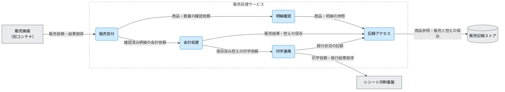

---
specdojo:
  id: specdojo:cpd-sample
  type: architecture
  status: draft
  owner: ARC
  rulebook: specdojo:cpd-rulebook
  part_of: []
  based_on: []
  supersedes: []
---

# 駄菓子屋きぬや 販売処理サービス C4コンポーネント図

## 1. 概要

駄菓子屋きぬやで、店主代表と家族利用者代表が同じ手順で現金販売を記録し、店番の交代時に販売結果とレシート発行状況を確認できるよう、販売処理サービス内部を分割する。販売結果の保持と印字の失敗を分けて扱う境界を示し、実装配置と結合テストの設計へ渡す。

_ASSUMPTION_: 単一店舗・タブレット1台に対し、一つの販売処理サービスが店舗側の販売記録ストアと外部のレシート印刷基盤を利用する学習用設計案である。対象は現金販売の明細確認から記録・控えの保存と印字依頼までとし、在庫更新、つけ管理、EC、本格会計、仕入れ先連携は扱わない。上位コンテナ図 `cnd-kinuya-sales-service` は未同梱の架空参照名であり、`based_on` は未接続とする。

ARC が構成案を整理し、DEV は実装への配置、QE は保存・印字の結合境界を確認する。PO を担う店主代表が業務上の確定条件と運用可否を判断する。以下は合意済みの実構成ではなく、詳細契約と回復手順の整備前に自動再送を認めるものではない。

## 2. C4コンポーネント図（Mermaid）

矢印は主たる依頼・参照の向きで、応答を含む。販売と控えの保存を確認してから印字を依頼する案であり、すべての矢印が毎回通るという意味ではない。画面内の操作手順とサービス内の全呼び出しは省略する。

## 3. 要素と境界の定義

### 3.1. 対象コンテナ境界と利用者

境界内は販売依頼の受付、明細の確認、会計結果の組立て、記録へのアクセス、印字の委譲である。販売画面、永続記録、物理印字は外側に置く。内部の五つの責務は同じサービスの論理的な配置であり、五つの別プロセスを要求しない。

Person は直接サービスを操作しないため図では非該当とし、直接の呼出元である販売画面だけを描く。

| 上位図の Person | 本図の接点と確認する結果                                             |
| --------------- | -------------------------------------------------------------------- |
| 店主代表        | 販売画面を介し、会計結果と未印字・結果不明の取引を確認する           |
| 家族利用者代表  | 同じ画面で販売を記録し、交代時に対象取引と未完了の発行状況を引き継ぐ |

### 3.2. コンポーネントと論理配置

| コンポーネント | 固有の責務                                                   | 主な入力 → 出力                             | 論理配置・境界                                       |
| -------------- | ------------------------------------------------------------ | ------------------------------------------- | ---------------------------------------------------- |
| 販売受付       | 画面からの依頼を受け、確認・会計の結果を返す                 | 販売依頼 → 明細・会計結果・発行状況         | 入力境界。取引の更新判断を独自に持たない             |
| 明細確認       | 商品と数量を照合し、会計対象の明細を組み立てる               | 商品指定・数量 → 確認済み明細または訂正理由 | 会計の前段。物理印字は扱わない                       |
| 会計処理       | 確認済み明細から販売結果と控えを作り、保存後に印字を依頼する | 明細・支払情報 → 販売結果・控え・印字依頼   | 販売結果を作る責務。発行状況の管理は印字連携へ委ねる |
| 記録アクセス   | 商品を参照し、販売結果・控え・発行状況を保持する             | 参照・保存要求 → 内容・保存結果             | 共通の記録接点。販売可否を判断しない                 |
| 印字連携       | 保存済み控えを印刷基盤へ渡し、発行状況を記録する             | 控え → 発行結果または結果不明の通知         | 外部接点。販売を再登録しない                         |

会計処理と印字連携は同じ取引を識別するが、販売結果と発行状況をそれぞれの責務として扱う。

### 3.3. ストアと外部依存

| 要素・区分                       | 保持内容または委ねる責務                 | 利用条件・失敗の影響                                                           |
| -------------------------------- | ---------------------------------------- | ------------------------------------------------------------------------------ |
| 販売画面（別コンテナ）           | 店番担当による入力と結果確認             | 直接の呼出元。応答欠落時に画面の未表示だけで販売未実施と判断できない           |
| 販売記録ストア（ストア）         | 商品参照用情報、販売結果、控え、発行状況 | 記録アクセスから利用する。保存失敗時は残った記録と対象取引の照合が必要         |
| レシート印刷基盤（外部システム） | 控えの物理印字と発行結果の通知           | 保存済み控えの印字時に利用する。用紙切れ・接続断・応答欠落は販売結果と区別する |

### 3.4. 関係と詳細の正本

正本欄は未同梱の架空参照名である。データ項目・構文・再実行条件は本図で規定しない。

| 関係 ID  | 起点 → 終点                   | 授受情報・条件                                       | 詳細の正本                       |
| -------- | ----------------------------- | ---------------------------------------------------- | -------------------------------- |
| `REL-01` | 販売画面 → 販売受付           | 販売依頼と対象取引の結果。応答欠落時は取引を照合する | `kinuya-sales-service-interface` |
| `REL-02` | 販売受付 → 明細確認           | 商品と数量の確認依頼、明細または訂正理由             | `kinuya-sales-component-design`  |
| `REL-03` | 明細確認 → 記録アクセス       | 商品・明細の参照内容と参照結果                       | 同上                             |
| `REL-04` | 販売受付 → 会計処理           | 確認済み明細と支払情報、販売結果と発行状況           | 同上                             |
| `REL-05` | 会計処理 → 記録アクセス       | 販売結果・控えの保存依頼と保存結果                   | `kinuya-sales-storage-contract`  |
| `REL-06` | 記録アクセス → 販売記録ストア | 商品の参照、販売結果・控え・発行状況の保存           | `kinuya-sales-record-schema`     |
| `REL-07` | 会計処理 → 印字連携           | 保存済み控えの印字依頼と発行状況                     | `kinuya-sales-component-design`  |
| `REL-08` | 印字連携 → レシート印刷基盤   | 控えの印字依頼と発行結果。販売の再登録は含めない     | `kinuya-print-interface`         |
| `REL-09` | 印字連携 → 記録アクセス       | 対象取引の発行状況と保存結果                         | `kinuya-sales-storage-contract`  |

## 4. 技術前提・制約と検証観点

### 4.1. 技術前提・制約

- 受付から明細確認・会計処理へ、各処理から記録アクセス・印字連携へ依存する。共通の記録アクセスから販売受付への逆依存は設けない。
- _ASSUMPTION_: 販売結果と控えの保存が確認できるまで印字を依頼しない。保存の原子性や途中失敗後の回復は未確定で、詳細の記録契約へ委ねる。
- 印字失敗だけで保存済み販売を取り消さない。応答欠落時に無条件で販売または印字を繰り返さず、店主代表と開発担当が残った記録・紙面を照合する。
- 店主代表が販売・保留・回復の判断を担う。サービスの成功通知や印字結果だけで、実際の現金授受や運用承認を保証しない。

### 4.2. コンポーネント間の検証対象

以下は結合テスト設計への入力であり、店舗での確認済み結果を示すものではない。

| 対象関係           | 条件                                     | 観測する結果                                                           |
| ------------------ | ---------------------------------------- | ---------------------------------------------------------------------- |
| `REL-02`〜`REL-04` | 未登録商品や訂正が必要な数量を入力する   | 訂正理由が返り、未確認明細が会計へ渡らないこと                         |
| `REL-05`〜`REL-07` | 販売結果または控えの保存が失敗する       | 保存できた範囲を識別し、確認前に印字を依頼しないこと                   |
| `REL-07`・`REL-08` | 保存成功後に印刷基盤が失敗・応答欠落する | 販売結果を保持し、発行失敗と結果不明を区別すること                     |
| `REL-09`           | 印字後の発行状況保存が失敗する           | 紙面が存在し得ることと、記録が未確認であることを販売受付側へ渡せること |
| `REL-01`           | 会計要求後に画面への応答が欠ける         | 同じ取引の照合へ引き継ぎ、新規の販売登録を先行させないこと             |

## 5. メモ / 将来課題

| 対象・論点       | 影響                                                               | 担当ロール     | 解消条件・引き継ぎ先                                                                                 |
| ---------------- | ------------------------------------------------------------------ | -------------- | ---------------------------------------------------------------------------------------------------- |
| 上位図・実装配置 | 架空の上位図は未同梱。内部責務は論理案でありソース配置を指定しない | ARC / DEV      | 対象コンテナとストアの境界を上位図で確認し、実装配置と各内部契約を特定して接続する                   |
| 記録・連携の詳細 | 架空の正本は未同梱。保存途中失敗・印字応答欠落後の回復は未確定     | ARC / DEV / QE | 記録契約・schema・印刷契約を整え、保持範囲、照合方法、再実行の条件を結合設計へ渡す                   |
| 店舗運用の判断   | 販売・保留・紙面確認と発行状況が整合するかは未確認                 | PO / QE        | 店主代表と家族利用者代表が正常・保存失敗・未印字・結果不明を確認し、回復手順を含む運用可否を判断する |
