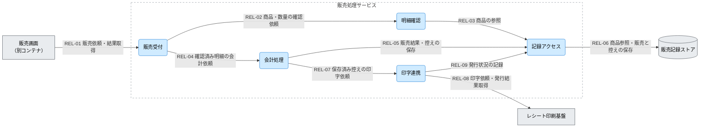

---
specdojo:
  id: specdojo:cpd-sample
  type: architecture
  status: ready
  owner: ARC
  rulebook: specdojo:cpd-rulebook
  part_of: []
  based_on:
    - specdojo:cnd-sample
  supersedes: []
---

# 駄菓子屋きぬや 販売処理サービス C4コンポーネント図

## 1. 概要

[[specdojo:cnd-sample|販売管理システム C4コンテナ図]] の販売処理サービス内部を分割し、販売結果の保持と印字の失敗を分けて扱う境界を実装配置と結合テストの設計へ渡す。店主代表と家族利用者代表が、記憶やノートだけに頼らず同じ手順で現金販売を記録し、交代時に販売結果と発行状況を確認できるようにする。

業務課題と放置時の影響は [[specdojo:prj-overview-sample|プロジェクト概要]] の「必要性」、業務目的と成功基準は同書の「基本的な考え方」「期待効果」を根拠とする。記憶と紙の運用のままでは店主以外の店番で同じ判断ができず、販売記録の漏れと引き継ぎの確認負担が残る。本分割は、販売記録の完遂と両利用者の確認結果の一致を支える。正常販売では同じ明細・請求額・販売結果を確認でき、保存失敗・未印字・結果不明では未完了の取引を店主代表へ引き継げることを確認対象とする。在庫・つけを含むプロジェクト全体の成功は、本図だけでは判定しない。

_ASSUMPTION_: 上位図の単一店舗・タブレット1台・店舗側サービスを引き継ぐ学習用の論理分割案であり、実装確認済みの構成ではない。対象は現金販売の明細確認から記録・控えの保存と印字依頼までとし、在庫更新、つけ管理、EC、本格会計、仕入れ先連携は扱わない。CLI と本部 API を使う [[specdojo:clis-sample|販売管理 CLI 仕様]] は別構成の例であり、本サービスの直接の設計根拠にはしない。

本書は、詳細設計の着手前に内部の責務・依存方向と失敗時の分界を照合し、結合実装と結合テストの範囲を決めるために使う。公開する範囲は本文・図・ラベル・参照先で、学習用ドキュメントサイトの読者に示す。

用語のうち、コンテナ・コンポーネント・依存方向は [[specdojo:cpd-rulebook|CPD 作成ルール]] の「位置づけと用語定義」、販売・店主代表は [[specdojo:gl-sample|用語集]] に従う。本書固有の語として、控えは販売結果から作る印字用の保存記録、発行状況は控えごとの印字済み・未印字・結果不明の区分、記録アクセスは販売記録ストアへの参照・保存をまとめるコンポーネントを指す。

## 2. C4コンポーネント図（Mermaid）

矢印は主たる依頼・参照の向きで、応答を含む。販売と控えの保存を確認してから印字を依頼する案であり、すべての矢印が毎回通るという意味ではない。画面内の操作手順とサービス内の全呼び出しは省略する。

## 3. 要素と境界の定義

### 3.1. 対象コンテナ境界と利用者

境界内は販売依頼の受付、明細の確認、会計結果の組立て、記録へのアクセス、印字の委譲である。販売画面、永続記録、物理印字は外側に置く。内部の五つの責務は同じサービスの論理的な配置であり、五つの別プロセスを要求しない。

Person は直接サービスを操作しないため図では非該当とし、直接の呼出元である販売画面だけを描く。

| 上位図の Person | 本図の接点と確認する結果                                             |
| --------------- | -------------------------------------------------------------------- |
| 店主代表        | 販売画面を介し、会計結果と未印字・結果不明の取引を確認する           |
| 家族利用者代表  | 同じ画面で販売を記録し、交代時に対象取引と未完了の発行状況を引き継ぐ |

### 3.2. コンポーネントと論理配置

| コンポーネント | 固有の責務                                                   | 主な入力 → 出力                             | 論理配置・境界                                       |
| -------------- | ------------------------------------------------------------ | ------------------------------------------- | ---------------------------------------------------- |
| 販売受付       | 画面からの依頼を受け、確認・会計の結果を返す                 | 販売依頼 → 明細・会計結果・発行状況         | 入力境界。取引の更新判断を独自に持たない             |
| 明細確認       | 商品と数量を照合し、会計対象の明細を組み立てる               | 商品指定・数量 → 確認済み明細または訂正理由 | 会計の前段。物理印字は扱わない                       |
| 会計処理       | 確認済み明細から販売結果と控えを作り、保存後に印字を依頼する | 明細・支払情報 → 販売結果・控え・印字依頼   | 販売結果を作る責務。発行状況の管理は印字連携へ委ねる |
| 記録アクセス   | 商品を参照し、販売結果・控え・発行状況を保持する             | 参照・保存要求 → 内容・保存結果             | 共通の記録接点。販売可否を判断しない                 |
| 印字連携       | 保存済み控えを印刷基盤へ渡し、発行状況を記録する             | 控え → 発行結果または結果不明の通知         | 外部接点。販売を再登録しない                         |

会計処理と印字連携を分ける理由は、印字障害で保存済み販売をやり直さず、交代時に未印字だけを引き継げるようにするためである。明細確認は入力訂正を保存前に返すため会計から分離し、記録アクセスは商品参照・販売保存・発行状況保存の接点を集約する。販売可否の判断を共通の記録接点へ移さない。ソース配置は未確認で、内部設計へ引き継ぐ。

### 3.3. ストアと外部依存

| 要素・区分                       | 保持内容または委ねる責務                 | 利用条件・失敗の影響                                                           |
| -------------------------------- | ---------------------------------------- | ------------------------------------------------------------------------------ |
| 販売画面（別コンテナ）           | 店番担当による入力と結果確認             | 直接の呼出元。応答欠落時に画面の未表示だけで販売未実施と判断できない           |
| 販売記録ストア（ストア）         | 商品参照用情報、販売結果、控え、発行状況 | 記録アクセスから利用する。保存失敗時は残った記録と対象取引の照合が必要         |
| レシート印刷基盤（外部システム） | 控えの物理印字と発行結果の通知           | 保存済み控えの印字時に利用する。用紙切れ・接続断・応答欠落は販売結果と区別する |

### 3.4. 関係と詳細の正本

正本欄は未同梱の架空参照名である。外部接点は上位図の詳細化先を引き継ぎ、内部関係のみ `kinuya-sales-component-design` で補う。データ項目・構文・再実行条件は本図で規定しない。本図の `REL-01`・`REL-06`・`REL-08` は、それぞれ上位図の `REL-03`・`REL-04`・`REL-05` のサービス側接点を具体化する。

| 関係 ID  | 起点 → 終点                   | 授受情報・条件                                       | 詳細の正本                      |
| -------- | ----------------------------- | ---------------------------------------------------- | ------------------------------- |
| `REL-01` | 販売画面 → 販売受付           | 販売依頼と対象取引の結果。応答欠落時は取引を照合する | `kinuya-sales-api`              |
| `REL-02` | 販売受付 → 明細確認           | 商品と数量の確認依頼、明細または訂正理由             | `kinuya-sales-component-design` |
| `REL-03` | 明細確認 → 記録アクセス       | 商品の参照依頼と参照結果                             | 同上                            |
| `REL-04` | 販売受付 → 会計処理           | 確認済み明細と支払情報、販売結果と発行状況           | 同上                            |
| `REL-05` | 会計処理 → 記録アクセス       | 販売結果・控えの保存依頼と保存結果                   | `kinuya-sales-component-design` |
| `REL-06` | 記録アクセス → 販売記録ストア | 商品の参照、販売結果・控え・発行状況の保存           | `kinuya-record-schema`          |
| `REL-07` | 会計処理 → 印字連携           | 保存済み控えの印字依頼と発行状況                     | `kinuya-sales-component-design` |
| `REL-08` | 印字連携 → レシート印刷基盤   | 控えの印字依頼と発行結果。販売の再登録は含めない     | `kinuya-print-command-contract` |
| `REL-09` | 印字連携 → 記録アクセス       | 対象取引の発行状況と保存結果                         | `kinuya-sales-component-design` |

## 4. 技術前提・制約と検証観点

### 4.1. 技術前提・制約

- 受付から明細確認・会計処理へ、各処理から記録アクセス・印字連携へ依存する。共通の記録アクセスから販売受付への逆依存は設けない。
- _ASSUMPTION_: 上位図に従い、画面からは店内 HTTP、記録ストアへはローカルファイル入出力、印刷基盤へは外部コマンドで接続する。販売処理サービスのランタイム・バージョン、保存先と権限、機器接続条件は `kinuya-infra-design` へ委ね、DB 製品の導入を前提にしない。通常販売には店舗側サービスと保存先への到達性が必要である。
- 販売結果・保存済み控え・発行状況は照合の根拠である。画面の表示と物理紙面はそれらの確認対象で、表示を更新しても保存成功の代わりにはならない。印字内容は保存済み控えから作り、再印刷を新規販売登録にしない。
- _ASSUMPTION_: 販売結果と控えの保存が確認できるまで印字を依頼しない。保存の原子性や途中失敗後の回復は未確定で、詳細の記録契約へ委ねる。
- 印字失敗だけで保存済み販売を取り消さない。応答欠落時に無条件で販売または印字を繰り返さず、店主代表が残った記録・紙面を照合する。
- 店主代表が販売・保留・回復の判断を担う。サービスの成功通知や印字結果だけで、実際の現金授受を保証しない。

保存責務を変える場合は、`REL-05`・`REL-06`・`REL-09` と図・定義表、`kinuya-record-schema`・内部設計・実装、「コンポーネント間の検証対象」の保存失敗の行、店頭の回復手順を照合する。印刷契約を変える場合は、`REL-07`・`REL-08` と `kinuya-print-command-contract`、印字失敗・応答欠落の行を照合する。販売処理サービスの境界が変わる場合は上位図も改訂し、変わらない場合は更新不要の理由を残す。

### 4.2. コンポーネント間の検証対象

以下は結合テスト設計への入力であり、店舗での確認済み結果を示すものではない。同じ取引の依頼・保存記録・控え・発行状況と紙面を照合する。各行の観測結果をすべて満たせば Pass、違反すれば Fail、契約や観測方法が未整備なら未判定として当該経路の受入を保留する。

| 対象関係           | 条件                                               | 観測する結果                                                                                                       |
| ------------------ | -------------------------------------------------- | ------------------------------------------------------------------------------------------------------------------ |
| `REL-01`〜`REL-09` | 有効な明細・支払情報で販売し、保存と印字が成功する | 両利用者が同じ明細・請求額・販売結果を確認でき、保存済み控えと紙面が一致する。販売と発行状況を別々に確認できること |
| `REL-02`〜`REL-04` | 未登録商品や訂正が必要な数量を入力する             | 訂正理由が返り、未確認明細が会計へ渡らないこと                                                                     |
| `REL-03`・`REL-06` | 商品の参照が失敗する                               | 参照失敗と未登録商品を区別し、未確認の商品・単価で会計しないこと                                                   |
| `REL-05`〜`REL-07` | 販売結果または控えの保存が失敗する                 | 販売成立を通知せず、保存できた範囲を識別し、確認前に印字を依頼しないこと                                           |
| `REL-07`・`REL-08` | 保存成功後に印刷基盤が失敗・応答欠落する           | 販売結果を保持し、発行失敗と結果不明を区別すること                                                                 |
| `REL-09`           | 印字後の発行状況保存が失敗する                     | 紙面が存在し得ることと、記録が未確認であることを販売受付側へ渡せること                                             |
| `REL-01`           | 会計要求後に画面への応答が欠ける                   | 同じ取引の照合へ引き継ぎ、新規の販売登録を先行させないこと                                                         |

[[specdojo:cpd-rulebook|CPD 作成ルール]] の「検証と合意の判定」に沿った本図の確認結果は次のとおりである。

- 要素と関係の対応: 一致。図の8要素（内部5、外部3）は境界の説明と定義表に、`REL-01`〜`REL-09` の端点・ラベルは関係表に過不足なく対応する。
- 上位図との比較: 一致。販売画面・販売記録ストア・レシート印刷基盤は上位図と同じく境界外にあり、`REL-01`・`REL-06`・`REL-08` は上位図の `REL-03`・`REL-04`・`REL-05` と同じ向きである。
- 主要経路の追跡: 未判定。上表の通常時と失敗・応答欠落時は関係 ID に対応するが、詳細の正本が未同梱のため、`REL-05`〜`REL-09` の経路の受入を保留する。

図の構文は、本リポジトリでは `node tools/lint-mermaid.mjs docs/ja/specdojo/samples/cpd-sample.md` で確かめる。終了コード 0 で、出力の `flowchart` の行が `1 passed, 0 error, 0 未検査` となれば合格とする。描画後の要素名・関係ラベル・境界の判読は、文書サイトで描画した SVG を目で確かめる。

## 5. メモ / 将来課題

| 対象・区分                      | 影響と後続成果物                                                             | 次アクション・解消条件                                                                                                                                         | 引き継ぎ先                         |
| ------------------------------- | ---------------------------------------------------------------------------- | -------------------------------------------------------------------------------------------------------------------------------------------------------------- | ---------------------------------- |
| _ASSUMPTION_: 内部配置          | 全5コンポーネント。実装配置・内部設計は未確認                                | 詳細設計への引き渡し前に、上位図の販売処理サービス内に収まる配置を示し、責務と依存方向が本図と一致すれば解消。未解消の間は構成を確定しない                     | `kinuya:pjr-a001-sales-placement`  |
| 詳細契約の未整備                | `REL-01`〜`REL-09`。API、記録 schema、印刷契約と内部設計が未同梱             | 結合実装着手前に、関係表の4正本で入出力・保存結果・発行状況を定義し、観測方法を結合テスト設計へ接続すれば解消。契約の調査は進め、当該結合実装は保留する        | `kinuya:pjr-a002-sales-contracts`  |
| 保存中断・印字応答欠落          | `REL-05`〜`REL-09`。販売の二重登録・二重印字の懸念。回復条件が未確定         | 受入開始前に、保存済み・未保存・結果不明の照合と控えだけの再印刷条件を定め、紙面と記録を比べる期待値を示す。解消まで自動再送を認めず、当該経路の受入を保留する | `kinuya:pjr-a003-sales-recovery`   |
| _UNDECIDED_: 店舗運用・公開範囲 | 正常販売と保留・引き継ぎ、接続不能時の扱い、公開用図。実機・業務確認は未実施 | 店舗試行前に `kinuya-infra-design`・`kinuya-sales-operations` で接続・回復条件を整える。個人情報・認証情報・実店舗の内部接続先を公開する本文・図から除く       | `kinuya:pjr-a004-sales-operations` |

表の PJR 名と文書名は未同梱の架空の引き継ぎ先で、上位図で同じ対象を追う候補へ集約する。作業は「配置の照合 → 契約整備 → 結合検証 → 店舗試行」の順に進め、前の行が解消するまで、後の行に関わる結合実装・受入・店舗試行を始めない。各段の日付は _UNDECIDED_: 詳細設計の計画で決める。
