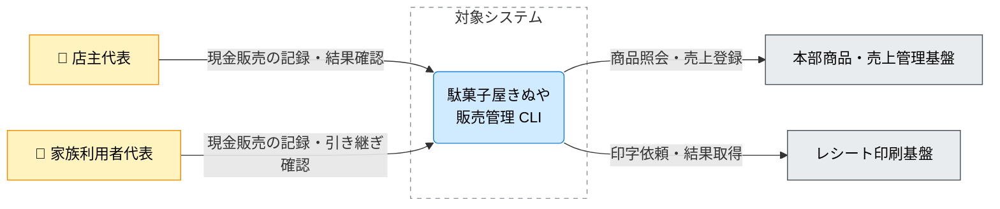

---
specdojo:
  id: specdojo:cxd-sample
  type: architecture
  status: draft
  rulebook: specdojo:cxd-rulebook
  part_of: []
  based_on: []
---

# 駄菓子屋きぬや 販売管理 CLI C4コンテキスト図

## 1. 概要

店主代表と家族利用者代表が現金販売を記録し、会計と印字の結果を次の店番へ引き継ぐための販売管理 CLI を対象とする。店頭での操作、商品・売上の外部管理、レシート印刷の責任分界を定義し、通信や印字の失敗を会計のやり直しと混同しないようにする。本図は [[specdojo:clis-sample|販売管理 CLI 仕様]] と同じ学習用の構成を扱い、通常利用のタブレット画面、在庫調整、つけ管理、仕入れ、キャッシュレス決済は対象外とする。

| 対象者                 | 課題・関心事                                   | 本図で確認する内容                                     |
| ---------------------- | ---------------------------------------------- | ------------------------------------------------------ |
| 店主代表               | 暗算やノートへの転記に頼らず販売結果を把握する | 会計の判断を人間が担い、外部連携の失敗を区別できること |
| 家族利用者代表         | 店主不在でも同じ境界と手順で店番を続ける       | 自分が操作する範囲と、保留時に店主へ戻す判断           |
| 技術メンター・開発担当 | CLI と外部基盤の責務を分ける                   | 商品・売上の管理主体、会計と印刷の分界                 |
| 同行レビュー担当       | 二重会計と結果不明の見落としを防ぐ             | 境界テストの対象と、契約未整備の経路                   |

_ASSUMPTION_: 店舗端末1台から人が操作し、商品照会と売上登録には本部商品・売上管理基盤を使う。これは学習用 CLI に限った外部 API の仮定であり、複数店舗展開や本格会計を初期範囲に加えるものではない。

## 2. C4コンテキスト図（Mermaid）

矢印は主たる操作・依頼の方向を表し、照会結果や受付応答は同じ関係に含む。来店客は店番担当を介して現金とレシートを受け渡し、CLI を直接操作しないため Person に含めない。

## 3. 要素と境界の定義

### 3.1. 対象システムとシステム境界

| 項目               | 内容                                                                                                           |
| ------------------ | -------------------------------------------------------------------------------------------------------------- |
| システム名         | 駄菓子屋きぬや 販売管理 CLI                                                                                    |
| 提供する中核責務   | 取引開始、明細追加、請求額確認、現金会計の確定、確定前取消、会計・印字結果の表示と記録                         |
| 境界内に含める範囲 | 人からの操作受付、金額計算、取引状態と販売実績・レシート控えの保持、外部基盤への依頼と応答の取り扱い           |
| 境界外へ委ねる範囲 | 商品マスタと売上受付は本部基盤、機器制御と物理印字は印刷基盤、現金授受と保留取引の業務判断は店番担当・店主代表 |

### 3.2. Person（人・ロール）

| Person（図中ラベル） | 対応ロール・利用者区分 | 利用目的・主な関わり                                 | 境界上の接点・確認責務                                                     |
| -------------------- | ---------------------- | ---------------------------------------------------- | -------------------------------------------------------------------------- |
| 店主代表             | 店舗責任者・店番担当   | 自分で販売を記録し、保留取引と引き継ぎ結果を確認する | CLI の結果と現金・本部受付を照合し、確定後の訂正や結果不明の取引を判断する |
| 家族利用者代表       | 店番担当               | 現金販売を記録し、請求額と釣銭を提示する             | 完了・未印字・結果不明を区別し、未解決の取引番号と記録を店主代表へ渡す     |

技術メンター・開発担当と同行レビュー担当は本図を設計・検証に用いる関係者であり、店頭販売の直接操作者としては描かない。

### 3.3. External Software System（外部システム）

| 外部システム（図中ラベル） | 区分・利用条件                                     | 対象システムとの責任分界                                                   | 不在・障害時の影響と境界上の扱い                                                                                   |
| -------------------------- | -------------------------------------------------- | -------------------------------------------------------------------------- | ------------------------------------------------------------------------------------------------------------------ |
| 本部商品・売上管理基盤     | 商品照会・会計確定に使う外部 API                   | CLI が商品コードや販売実績を渡し、本部側が商品情報の返却と売上受付を担う   | 商品照会失敗では明細を追加しない。売上要求後の応答欠落では受付済みの可能性があるため、結果不明を未登録と断定しない |
| レシート印刷基盤           | 会計確定後に使う店舗端末上の外部コマンド・ドライバ | CLI が保存済みのレシートを渡し、外部基盤がプリンタとの通信と物理印字を担う | 未導入・異常終了・時間切れでは印字未完了を示す。確定済み会計を維持し、控えと紙面を確認してから再印刷を判断する     |

### 3.4. Relationship（関係・連携契約）

| 関係 ID  | 起点 → 終点                           | 図中ラベル                   | やり取りする情報・制御の要点                   | 連携方式・境界               | 正本・関連仕様                                                        |
| -------- | ------------------------------------- | ---------------------------- | ---------------------------------------------- | ---------------------------- | --------------------------------------------------------------------- |
| `REL-01` | 店主代表 → 販売管理 CLI               | 現金販売の記録・結果確認     | 購入明細・預かり金の入力、会計・印字状態の確認 | 人間による CLI 操作          | [[specdojo:clis-sample\|販売管理 CLI 仕様]]                           |
| `REL-02` | 家族利用者代表 → 販売管理 CLI         | 現金販売の記録・引き継ぎ確認 | 販売操作と結果の確認、保留取引の引き継ぎ       | 人間による CLI 操作          | [[specdojo:clis-sample\|販売管理 CLI 仕様]]                           |
| `REL-03` | 販売管理 CLI → 本部商品・売上管理基盤 | 商品照会・売上登録           | 商品情報の取得、販売実績の送信と受付応答       | 外部 API 呼び出し            | `ifx-api-kinuya-products.yaml`、`ifx-api-kinuya-sales.yaml`（未同梱） |
| `REL-04` | 販売管理 CLI → レシート印刷基盤       | 印字依頼・結果取得           | 保存済みレシートの引き渡しと印字結果の取得     | ローカル外部コマンド呼び出し | [[specdojo:ifx-cmd-sample\|レシート印刷コマンド連携仕様]]             |

引数、電文、保存ファイルの構造は各操作・連携の正本へ委ねる。本図の外部 API の参照名は架空契約であり、未同梱の状態を実接続可能な保証とは扱わない。

## 4. 技術前提・制約と検証観点

### 4.1. 技術前提・制約

- 単一店舗・単一端末で人が操作する。無人会計や通信不能時の販売継続は扱わない。
- 会計確定と物理印字の成否を分ける。印刷のために会計・売上登録を再実行しない。
- 外部 API の認証は実行環境で準備する。仕様・販売記録・レシートへ認証値を記載しない。

### 4.2. システム境界・外部依存の検証観点

| 確認区分           | 対象関係・境界     | 検証観点                                                                                     | 主確認ロール |
| ------------------ | ------------------ | -------------------------------------------------------------------------------------------- | ------------ |
| 利用者と判断の分界 | `REL-01`・`REL-02` | 両者が同じ結果区分を確認でき、保留取引を店主代表へ引き継げるか                               | PO / BA      |
| 本部 API の失敗    | `REL-03`           | 商品照会失敗で明細が増えず、売上応答欠落では照合前に再登録しないか                           | QE / ARC     |
| 印刷の失敗         | `REL-04`           | 時間切れ・結果不正でも会計を維持し、警告・控え・紙面を照合できるか。再印刷で売上が増えないか | QE / DEV     |

## 5. メモ / 将来課題

| 対象・論点          | 影響範囲                                             | 担当ロール | 解消条件・引き継ぎ先                                                                                                                              |
| ------------------- | ---------------------------------------------------- | ---------- | ------------------------------------------------------------------------------------------------------------------------------------------------- |
| 架空の本部 API 契約 | `REL-03`。売上の受付照会・重複排除・保存失敗後の回復 | ARC / DEV  | `ifx-api-kinuya-products.yaml`・`ifx-api-kinuya-sales.yaml` の整備時に照合方法を定める。QE が期待結果を確認するまで結果不明の取引を自動再送しない |
| 印字経路の実機確認  | `REL-04`。未印字と結果不明、二重印字の識別           | DEV / QE   | 開発担当と店番担当が紙面・控えの照合と再印刷を確認し、会計を再実行しないことを検証する                                                            |
| 内部構成・配置      | 取引記録と外部連携を担う内部構成                     | ARC        | 未同梱の `cnd-kinuya-sales-cli`・`ifd-kinuya-sales-cli` で記録と実行環境を詳細化し、本図の外部境界を維持する                                      |
