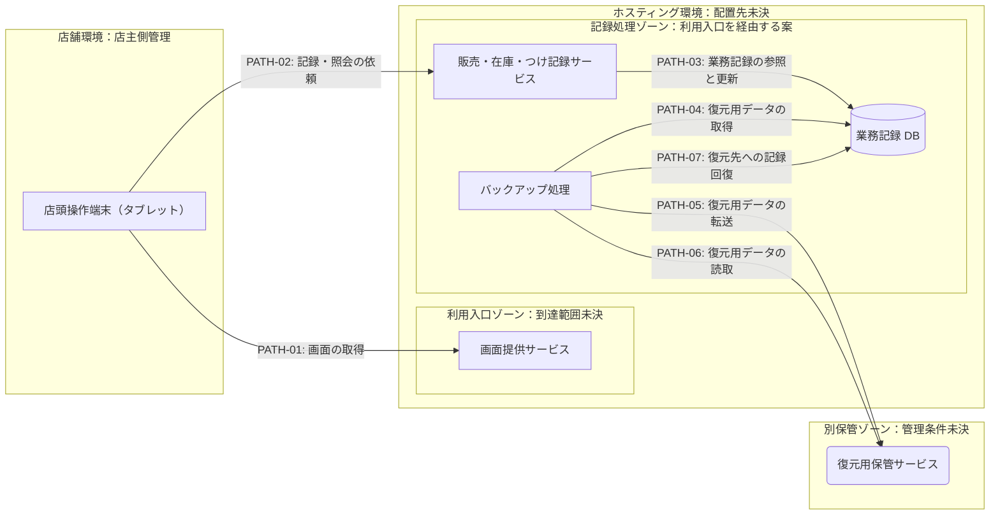

---
specdojo:
  id: specdojo:ifd-sample
  type: architecture
  status: draft
  owner: ARC
  rulebook: specdojo:ifd-mermaid-rulebook
  part_of: []
  based_on: []
  supersedes: []
---

# 駄菓子屋きぬや 販売管理システム インフラ構成図

## 1. 概要

単一店舗のタブレットから販売・在庫・つけの情報を記録する配置案を示す。店主代表が店舗外へ渡る情報と通信依存を判断し、技術メンター・開発担当が接続境界を設計し、同行レビュー担当が通信断・保存失敗・復元の検証対象を選べるようにする。

[[specdojo:prj-overview-sample|プロジェクト概要]] の「まず記録する」方針を受け、店舗の利用経路、記録の正本、保管先を区別する。図は業務手順・画面・データ schema・接続設定・運用手順を定義しない。技術メンターが ARC、開発担当が DEV、同行レビュー担当が QE、店主代表が公開・利用判断の PO を担う学習用の責務対応とする。

_ASSUMPTION_: 本例だけの配置仮説として、通常利用のタブレットからホスティング環境のアプリを利用し、記録の正本を同環境の DB に置く。クラウド製品、費用上限、公開範囲、オフライン運用は未決で、実案件で採択した構成ではない。上位構成図 `cnd-kinuya` は未同梱の架空参照名であり、`based_on` は未接続とする。

## 2. インフラ構成図（Mermaid）

全経路は未検証の配置仮説である。実線は操作・参照・転送の起点から終点への向きで、応答を含む。枠は管理・到達範囲を検討する論理区分で、通信制御の実装を保証しない。記録サービスは利用入口を介して呼び出す想定だが、入口の中継方式は省略し、タブレットからの依頼を一つの論理線で描く。`PATH-05` と `PATH-06` は保存時と復元時の別操作で、常時の双方向同期を表さない。

## 3. 配置と境界の定義

| 図中の環境・要素                              | 上位要素との対応               | 管理主体                                       | 保持情報・到達条件                                                                               |
| --------------------------------------------- | ------------------------------ | ---------------------------------------------- | ------------------------------------------------------------------------------------------------ |
| 店舗環境 / 店頭操作端末                       | 店頭操作の接点に対応する案     | 店主側。技術支援は開発担当                     | 店主代表・家族利用者代表が使うタブレット。正本 DB の複製を端末に保持する前提は置かない           |
| 利用入口ゾーン / 画面提供サービス             | 画面提供を担う要素に対応する案 | アプリは開発担当、基盤は提供事業者             | 配信する画面資材。顧客のつけ記録を公開資材へ混ぜない                                             |
| 記録処理ゾーン / 販売・在庫・つけ記録サービス | 業務記録の処理に対応する案     | 開発担当                                       | 店頭要求と処理結果。店舗からの依頼は入口で認証・到達制御する案で、管理用操作の経路は別途設計する |
| 業務記録 DB                                   | 記録の正本に対応する案         | 論理データは店主側、技術管理は開発担当         | 販売・在庫・顧客とつけの記録。アプリとバックアップ処理から使い、店舗端末の直接接続先にしない     |
| バックアップ処理                              | 保全・復元を担う補助処理       | 開発担当                                       | 復元用データと処理結果。業務更新と同じ処理として扱わない                                         |
| 別保管ゾーン / 復元用保管サービス             | 正本の復元用コピーに対応する案 | 開発担当と提供事業者。保管可否は店主代表が判断 | 復元用コピー。別枠であることだけでは障害独立性・閲覧制限・消去を保証しない                       |

本例は店頭での記録と復元用保全に絞り、管理端末、監視基盤、開発・検証環境は描かない。これらの配置と権限は実運用前の技術構成・運用設計へ渡す。架空の上位図との対応は未確認であり、役割の候補として示す。

## 4. 通信経路と情報の境界

接続契約・構文・データ構造の架空参照名は未同梱である。表は境界を越える情報の種類と利用条件だけを示す。

| 経路 ID               | 起点 → 終点                                         | 目的・情報の要点                                       | 利用条件・詳細の委譲先                                                                       |
| --------------------- | --------------------------------------------------- | ------------------------------------------------------ | -------------------------------------------------------------------------------------------- |
| `PATH-01`             | 店頭操作端末 → 画面提供サービス                     | 操作開始時の画面資材の取得                             | 店頭利用時。配信先と入口条件は `tsd-kinuya-hosting` へ委ねる                                 |
| `PATH-02`             | 店頭操作端末 → 販売・在庫・つけ記録サービス         | 販売明細・在庫確認・顧客識別とつけの記録要求、処理結果 | 店番担当の操作時。認証と情報範囲は `ifx-api-kinuya` へ委ねる                                 |
| `PATH-03`             | 販売・在庫・つけ記録サービス → 業務記録 DB          | 記録の読取・更新と保存結果                             | 業務処理時。項目・整合性は `kinuya-record-schema` を正本候補とする                           |
| `PATH-04`             | バックアップ処理 → 業務記録 DB                      | 復元に必要な記録の取得                                 | 保存を行う場合。取得対象と整合した時点の扱いは `ops-kinuya-backup` へ委ねる                  |
| `PATH-05`             | バックアップ処理 → 復元用保管サービス               | 店舗外の別保管先へ復元用コピーを送る                   | 保全を選択した場合。保管期間・権限・転送条件は `ops-kinuya-backup` へ委ねる                  |
| `PATH-06` / `PATH-07` | バックアップ処理 → 復元用保管サービス / 業務記録 DB | 対象コピーを読み、選んだ DB へ記録を回復する           | 店主代表が回復対象を判断した場合。復元先の隔離と業務再開判断は `ops-kinuya-restore` へ委ねる |

端末へ結果が届かない場合は、未保存と断定して同じ販売を記録し直さない。受付結果と DB の保存結果を照合できる契約が必要であり、本図から自動再送・重複排除の保証は導かない。

## 5. 技術前提・制約と検証観点

### 5.1. 技術前提・制約

- 通常利用は単一店舗のタブレットを前提とする。ホスティング環境への通信が利用条件になる配置案であり、通信不能時にも記録を継続できる構成を保証しない。
- 顧客とつけの情報は店舗外の処理・保管へ渡る可能性がある。店主代表が送信範囲・閲覧者・保管条件を判断するまで、本例を根拠に実データを投入しない。
- アプリ用と保全・復元用の到達条件を分ける。DB を枠内に描くだけで直接接続が拒否されるとはしない。入口、DB、保管先の権限・到達性は個別に確認する。
- バックアップの成功と復元可能性を区別する。取得時点、復元対象、障害の独立性、許容停止・損失の条件は運用設計で判断し、値を本図へ再掲しない。

### 5.2. 境界・障害の検証対象

以下は同行レビュー担当と開発担当が設計する確認で、実施済みの証跡ではない。

| 対象経路・境界             | 障害条件・影響                               | 観測する結果・切り分け対象                                               | 主確認ロール  |
| -------------------------- | -------------------------------------------- | ------------------------------------------------------------------------ | ------------- |
| `PATH-01` / 利用入口       | 店舗通信断・配信失敗で画面を開始できない     | 端末の通信状態と配信応答を分け、記録操作に入れるかを確認する             | QE / DEV      |
| `PATH-02`                  | 認証拒否・応答欠落で記録結果を判断できない   | 要求の受付と保存結果を照合し、利用者が保留すべき対象を識別できるか       | QE / DEV      |
| `PATH-03` / 記録処理ゾーン | DB 停止・更新拒否で記録できない              | DB の応答とアプリの保存結果通知を対応付け、未保存を成功表示しないか      | QE / DEV      |
| DB の到達境界              | 許可していない接続元から記録へ到達する       | 店舗端末などからの直接接続が拒否され、許可した業務経路だけが利用できるか | ARC / QE      |
| `PATH-04` / `PATH-05`      | 取得失敗・転送失敗で復元用コピーがそろわない | 取得した対象、転送結果、保管先のコピーを照合できるか                     | QE / DEV      |
| `PATH-06` / `PATH-07`      | コピー破損・復元先誤りで記録を回復できない   | 選んだコピーと復元先、回復した業務記録を対応付けて確認できるか           | QE / DEV / PO |

監視の候補は入口応答、業務保存結果、DB 到達性、保全結果、復元確認結果である。通知先・頻度・閾値と障害対応操作は `ops-kinuya-monitoring` で定める。

## 6. メモ / 将来課題

| 対象・論点                              | 影響                                                     | 担当           | 解消条件・引き継ぎ先                                                                                         |
| --------------------------------------- | -------------------------------------------------------- | -------------- | ------------------------------------------------------------------------------------------------------------ |
| _ASSUMPTION_: ホスティング配置と正本 DB | 上位要素・費用・運用負荷との対応が未確認                 | ARC / PO       | `cnd-kinuya` で役割を照合し、費用と担当負荷を判断して `tsd-kinuya-hosting` を整備する                        |
| _TODO_: 店舗外へ渡る情報と到達制御      | 顧客・つけ情報の利用範囲と認証が未確定                   | PO / ARC       | 店主代表が利用者と情報範囲を判断し、`ifx-api-kinuya` と技術構成へ反映する                                    |
| _TODO_: 通信不能時・結果不明時の扱い    | 店番の継続可否と再記録の判断が未確定                     | PO / BA / DEV  | 店主代表が現場の保留方法を判断し、受付照合の契約と業務・運用手順を整備する                                   |
| _TODO_: 保全・復元の成立条件            | 別保管先の独立性・保管期間・復元先が未確定               | ARC / DEV / PO | 損失と停止の許容条件を判断し、`ops-kinuya-backup` / `ops-kinuya-restore` に確認方法を定める                  |
| _TODO_: 詳細正本と管理経路              | 参照した架空仕様は未同梱。監視・管理用操作の配置も未整備 | ARC / DEV      | `kinuya-record-schema` と `ops-kinuya-monitoring` を含む正本を整備し、実運用前に管理主体・到達条件を確定する |
