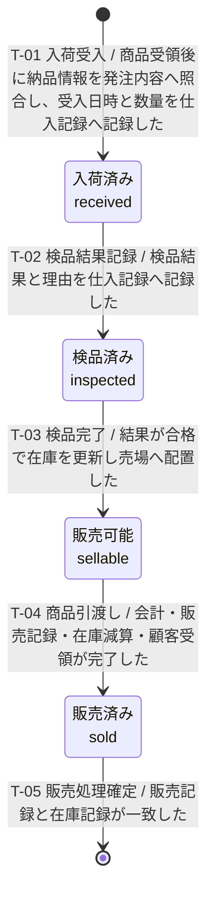
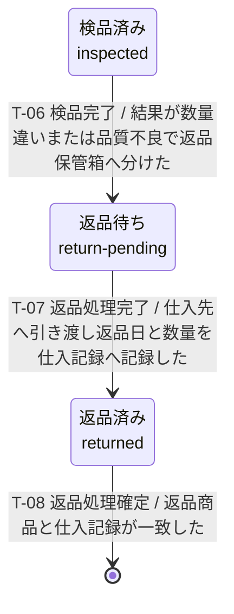

---
specdojo:
  id: specdojo:stsd-sample
  type: data
  status: draft
  rulebook: specdojo:stsd-rulebook
  based_on:
    - specdojo:sample-authoring-standard
---

# 商品のステータス定義

駄菓子屋きぬやの商品について、納品から販売または返品までの状態と遷移を定義する。

## 1. 目的

商品の受入から販売・返品までの進み具合と販売可否を管理する。店主代表と家族利用者代表が、検品、売場補充、顧客への引渡し、仕入先への返品のどれを次に行えるか判断するために使う。

## 2. 適用範囲

- 対象: 店舗が仕入先へ発注し、納品を受けた商品
- 業務範囲: 商品の受領を起点とする入荷受入、検品、売場補充、販売、仕入先への返品。納品前の発注業務と顧客への引渡し後の対応は対象外とする
- 到達点: 販売処理確定または返品処理確定で店舗管理のライフサイクルを終了する

## 3. 状態の判定

- 状態の正本: 仕入記録、在庫記録、販売記録。現物の配置は売場棚または返品保管箱で補助確認する
- 一意判定: 対象商品の記録を業務の発生順に照合し、開始から遷移表の条件を満たす遷移を順にたどり、最後に成立した遷移の遷移先を現在状態とする。入荷受入前は状態を割り当てず、後続遷移が成立した時点で遷移元の状態は終了するため、同時に複数状態へは分類しない
- 互換の扱い: 旧状態値・旧イベントの読み替えは不要とする。記録が欠けて判定できない場合は現物だけで補完せず、店主代表が記録を確認・補記した後に再判定する

## 4. 状態一覧

| 値             | 状態名   | 通称       | 意味                                                     | 成立条件                                                                                     | 管理場所             |
| -------------- | -------- | ---------- | -------------------------------------------------------- | -------------------------------------------------------------------------------------------- | -------------------- |
| received       | 入荷済み | 入った品   | 店舗が納品を受け、検品結果が未確定の商品                 | 納品情報を発注内容へ照合して受入日時と数量を仕入記録へ記録し、検品結果をまだ記録していない   | 仕入記録、検品場所   |
| inspected      | 検品済み | 検品した品 | 検品結果を記録し、結果に応じた配置または分離の途中の商品 | 検品結果と理由を仕入記録へ記録し、在庫更新・売場配置または返品保管箱への分離が完了していない | 仕入記録、検品場所   |
| sellable       | 販売可能 | 売れる品   | 検品に合格し、店頭販売できる商品                         | 検品合格を記録し、在庫数量を更新して受入品を売場棚へ配置し、販売完了をまだ記録していない     | 在庫記録、売場棚     |
| sold           | 販売済み | 売れた品   | 会計を終え、店舗在庫から顧客へ引き渡した商品             | 販売記録を確定し、在庫を減算して、顧客が商品を受領した                                       | 販売記録             |
| return-pending | 返品待ち | 返す品     | 数量違いまたは品質不良により受入不可の商品               | 不合格理由を仕入記録へ記録して返品保管箱へ分け、返品日と数量をまだ記録していない             | 仕入記録、返品保管箱 |
| returned       | 返品済み | 返した品   | 仕入先へ返却し、店舗の管理対象から外れた商品             | 仕入先へ商品を引き渡し、返品日と数量を仕入記録へ記録した                                     | 仕入記録             |

## 5. 状態遷移

検品後の販売と返品を分けて確認するため、通常系と例外系に分割する。

通常系（`T-01`〜`T-05`）。例外系との共有状態は検品済み（`inspected`）。

| 遷移 ID | 遷移元   | 遷移先   | イベント     | 条件                                                                       | 補足                                     |
| ------- | -------- | -------- | ------------ | -------------------------------------------------------------------------- | ---------------------------------------- |
| `T-01`  | 開始     | 入荷済み | 入荷受入     | 商品受領後に納品情報を発注内容へ照合し、受入日時と数量を仕入記録へ記録した | 検品前の商品を一意に識別する             |
| `T-02`  | 入荷済み | 検品済み | 検品結果記録 | 検品結果と理由を仕入記録へ記録した                                         | 後続作業中も現在状態を判定できる         |
| `T-03`  | 検品済み | 販売可能 | 検品完了     | 結果が合格で在庫を更新し売場へ配置した                                     | 販売グループへ売場商品を引き渡せる       |
| `T-04`  | 販売可能 | 販売済み | 商品引渡し   | 会計・販売記録・在庫減算・顧客受領が完了した                               | 販売記録で顧客への引き渡しを確認する     |
| `T-05`  | 販売済み | 終了     | 販売処理確定 | 販売記録と在庫記録が一致した                                               | 店舗在庫としてのライフサイクルを終了する |

例外系（`T-06`〜`T-08`）。通常系との共有状態は検品済み（`inspected`）。

| 遷移 ID | 遷移元   | 遷移先   | イベント     | 条件                                             | 補足                                           |
| ------- | -------- | -------- | ------------ | ------------------------------------------------ | ---------------------------------------------- |
| `T-06`  | 検品済み | 返品待ち | 検品完了     | 結果が数量違いまたは品質不良で返品保管箱へ分けた | 合格条件と相互排他的に判定する                 |
| `T-07`  | 返品待ち | 返品済み | 返品処理完了 | 仕入先へ引き渡し返品日と数量を仕入記録へ記録した | 仕入記録を返品経路の正本とする                 |
| `T-08`  | 返品済み | 終了     | 返品処理確定 | 返品商品と仕入記録が一致した                     | 店舗の管理対象としてのライフサイクルを終了する |
