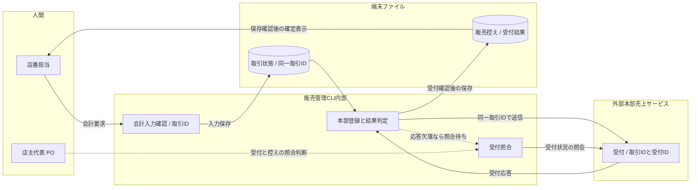
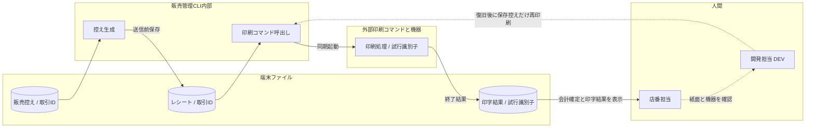

---
specdojo:
  id: specdojo:sysd-critical-flows-sample
  type: architecture
  status: draft
  owner: ARC
  rulebook: specdojo:sysd-critical-flows-rulebook
  part_of: []
  based_on: []
---

# 駄菓子屋きぬや 販売管理システム重要フロー

## 1. 概要（対象・運用方針）

単一店舗・タブレット1台で、店主代表と家族利用者代表が販売を記録して店番を引き継ぐ。会計確定とレシート印字の境界を誤ると二重売上や二重請求につながるため、重要フローをこの2件に絞る。商品閲覧、明細入力、在庫分析は対象外とし、追加する場合も最大5件に収める。

_ASSUMPTION_: 学習用の設計例として、販売 CLI から本部売上サービスへ送信し、端末に販売控えとレシートを保存する。単一端末でも応答欠落や操作の繰り返しは起こり得る。本部の受付照会・重複排除契約を未整備のまま自動再送しない。

公開対象は設計条件と架空の検証ケースであり、実際の顧客名・購入履歴・つけ残高・認証情報を含めない。開発担当 DEV が設計を更新し、技術メンター ARC が境界、同行レビュー担当 QE が期待結果、店番を担う家族利用者代表が操作と引継ぎを確認する。人間の店主代表 PO が業務条件・実運用・公開の最終判断を行う。

設計索引 `kinuya-sysd-index`、取引状態仕様 `kinuya-stsd-sale` は未同梱の架空参照名で、SU-01で追跡する。本例の「会計確定」は本部受付とローカル販売実績の保存が確認できた状態、「照合待ち」は受付の成否を断定できない状態を指す。正式な状態体系は状態仕様へ委譲する。

## 2. 重要フロー一覧（最大5件）

| Flow ID | フロー名                       | 事故論点                 | 利用者・運用者                       | 放置時の業務影響                                               | 期待効果・選定理由                                                 |
| ------- | ------------------------------ | ------------------------ | ------------------------------------ | -------------------------------------------------------------- | ------------------------------------------------------------------ |
| scf-001 | 会計確定と受付結果の照合       | 冪等・応答欠落・部分成功 | 店番担当、店主代表 PO、開発担当 DEV  | 売上の二重計上や受付済み取引の取消で、閉店時の照合負荷が増える | 同じ取引の記録を一件に保つ。閲覧より金銭・引継ぎへの影響が大きい   |
| scf-002 | 確定後のレシート保存と印字回復 | 外部コマンド障害・再実行 | 店番担当、運用助言 OPS、開発担当 DEV | 印字失敗を会計失敗と誤認して再請求し、または紙の控えを失う     | 売上と印字の結果を分ける。通常表示と異なり外部機器の結果確認が必要 |

## 3. フロー詳細（IDごと）

図の実線は同期の操作・応答、破線は応答欠落後の照合や人間による後続対応を示す。システム内部の処理、端末保存、外部サービス／機器、人間を subgraph で分ける。

### 3.1. scf-001: 会計確定と受付結果の照合

- **目的・起動**: 店番担当が明細・請求額・預かり金を確認して会計を要求したとき、売上を一度だけ確定する。
- **範囲・入出力**: 入力は取引 ID、確定する明細、預かり金。出力は本部受付結果、ローカル販売実績、釣銭と確定表示、または照合待ち。明細訂正と印字は対象外。

- **永続化点**: 会計要求前の取引状態、本部受付記録、ローカル販売実績。要求送信だけでは会計確定としない。本部受付後の控え保存失敗も成功表示を保留する。
- **整合性・再実行**: 取引 ID を本部受付と端末控えの照合キーにする。受付済みなら記録を回復し、未受付と確認できた場合だけ同じ取引の送信を再開する。確認不能なら照合待ちを保つ。自動再送の上限や間隔は未整備の本部契約から推測しない。
- **失敗・補償**: 入力不正は送信前に訂正する。応答欠落・保存失敗では明細と受付情報を保持し、店主代表 PO と開発担当 DEV が照合する。受付済み売上を取引ファイルの削除や確定前取消で戻さない。返品・確定後訂正は別の業務判断へ渡す。
- **受入 KA-01**: 店番担当は「確定」「照合待ち」を見分けられる。同行レビュー担当 QE は同一取引の繰り返し操作でも本部売上一件、端末控え一件になることを確認し、店主代表 PO は照合待ちからの引継ぎを判断できる。

### 3.2. scf-002: 確定後のレシート保存と印字回復

- **目的・起動**: 会計確定後に取引の控えを印字し、印字だけの失敗を回復できるようにする。
- **範囲・入出力**: 入力は保存済み販売実績、出力はレシートファイルと印字結果。売上の再送・再会計は含めない。

- **永続化点・再実行**: 印刷前のレシートファイルと試行ごとの印字結果。取引 ID と試行識別子で追跡する。紙の重複排除は保証しないため、結果不明の試行は紙面確認前に再印刷しない。
- **失敗・再開**: 控え保存に失敗したら印刷を開始せず、販売実績を保持して DEV が容量・権限を回復する。印刷の未開始／失敗／結果不明はそれぞれ警告し、PO／店番担当が紙面を確認する。復旧後は保存控えを使い、会計・本部登録を再実行しない。
- **受入 KA-02**: 店番担当は印字未完了でも会計が確定済みであること、保持控えと次の手を確認できる。QE は印刷失敗後の回復で売上件数が増えず、結果不明時に自動再印刷されないことを確認する。

## 4. 観測性と運用連携

### 4.1. 検知と責任

分散 trace は本例では採用しない。取引 ID を CLI・本部受付・端末控えへ、印字試行識別子をコマンド結果へ接続し、actor、時刻、処理結果、停止段階を照合する。公開ログには明細・顧客情報・認証情報を含めない。

| Flow ID | 検知条件・設計上の閾値                               | 機械の動作                                         | 人間の対応・問い合わせ先                           |
| ------- | ---------------------------------------------------- | -------------------------------------------------- | -------------------------------------------------- |
| scf-001 | 一件でも受付不明・保存失敗・同一取引の重複を検出     | 確定表示と新しい会計を保留し、同じ取引の記録を保持 | 店番担当 → PO が照合、技術調査は DEV → ARC         |
| scf-002 | 一件でも控え保存失敗・印字未完了・印字結果不明を検出 | 会計結果を維持し、印字警告と保持先を表示           | 店番担当が紙面確認、DEV が復旧、OPS が引継ぎを確認 |

上記は本例のイベント条件で、営業時間外の通知先や応答期限は未決である。SU-03を解消するまで常駐監視や無人復旧があるとは扱わない。

### 4.2. 管理記録への引渡し

| 条件                                 | 記録種別       | 担当・対応方針と判断先                                    |
| ------------------------------------ | -------------- | --------------------------------------------------------- |
| 受付不明、重複、保存失敗、印字未完了 | issue          | DEV が取引 ID と保持状態を PM へ渡し、PO が照合結果を判断 |
| 本部契約・復旧手順・通知条件の未整備 | risk           | PM が受入への影響を記録し、OPS／ARC が補完案を提示        |
| 自動再送・印刷方式の追加変更         | change-request | ARC／DEV が条件と費用を示し、PO が採否を判断              |
| 照合・運用留保・公開可否の結論       | decision       | PO の結論と対象範囲を PM が判断記録へ接続                 |

## 5. 関連ドキュメント導線（SDI/テスト/運用/DEC）

### 5.1. 正本と変更影響

架空の参照名はすべて未同梱であり、実在する実装・自動テストとして示すものではない。

| Flow ID | 設計・設定の正本                                                     | 変更時に確認する契約・互換性                                                              | 運用・判断の追跡先                                        |
| ------- | -------------------------------------------------------------------- | ----------------------------------------------------------------------------------------- | --------------------------------------------------------- |
| scf-001 | `kinuya-sysd-index`、`kinuya-stsd-sale`、`ifx-api-kinuya-sales.yaml` | `kinuya-sales-record-schema`、受付済みの旧控えから取引を照合できること、会計CLIの停止表示 | `kinuya-opr-sale-reconciliation`、SU-01／02、`KIN-DEC-01` |
| scf-002 | [[specdojo:ifx-cmd-sample\|レシート印刷コマンド連携仕様]]            | `kinuya-receipt-format-schema`、保存済み控えを再印刷できること、印字警告の表示            | `kinuya-opr-reprint`、SU-03、`KIN-DEC-02`                 |

### 5.2. 検証への引渡し

以下の ID は本例内で定義する手動シナリオであり、実行済みの証跡ではない。QE が DEV と試験用受付・印刷先を準備し、実データを使わず実施する。自動試験コマンドの決定は SU-02へ渡す。

| テストID / 対象   | 実行方法・対象条件                                                              | pass / fail の判定                                                                       |
| ----------------- | ------------------------------------------------------------------------------- | ---------------------------------------------------------------------------------------- |
| KIN-CF-01 / KA-01 | 同一取引で正常会計後に同じ操作を要求し、本部と端末の件数を照合                  | 売上一件・控え一件を保てばpass、二重計上ならfail                                         |
| KIN-CF-02 / KA-01 | 試験用本部が受付後に応答を落とす。PO の照合で受付済みと確認し、控え回復まで追う | 照合前の自動再送なし、回復後一件ならpass。取消や新規取引への置換で隠せばfail             |
| KIN-CF-03 / KA-01 | 受付後の控え保存を失敗させ、容量・権限回復後に記録を照合                        | 保持情報から受付を回復でき、重複登録しなければpass。受付済み情報の消失ならfail           |
| KIN-CF-04 / KA-02 | 印刷結果を未完了・結果不明に分け、警告と紙面確認後の回復を試す                  | 会計確定を維持し保存控えだけ再印刷できればpass。売上再送または確認前の自動再印刷ならfail |

### 5.3. 未決事項と後続作業

| ID    | 不足・依存と影響                                                           | 作業順・担当・完了条件・判断時期                                                                                                         |
| ----- | -------------------------------------------------------------------------- | ---------------------------------------------------------------------------------------------------------------------------------------- |
| SU-01 | 索引・状態仕様・保存構造が未同梱。正式な実装入力へ未接続                   | ARC／DEV が参照正本を整備 → QE が境界と用語を照合。実装開始前に PM が issue と依存作業を計画                                             |
| SU-02 | 本部受付・照会・重複排除契約と自動テストは未整備。自動再送と会計受入を保留 | ARC／DEV が契約と回復方法を定義 → QE が KIN-CF-01〜03 を確認 → PO が採否を判断。会計受入前に risk として管理                             |
| SU-03 | 照合・再印刷OPR、通知先・応答期限は未整備。別の店番へ復旧を委ねられない    | OPS／DEV が手順を作成 → 家族利用者代表と QE が KIN-CF-04 と引継ぎを確認 → PO が運用開始を判断。開始前に PM が risk／必要な変更要求を記録 |

### 5.4. 承認対象と公開前条件

PO が scf-001 の照合待ち・確定・取消境界と、scf-002 の会計と印字の分離を承認する。判断材料は KA-01／02、KIN-CF-01〜04の結果、SU-01〜03の解消または留保の影響である。DEV が参照正本、QE が期待結果、OPS が復旧の引継ぎ、PM が未決事項の記録先を提示し、PO が実運用と公開の可否を別々に判断する。

本例は設計文書としての完成例であり、未同梱の契約や手順の存在・実装成功を表さない。公開前は非公開記録の除外を確認し、人間の判断を得るまで `draft` を維持する。
