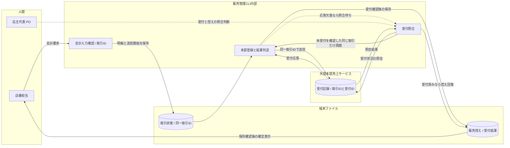
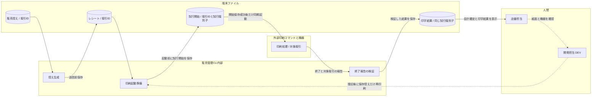

---
specdojo:
  id: specdojo:sysd-critical-flows-sample
  type: architecture
  status: draft
  owner: ARC
  rulebook: specdojo:sysd-critical-flows-rulebook
  part_of: []
  based_on: []
---

# 駄菓子屋きぬや 販売管理システム重要フロー

## 1. 概要（対象・運用方針）

単一店舗・タブレット1台で、店主代表と家族利用者代表が販売を記録して店番を引き継ぐ。[[specdojo:prj-overview-sample|プロジェクト概要]] の「まず記録する」方針に対応し、会計要求から受付照合、確定後のレシート保存・印字回復までを扱う。境界を誤ると二重売上や二重請求につながるため、重要フローをこの2件に絞る。商品閲覧、明細入力、在庫分析は対象外とし、追加候補は統合・置換を判断して最大5件に収める。

_ASSUMPTION_: [[specdojo:clis-sample|販売管理 CLI 仕様]] と同じ学習用の現金販売 CLI を扱い、本部売上サービスへの送信、端末への販売控え・レシート保存、USB 直結プリンタへの同期印字を前提とする。通常のタブレット画面、つけ販売、キャッシュレス決済、オフライン販売の継続は本例の対象外。本部の受付照会・重複排除契約を未整備のまま自動再送しない。

公開対象は設計条件と架空の検証ケースであり、実際の顧客名・購入履歴・つけ残高・認証情報を含めない。開発担当 DEV が設計を更新し、技術メンター ARC が境界、同行レビュー担当 QE が期待結果、店番を担う家族利用者代表が操作と引継ぎを確認する。人間の店主代表 PO が業務条件・実運用・公開の最終判断を行う。

設計索引 `kinuya-sysd-index`、取引状態仕様 `kinuya-stsd-sale` は未同梱の架空参照名で、SU-01で追跡する。本例の「会計確定」は本部受付とローカル販売実績の保存が確認できた状態、「照合待ち」は受付の成否を断定できない状態を指す。正式な状態体系は状態仕様へ委譲する。

## 2. 重要フロー一覧（最大5件）

| Flow ID | フロー名                       | 事故論点                 | 利用者・運用者（Role code）          | 放置時の業務影響                                               | 期待効果・選定理由                                                 |
| ------- | ------------------------------ | ------------------------ | ------------------------------------ | -------------------------------------------------------------- | ------------------------------------------------------------------ |
| scf-001 | 会計確定と受付結果の照合       | 冪等・応答欠落・部分成功 | 店番担当、店主代表 PO、開発担当 DEV  | 売上の二重計上や受付済み取引の取消で、閉店時の照合負荷が増える | 同じ取引の記録を一件に保つ。閲覧より金銭・引継ぎへの影響が大きい   |
| scf-002 | 確定後のレシート保存と印字回復 | 外部コマンド障害・再実行 | 店番担当、運用助言 OPS、開発担当 DEV | 印字失敗を会計失敗と誤認して再請求し、または紙の控えを失う     | 売上と印字の結果を分ける。通常表示と異なり外部機器の結果確認が必要 |

## 3. フロー詳細（IDごと）

図の実線は同期の処理・読み書き・要求応答、破線は中断後の照合や人間による後続対応を示す。本例に非同期キューはない。システム内部の処理、端末保存、外部サービス／機器、人間を subgraph で分ける。

### 3.1. scf-001: 会計確定と受付結果の照合

- **目的・起動**: 店番担当が明細・請求額・預かり金を確認して会計を要求したとき、売上を一度だけ確定する。
- **範囲・入出力**: 入力は取引 ID、確定する明細、預かり金。出力は本部受付結果、ローカル販売実績、釣銭と確定表示、または照合待ち。明細訂正と印字は対象外。

- **永続化点**: 送信前に取引 ID と送信対象の明細を保存できなければ本部を呼ばない。送信開始を記録した取引は、再起動後も照合対象とする。本部受付記録とローカル販売実績の両方を確認して初めて確定表示を許す。販売実績保存後・表示前の中断では保存済み結果を再表示し、本部へ再登録しない。
- **整合性・再実行**: 本部と端末の保存は一つのトランザクションにできないため、部分成功を取引 ID で照合して回復する。会計要求後は明細を固定し、端末上で同じ取引の確定処理を重ねない。受付済みなら記録を回復し、未受付と確認できた場合だけ同じ取引の送信を再開する。確認不能なら照合待ちを保つ。排他・保存の実現方法は SU-01、本部契約と再送条件は SU-02 で確定する。
- **失敗・補償**: 入力不正は送信前に訂正する。応答欠落・保存失敗では明細と受付情報を保持し、店主代表 PO と開発担当 DEV が照合する。受付済み売上を取引ファイルの削除や確定前取消で戻さない。返品・確定後訂正は別の業務判断へ渡す。
- **受入 KA-01**: 店番担当は「確定」「照合待ち」を見分けられる。同行レビュー担当 QE は同一取引の繰り返し操作でも本部売上一件、端末控え一件になることを確認し、店主代表 PO は照合待ちからの引継ぎを判断できる。

### 3.2. scf-002: 確定後のレシート保存と印字回復

- **目的・起動**: 会計確定後に取引の控えを印字し、印字だけの失敗を回復できるようにする。
- **範囲・入出力**: 入力は保存済み販売実績、出力はレシートファイルと印字結果。売上の再送・再会計は含めない。

- **永続化点・整合性・再実行**: レシートと試行開始を保存してから印刷を起動し、終了後に結果を保存する。試行識別子は呼出し元の記録であり、プリンタの重複排除キーではない。開始記録だけ残る中断、終了報告の不正、結果保存の失敗は結果不明とし、紙面確認前に再印刷しない。印字完了は終了成功と対象取引の完了報告の両方で判定する。
- **失敗・保持・補償・再開**: レシートまたは開始記録を保存できなければ印刷せず、販売実績を保持して DEV が保存先を復旧する。自動再試行は [[specdojo:ifx-cmd-sample|レシート印刷コマンド連携仕様]] の送信前ビジーと確認できた場合に限り、上限・待機・同時起動制約も同契約へ委ねる。その他の失敗や結果不明は店番担当が紙面を確認し、DEV が復旧する。既に出た紙は取り消せないため、必要な手動再印刷は保存控えだけを使い、会計・本部登録を再実行しない。
- **受入 KA-02**: 店番担当は印字未完了でも会計が確定済みであること、保持控えと次の手を確認できる。QE は印刷失敗後の回復で売上件数が増えず、結果不明時に自動再印刷されないことを確認する。

## 4. 観測性と運用連携

### 4.1. 検知と責任

外部本部 API には内部 `trace_id` を受け渡す契約が未整備で、USB 印字にも分散 trace の受渡し先がないため、本例では分散 trace を採用しない。代替として下表のキーを用い、CLI がフロー ID、actor、時刻、処理結果、停止段階を記録する。本部との相関契約の確認は SU-02、印字試行記録の保存方式は SU-01 で追跡する。公開ログには明細・顧客情報・認証情報を含めない。

| Flow ID | 相関キーと追跡範囲                                                     | 検知条件・閾値の正本                                                                 | 実装動作                                           | 人間の一次対応・照会先                                      |
| ------- | ---------------------------------------------------------------------- | ------------------------------------------------------------------------------------ | -------------------------------------------------- | ----------------------------------------------------------- |
| scf-001 | 取引 ID → 本部受付 ID → 端末販売実績。受付 ID 未取得時も取引 ID を保持 | 本書「会計確定と受付結果の照合」：一件でも受付不明・保存失敗・重複を検出             | 確定表示と新しい会計を保留し、同じ取引の記録を保持 | 店番担当 → PO が照合、技術調査は DEV → ARC                  |
| scf-002 | 取引 ID → 保存レシート → 呼出し元の試行識別子 → 終了報告・紙面確認     | 本書「確定後のレシート保存と印字回復」：一件でも保存失敗・印字未完了・結果不明を検出 | 会計結果を維持し、印字警告と保持先を表示           | 店番担当が紙面確認、DEV が復旧、運用助言 OPS が引継ぎを確認 |

上記は本例のイベント条件で、営業時間外の通知先や応答期限は未決である。SU-03を解消するまで常駐監視や無人復旧があるとは扱わない。

### 4.2. 管理記録への引渡し

| 条件・対象                                        | 記録種別       | 担当Role code・対応方針                            | 報告・判断先                                     |
| ------------------------------------------------- | -------------- | -------------------------------------------------- | ------------------------------------------------ |
| 受付不明、重複、保存失敗、印字未完了（両フロー）  | issue          | DEV が取引 ID、停止段階、保持状態、業務影響を報告  | PM が課題記録へ接続、PO が照合結果を判断         |
| 本部契約・復旧手順・通知条件の未整備（SU-01〜03） | risk           | PM が受入への影響を記録し、OPS／ARC が補完案を提示 | PO が運用保留または代替手順の採否を判断          |
| 自動再送・印刷方式の追加変更（両フロー）          | change-request | ARC／DEV が条件と費用、検証への影響を提示          | PM が計画へ反映し、PO が採否を判断               |
| 照合・運用留保・公開可否の結論（両フロー）        | decision       | PM が PO の結論・根拠・対象差分を保存              | `KIN-DEC-01`（会計）、`KIN-DEC-02`（印字・公開） |

## 5. 関連ドキュメント導線（SDI/テスト/運用/DEC）

### 5.1. 正本と変更影響

架空の参照名はすべて未同梱であり、実在する実装・自動テストとして示すものではない。

| Flow ID | 実装・設定の一意な参照先                                                                                                                            | 変更時の契約・schema・生成物・CLI・互換性                                                                                                                             | 運用・判断への導線                                            |
| ------- | --------------------------------------------------------------------------------------------------------------------------------------------------- | --------------------------------------------------------------------------------------------------------------------------------------------------------------------- | ------------------------------------------------------------- |
| scf-001 | `kinuya-sysd-index` の会計保存・排他、`kinuya-stsd-sale` の確定・照合待ち、`ifx-api-kinuya-sales.yaml` の受付・照会                                 | `kinuya-session-schema` と `kinuya-sales-record-schema`、販売控え、[[specdojo:clis-sample\|販売管理 CLI 仕様]] の確定・停止表示。旧控えの照合と未解決取引の再開を維持 | `kinuya-opr-sale-reconciliation`、SU-01／02／03、`KIN-DEC-01` |
| scf-002 | [[specdojo:ifx-cmd-sample\|レシート印刷コマンド連携仕様]] の `execution`・`error_handling`、呼出し元の保存方式は `kinuya-sysd-index` の印字試行記録 | `kinuya-receipt-format-schema`、生成レシート、CLI の印字警告。既存控えの再印刷と開始記録だけの旧試行の判定を維持                                                      | `kinuya-opr-reprint`、SU-01／03、`KIN-DEC-02`                 |

### 5.2. 検証への引渡し

以下は本例内で定義する手動シナリオ ID であり、実行済みの証跡ではない。QE が DEV と試験用受付・印刷先を用意し、架空の取引だけで実施する。内部の保存・表示境界は ITC、外部本部・印刷契約との境界は ETC に分ける。自動テストファイル・コマンド・schema 検査の確定は SU-02 へ渡し、未同梱の CLI を実行可能とは扱わない。

| 検証ID / フロー                     | 実在する確認先・実行方法                                                         | 対象条件                                                 | 期待結果・失敗判定                                                                                                             |
| ----------------------------------- | -------------------------------------------------------------------------------- | -------------------------------------------------------- | ------------------------------------------------------------------------------------------------------------------------------ |
| etc-kinuya-cf-01 / scf-001（KA-01） | 本表の手動シナリオ：正常会計後に同じ取引を再要求し、本部・端末を照合             | 同じ取引 ID の繰返し、同時確定要求                       | 売上一件・控え一件で pass。二重登録・明細変更のまま再送は fail                                                                 |
| etc-kinuya-cf-02 / scf-001（KA-01） | 本表の手動シナリオ：試験用本部で応答を欠落させ、PO／DEV が照合                   | 受付済み／未受付／確認不能を個別に用意                   | 受付済みは控え回復だけ、未受付は同じ取引で再開、確認不能は保留で pass。照合前再送・取消・新規取引への置換は fail               |
| itc-kinuya-cf-03 / scf-001（KA-01） | 本表の手動シナリオ：各保存点で書込み失敗または停止を注入し、再起動               | 送信前保存、本部受付後の控え保存、控え保存後・表示前     | 送信前保存失敗は本部呼出しゼロ、受付後は照合待ち、保存済みは再表示だけで pass。先行確定・保持消失・再登録は fail               |
| etc-kinuya-cf-04 / scf-002（KA-02） | 本表の手動シナリオ：試験用印刷先の終了・診断・報告を切り替え、店番担当が紙面確認 | 送信前ビジー／送信後失敗／時間切れ／報告欠落・対象不一致 | ビジーだけ契約内で有限再試行。他は警告し紙面確認まで再印刷せず、売上件数不変で pass。契約上限超過・結果不明の自動再印刷は fail |
| itc-kinuya-cf-05 / scf-002（KA-02） | 本表の手動シナリオ：保存失敗、印字後の中断を注入し、保持記録から復旧             | レシート・試行開始の保存失敗、起動後・結果保存前の中断   | 保存失敗は印刷起動ゼロ、開始記録だけなら結果不明、回復は保存控えのみで pass。会計取消・本部再送・無確認の印字済み判定は fail   |

### 5.3. 未決事項と後続作業

SU は本書内の追跡 ID であり、登録済み課題や Schedule の task ではない。PM は各判断時期までに計画・管理記録へ移し、実 ID を本表へ戻す。

| ID / 対象        | 未充足事項・依存とScheduleへの影響                                                     | 作業単位・依存順・担当Role code                                                                              | 完了条件・判断時期・登録先                                                                                        |
| ---------------- | -------------------------------------------------------------------------------------- | ------------------------------------------------------------------------------------------------------------ | ----------------------------------------------------------------------------------------------------------------- |
| SU-01 / 両フロー | 索引・状態仕様・保存構造・排他方式が未同梱。実装入力と開始記録の耐中断性が未確定       | ARC／DEV が「正本と変更影響」の未同梱正本を整備 → QE が境界・用語・保存前後のケースを照合                    | 実装着手前に正本を接続し、二重確定防止と途中保存の回復方法を説明できること。PM が issue と依存作業を計画          |
| SU-02 / 両フロー | 本部契約と自動テスト・検査コマンドは未整備。会計受入と自動再送を保留、印字も実機未検証 | SU-01 → ARC／DEV が受付・照会・重複排除と相関契約を定義 → QE が「検証への引渡し」の ITC／ETC 全件を実施      | 会計・印字の受入前に KA-01／02 の結果と検査コマンドを追跡可能にし、PO が採否判断。PM が risk、検証不足を issue へ |
| SU-03 / 両フロー | 照合・再印刷 OPR、通知先・応答期限が未整備。店番交代時の復旧と運用開始を保留           | SU-01／02 の結果 → OPS／DEV が二つの OPR と通知条件を作成 → 家族利用者代表と QE が保持記録からの引継ぎを確認 | 運用開始前に照会先・紙面確認・再開条件まで到達でき、PO が運用可否を判断。PM が risk／必要な change-request を記録 |

### 5.4. 承認対象と公開前条件

| 判断対象 | 設計確認担当と合意事項                                                                                                                              | 人間の承認責任・確定条件                                                    |
| -------- | --------------------------------------------------------------------------------------------------------------------------------------------------- | --------------------------------------------------------------------------- |
| scf-001  | ARC／DEV が保存・排他と本部契約、QE が KA-01 と `etc-kinuya-cf-01`・`etc-kinuya-cf-02`・`itc-kinuya-cf-03` の検証結果、PM が SU-01〜03 の影響を提示 | PO が確定・照合待ち・取消の境界を承認。受付不明のまま再送する経路は受入不可 |
| scf-002  | DEV／QE が KA-02 と `etc-kinuya-cf-04`・`itc-kinuya-cf-05` の検証結果、OPS と家族利用者代表が紙面確認・再印刷の引継ぎを提示                         | PO が会計と印字の分離、有限再試行、結果不明時の手動確認を承認               |

公開／`ready` 昇格前に ARC が構造・参照、QE が上表の期待結果と実績の区別、OPS が非公開記録の除外と運用導線、PM が SU の解消または留保の影響と判断記録を確認する。PO が対象差分に対する人間の承認を残し、設計例の公開と実運用の可否を別々に判断する。

本例は設計文書としての完成例であり、未同梱の契約や手順の存在・実装成功を表さない。人間の判断を得るまで `draft` を維持する。
