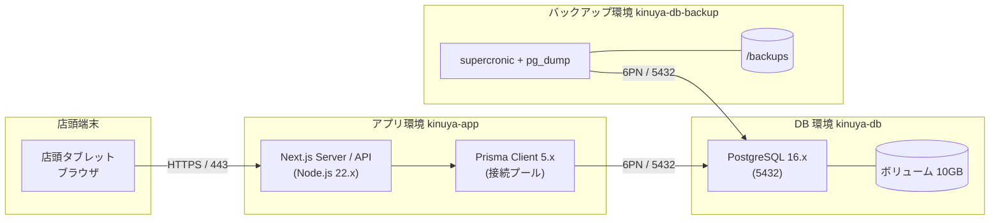

---
specdojo:
  id: specdojo:tsd-sample
  type: architecture
  status: draft
  rulebook: specdojo:tsd-rulebook
  part_of:
    - specdojo:tsd-index-sample
  based_on:
    - specdojo:prj-overview-sample
    - specdojo:opd-index-sample
---

# データベース（PostgreSQL / Prisma）技術スタック詳細定義（TSD）サンプル

本書は、駄菓子屋きぬや販売管理システムのデータベース基盤（PostgreSQL 16.x）と ORM（Prisma 5.x）について、構成・採用設定・導入から復旧までの手順を定義する。DB の構築、接続トラブルの調査、スキーマ変更、バックアップからの復元の作業前に読み、対象環境に同じ構成を再現できるか、採用設定が反映され正常に動いているかを判断するために使う。

## 1. 概要と位置づけ

### 1.1. 目的

販売記録・在庫数・常連客のつけ残高を、店頭タブレットから読み書きでき、再起動や再デプロイでも失われない状態で保持する。この記録の一元管理が必要な理由と期待効果は [[specdojo:prj-overview-sample|プロジェクト概要]] を正とし、本書では繰り返さない。

読み終えた時点の到達状態は、開発端末と本番環境で DB が起動し、採用設定の有効値を確認でき、Prisma のマイグレーションが適用済みで、日次のダンプから復元できることである。

### 1.2. 対象範囲と責務境界

次の表は、本書が扱う範囲と、扱わない作業を済ませる文書を示す。

| 区分   | 範囲                       | 主な内容・委ねる先                                                                                                        |
| ------ | -------------------------- | ------------------------------------------------------------------------------------------------------------------------- |
| 対象   | DB 実行基盤と接続設定      | PostgreSQL 16.x の構成、Prisma 5.x の接続設定、接続プール、永続ボリューム                                                 |
| 対象   | 環境の整合と変更           | 開発端末と本番環境の設定値の統一、マイグレーションの適用・失敗時の解消                                                    |
| 対象   | バックアップの技術操作     | `pg_dump` による取得、取得結果の確認、`pg_restore` による復元のコマンドと影響                                             |
| 対象外 | バックアップの方針         | 取得の頻度・RTO/RPO・保管期間は [[specdojo:opd-index-sample\|運用方針・設計]] の「バックアップ・リストア方針（RTO/RPO）」 |
| 対象外 | アプリケーションの詳細設計 | 個別機能の業務ロジック、詳細 API 仕様、SQL 全文                                                                           |
| 対象外 | 店頭端末と店舗ネットワーク | 店頭タブレットの OS 設定、Wi-Fi 機器の配線と管理                                                                          |

### 1.3. 他文書との関係

- [[specdojo:tsd-index-sample|技術スタック一覧（TSD Index）]]: 採用技術と版の正本。本書は PostgreSQL・Prisma の行の詳細にあたる。
- [[specdojo:opd-index-sample|運用方針・設計]]: バックアップの取得頻度・保管期間・失敗時の扱いの正本。本書は方針を反映した取得時刻と確認方法だけを書く。
- `tsd-hosting.md`: _TODO_: 未作成。本書は、Fly.io のプライベートネットワーク（6PN）でアプリから `kinuya-db` へ接続できることと、`kinuya-app`・`kinuya-db`・`kinuya-db-backup` の 3 アプリの構成を前提とする。作成までは各アプリの `fly.toml` を正本とし、本書の「全体構成と接続経路」を変える前に `fly.toml` と照合する。
- `tsd-ci.md`: _TODO_: 未作成。本書の「スキーマ変更とマイグレーションの運用」は、本番デプロイの前に `npx prisma migrate deploy` が実行され、失敗したらアプリの切り替えが止まることを前提とする。作成までは `.github/workflows/` のワークフロー定義を正本とする。

## 2. 対象環境と前提条件

### 2.1. 実行環境と責務分界

次の表は、本書で使う実行場所の呼び名と、そこで動くプロセスを示す。以降の手順の実行場所はこの呼び名で示す。

| 呼び名           | 役割                     | 実行ホスト / 基盤                              | 主な実行プロセス                                                       |
| ---------------- | ------------------------ | ---------------------------------------------- | ---------------------------------------------------------------------- |
| 開発端末         | ローカル開発・検証       | macOS / Linux の開発用 PC                      | Docker Compose の `postgres` サービス（PostgreSQL 16.x）、Node.js 22.x |
| アプリ環境       | 店頭画面と API の提供    | Fly.io アプリ `kinuya-app`（東京 `nrt`）       | Next.js サーバー、Prisma Client 5.x                                    |
| DB 環境          | 記録の永続化とクエリ処理 | Fly.io アプリ `kinuya-db`（東京 `nrt`）        | Fly Postgres の PostgreSQL 16.x、永続ボリューム 10GB                   |
| バックアップ環境 | 日次ダンプの取得と保存   | Fly.io アプリ `kinuya-db-backup`（東京 `nrt`） | cron（`supercronic`）、`pg_dump`、ボリューム `/backups`                |
| 作業端末         | 本番の操作・確認         | 開発端末と同じ PC                              | `flyctl`（`fly` コマンド）、`psql`                                     |

### 2.2. 前提条件と必要リソース

- **ランタイム**: Node.js 22.x（開発端末・アプリ環境）。版の正本は `.node-version`。
- **コンテナ**: Docker 26.x 以上、Docker Compose v2.x（開発端末）。
- **権限**: 作業端末の `flyctl` が、3 アプリを持つ Fly.io の組織にログインしていること。本番 DB への接続は `fly proxy 15432:5432 --app kinuya-db` を経由する。
- **CPU / メモリ**:
  - 開発端末: `postgres` サービスに 512MB RAM、1 vCPU を割り当てる。
  - DB 環境: 1GB RAM、1 shared CPU。`shared_buffers` を 256MB とし、残りを接続ごとの作業メモリと OS のキャッシュに充てる。
- **ストレージ**: DB 環境のボリューム 10GB。_ASSUMPTION_: 1 日 200 件の取引、1 件あたり明細と索引を含め約 1.5KB として、年間の増加を約 110MB と見積もった。取引件数は実測がないため、運用開始 1 か月後に `SELECT pg_size_pretty(pg_database_size(current_database()));` で実測し、見積もりを置き換える。
- **ネットワーク**: ポート 5432 は 6PN 内だけで待ち受け、公開 IP を割り当てない。

## 3. 全体構成と接続経路

店頭タブレットから DB とバックアップの保存先に至る接続経路を以下に示す。



- 店頭タブレットは DB 環境へ直接接続しない。
- アプリ環境とバックアップ環境は、6PN の内部ホスト名 `kinuya-db.internal` で DB 環境へ接続する。
- 作業端末からの接続は `fly proxy 15432:5432 --app kinuya-db` で手元の 15432 番へ転送する。開発端末の `postgres` サービスが 5432 番で待ち受けるため、番号を分けて接続先の取り違えを防ぐ。

## 4. 採用技術と設定値

### 4.1. 採用設定一覧

次の表は、PostgreSQL と Prisma の採用設定と、その反映・確認方法を示す。

| 対象・用途       | 設定項目                     | 採用値・版       | 適用範囲             | 理由・制約                                                                                             | 反映・確認方法                                                |
| ---------------- | ---------------------------- | ---------------- | -------------------- | ------------------------------------------------------------------------------------------------------ | ------------------------------------------------------------- |
| DB エンジン      | メジャー版                   | PostgreSQL 16.x  | 全環境               | [[specdojo:tsd-index-sample\|技術スタック一覧]] で採用済みの版。コミュニティの保守期限は 2028 年 11 月 | `SELECT version();` が `PostgreSQL 16.` で始まる              |
| ORM              | 版                           | Prisma 5.x       | 開発端末・アプリ環境 | TypeScript 5.x の型からクエリを組み立てられ、PostgreSQL 16 を対応 DB に含むため                        | `npx prisma -v` の `prisma` 行が `5.` で始まる                |
| 文字コード       | `server_encoding`            | `UTF8`           | 全環境               | 商品名・常連客の呼び名に日本語を使うため。DB 作成後は変更できない                                      | DB 作成時のみ反映。`SHOW server_encoding;` が `UTF8`          |
| タイムゾーン     | `timezone`                   | `Asia/Tokyo`     | 全環境の DB          | 日次締めと売上集計の日付の境目を営業日に合わせるため                                                   | 新しい接続から有効。`SHOW timezone;` が `Asia/Tokyo`          |
| 接続数の上限     | `max_connections`            | `50`             | DB 環境              | 1GB RAM で接続ごとのメモリが枯渇しない上限。アプリ 10 と作業・バックアップの接続を収める               | 再起動が必要。`SHOW max_connections;` が `50`                 |
| 接続プール       | `connection_limit`           | `10`             | アプリ環境           | 店頭端末 1 台の同時操作では 10 を使い切らない。DB の上限との差を作業用に残す                           | アプリの再デプロイで反映。`DATABASE_URL` のクエリ文字列を確認 |
| 共有バッファ     | `shared_buffers`             | `256MB`          | DB 環境              | RAM 1GB の 25%。PostgreSQL 公式文書が示す出発点の値                                                    | 再起動が必要。`SHOW shared_buffers;` が `256MB`               |
| 遅いクエリの記録 | `log_min_duration_statement` | `1000`（ミリ秒） | DB 環境              | 1 秒以上のクエリを記録し、店頭画面の待ちの原因をたどるため                                             | 再読み込みで反映。`SHOW log_min_duration_statement;` が `1s`  |

設定値の反映先は次のとおり。

- DB 環境の `max_connections`・`shared_buffers`・`log_min_duration_statement` は、作業端末で `fly postgres config update --app kinuya-db --max-connections 50 --shared-buffers 256MB --log-min-duration-statement 1000` を実行して保存する。再起動を求められたら、営業時間外（18:00 以降）に応じる。保存値は `fly postgres config show --app kinuya-db` で確かめ、有効値は表の `SHOW` で確かめる。
- `timezone` は、DB 環境では `ALTER DATABASE <PROD_DB> SET timezone = 'Asia/Tokyo';` で DB 単位に保存する。開発端末では `docker-compose.yml` の `postgres` サービスに `command: ["postgres", "-c", "timezone=Asia/Tokyo"]` を追加し、既存の `environment` と `volumes` は残す。
- `connection_limit` は `DATABASE_URL` のクエリ文字列だけに置き、`schema.prisma` には書かない。

### 4.2. 採用値・推奨値・未決事項の区別

- **採用値**: PostgreSQL 16.x、Prisma 5.x、`UTF8`、`Asia/Tokyo`。版は技術スタック一覧で決定済み、文字コードとタイムゾーンは業務の前提から決まる。
- **推奨値**: `max_connections=50`、`connection_limit=10`、`shared_buffers=256MB`。現行の資源（RAM 1GB、店頭端末 1 台）を前提にした値で、資源か端末数が変わったら見直す。
- **未決事項**: 繁忙期にメモリを増やす基準は `ISSUE-03` で扱う。決まるまでは 1GB のまま運用する。

### 4.3. 接続情報と秘密情報の管理

- 接続文字列の書式は次のとおり。`<...>` は実値に置き換えず、各環境の保存先から注入する。
  - 開発端末: `postgresql://<DEV_USER>:<DEV_PASSWORD>@localhost:5432/<DEV_DB>?schema=public`
  - アプリ環境: `postgresql://<PROD_USER>:<PROD_PASSWORD>@kinuya-db.internal:5432/<PROD_DB>?connection_limit=10`
- 秘密情報の保存先は次のとおり。
  - 開発端末: `.env` に書き、`.gitignore` で除外する。項目名だけを `.env.example` で共有する。
  - アプリ環境・バックアップ環境: `fly secrets set DATABASE_URL=<接続文字列> --app <APP>` で保存し、環境変数として注入する。値は `fly secrets list` で名前と更新日時だけを確かめ、表示しない。
- 6PN は WireGuard で暗号化されるため、アプリ環境から DB 環境への接続に `sslmode=require` は付けない。作業端末からも `fly proxy` を経由し、公開の経路で接続しない。

## 5. 導入と初期設定

### 5.1. 開発端末の初期構築手順

開発端末で、リポジトリのルートを作業ディレクトリとして bash で実行する。

1. **DB コンテナの起動**:

   ```bash
   docker compose up -d postgres
   ```

2. **環境変数ファイルの準備**: `.env` がない場合だけテンプレートから作る。既にある場合は上書きせず、`DATABASE_URL` の行だけを確かめる。

   ```bash
   test -f .env || cp .env.example .env
   ```

3. **マイグレーションの適用**: `prisma/migrations` の内容をテーブルに反映する。初回の DB では全マイグレーションが適用される。

   ```bash
   npx prisma migrate dev
   ```

4. **初期データの投入**: 駄菓子の商品マスターと店舗設定を投入する。投入済みの DB で再実行すると重複するため、新しい DB でだけ実行する。

   ```bash
   npx prisma db seed
   ```

### 5.2. スキーマ変更とマイグレーションの運用

- スキーマを変えるときは開発端末で `npx prisma migrate dev --name <変更の要約>` を実行し、生成された `prisma/migrations/<日時>_<変更の要約>/` をコミットに含める。
- 本番稼働中の列の削除や型の変更は、新しい列の追加 → アプリの移行 → 旧列の削除の 2 回のデプロイに分ける。1 回目の後にアプリを戻しても旧列が残っているため、切り戻せる。
- 本番への適用は CI が `npx prisma migrate deploy` を実行し、成功した後にアプリを切り替える。失敗した場合は「トラブルシューティングガイド」のマイグレーション失敗の行で解消する。

## 6. 動作確認と切り分け

### 6.1. 動作確認一覧

次の表は、起動から最終利用までを順に確かめる項目と、各段階の合否の判定と失敗時に戻る先を示す。上の行が通らない場合は下の行へ進まない。

| 確認対象                  | 実行場所・方法                                                                                 | 期待結果                                                             | 失敗時の確認先                                                   |
| ------------------------- | ---------------------------------------------------------------------------------------------- | -------------------------------------------------------------------- | ---------------------------------------------------------------- |
| 1. DB の起動              | 開発端末: `docker compose ps postgres`。作業端末: `fly status --app kinuya-db`                 | 状態が `running`、再起動回数が増えていない                           | Docker デーモン、Fly.io の障害情報、`fly logs --app kinuya-db`   |
| 2. 疎通                   | アプリ環境: `fly ssh console --app kinuya-app -C "nc -zv kinuya-db.internal 5432"`             | `succeeded` または `open` が表示される                               | 6PN の名前解決、`kinuya-db` の待受ポート                         |
| 3. 認証                   | 作業端末: `fly proxy` を起動して `psql -h localhost -p 15432 -U <USER> -d <DB> -c "SELECT 1;"` | `1` が 1 行返る                                                      | `DATABASE_URL` の利用者名、パスワードの保存先                    |
| 4. 設定の反映             | 作業端末: 「採用設定一覧」の各行の `SHOW`                                                      | すべての行で表の採用値が返る                                         | `fly postgres config show`、再起動の実施有無                     |
| 5. マイグレーションの状態 | 開発端末・CI: `npx prisma migrate status`                                                      | `Database schema is up to date!` が表示される                        | `prisma/migrations`、`_prisma_migrations` テーブル               |
| 6. 読み書き               | 開発端末: `npm run test:unit -- tests/db/connection.test.ts`                                   | 商品とつけ残高のテスト用レコードの作成・取得・更新・削除がすべて成功 | `npx prisma generate` の実施有無、トランザクションのタイムアウト |
| 7. バックアップの取得     | 作業端末: `fly ssh console --app kinuya-db-backup -C "ls -l /backups"`                         | 前日の日付のダンプがあり、サイズが前回から大きく減っていない         | `fly logs --app kinuya-db-backup` の `pg_dump` の終了コード      |

次の表は、各確認の実施状況を示す。未実施の項目は成功として扱わない。

| 確認対象 | 確認した環境     | 確認日     | 結果・未確認の条件                                                  |
| -------- | ---------------- | ---------- | ------------------------------------------------------------------- |
| 1・5・6  | 開発端末         | 2026-11-20 | 成功。PostgreSQL 16.4、Prisma 5.22                                  |
| 1〜4     | DB 環境          | -          | _TODO_: 本番の DB 環境の作成後に確認する                            |
| 7        | バックアップ環境 | -          | _TODO_: バックアップ環境の作成後、初回の取得の翌朝に確認する        |
| 復元     | 検証用の DB      | -          | _TODO_: 「復元の手順」を検証用の DB で 1 回通し、所要時間を記録する |

## 7. 継続利用と運用

### 7.1. データの永続化と再起動時の挙動

- DB 環境のボリュームを `/data` にマウントし、PostgreSQL のデータディレクトリを置く。再起動・再デプロイ・ホストの保守で Machine が作り直されても、ボリュームのデータは残る。
- 再起動で失われるのは、実行中のトランザクション、接続、共有バッファの内容である。確定済みの販売記録とつけ残高は失われない。
- 再起動の間、アプリ環境の Prisma Client は接続エラー（`P1001`）を返す。DB 環境の起動後、次のリクエストで接続し直すため、アプリの再起動は要らない。ただし、エラーになった会計は自動で再送されないため、店頭で記録の有無を確かめてから入力し直す。
- ボリュームを削除すると DB のデータはすべて失われる。DB 環境の作り直しではボリュームを残し、削除する場合は先に「復元の手順」の手順 1 でダンプを取る。

### 7.2. バックアップの取得

取得の頻度と失敗時の扱いは「他文書との関係」の運用方針・設計に従い、本書は取得の構成とコマンドを定める。

- **取得時刻**: 方針の「閉店後の日次締めの後」を反映し、毎日 03:00（JST）に取る。
- **実行場所**: バックアップ環境の Machine で、`supercronic` が `crontab` の `0 18 * * * /app/backup.sh`（UTC の 18:00 = JST の 03:00）を実行する。実行ユーザーはコンテナ内の `backup`、DB 側の接続ロールは読み取り専用の `<BACKUP_USER>` とする。
- **保存先**: バックアップ環境のボリューム（3GB）を `/backups` にマウントする。_ASSUMPTION_: ダンプ 1 回は年間の増加の見積もりから 100MB 未満と見込む。
- **保管期間**: 方針で _UNDECIDED_ のため、決まるまで `/backups` のダンプを自動では削除しない。使用率が 80% を超えたら、方針の決定を待たずに課題として扱う。
- **外部の保管先への転送**: 保管先が `ISSUE-02` で未決のため、現時点では転送しない。ダンプはバックアップ環境のボリュームにだけ残り、`nrt` リージョン全体の障害には備えられない。

`/app/backup.sh` の取得コマンドは次のとおり。失敗すると 0 以外で終わり、`fly logs` に終了コードが残る。

```bash
#!/usr/bin/env bash
set -euo pipefail
pg_dump "$DATABASE_URL" -F c -f "/backups/kinuya-db-$(TZ=Asia/Tokyo date +%Y%m%d).dump"
```

取得の失敗は、開店時に「動作確認一覧」の 7 を実行して検知する。前日の日付のダンプがなければ、方針に従い失敗として扱い、バックアップ環境で `/app/backup.sh` を手動で実行して取り直す。

### 7.3. 復元の手順

復元は DB の既存のテーブルとデータを削除してから、ダンプの時点の内容で作り直す。ダンプの取得以降に記録した販売・在庫・つけの変更は失われるため、方針に従い紙の販売控えと日次締め記録から転記して戻す。営業時間外に作業端末から実行し、事前に次の 1 と 2 を済ませる。

1. **現状のダンプを取る**: 復元を取り消すときの戻り先にする。`fly proxy 15432:5432 --app kinuya-db` を起動した別の端末で実行する。

   ```bash
   pg_dump -h localhost -p 15432 -U <USER> -d <PROD_DB> -F c -f "kinuya-db-before-restore-$(date +%Y%m%d%H%M).dump"
   ```

2. **アプリを止める**: 復元中の書き込みを防ぐ。店頭画面は使えなくなる。

   ```bash
   fly scale count 0 --app kinuya-app
   ```

3. **ダンプを手元へ取り出す**: バックアップ環境から対象日のダンプを取り出す。

   ```bash
   fly ssh sftp get /backups/kinuya-db-<TARGET_DATE>.dump --app kinuya-db-backup
   ```

4. **復元する**: `--clean --if-exists` で既存のオブジェクトを削除してから作り直す。

   ```bash
   pg_restore -h localhost -p 15432 -U <USER> -d <PROD_DB> --clean --if-exists --no-owner "kinuya-db-<TARGET_DATE>.dump"
   ```

5. **確かめる**: 「動作確認一覧」の 3〜5 を実行し、前日の販売件数が日次締め記録と一致することを確かめる。
6. **アプリを戻す**: `fly scale count 1 --app kinuya-app` で再開し、「動作確認一覧」の 6 に相当する会計を店頭で 1 件記録して確かめる。

5 で一致しない場合は、アプリを止めたまま、手順 1 のダンプを手順 4 と同じコマンドで復元して復元前の状態に戻す。

## 8. 制約事項とトラブルシュート

### 8.1. 既知の制約事項

- **通信断時の記録**: 店頭タブレットがアプリ環境へ接続できない間は、販売・つけを記録できない。端末側に記録を退避して後で送る方式は未採択で、`ISSUE-01` で扱う。オフライン時の運用方針はプロジェクト概要で _UNDECIDED_ であり、決まるまでは運用方針・設計の当面の扱い（紙の販売控えに書き、復旧後に転記する）に従う。
- **同時接続数**: 分析のスクリプトなど店頭画面以外から接続する場合は、合計が 40 を超えないようにする（上限 50 とプール 10 の差）。
- **リージョン障害**: DB 環境とバックアップ環境は同じ `nrt` にあるため、リージョン全体の障害では両方を失うおそれがある。`ISSUE-02` が決まるまで残るリスクとする。

### 8.2. トラブルシューティングガイド

次の表は、症状ごとに確かめる順序と回避方法を示す。各行の確認は「動作確認一覧」の番号に対応する。

| 症状                                                                   | 主な原因                                   | 切り分け手順                                                                                                                       | 回避・復旧方法                                                                                                                                                                                                                                               |
| ---------------------------------------------------------------------- | ------------------------------------------ | ---------------------------------------------------------------------------------------------------------------------------------- | ------------------------------------------------------------------------------------------------------------------------------------------------------------------------------------------------------------------------------------------------------------ |
| 接続できない（`P1001: Can't reach database server`）                   | DB 環境の停止、または 6PN の名前解決の失敗 | 動作確認の 1 → 2 の順に確かめる                                                                                                    | 停止していれば `fly machine restart <MACHINE_ID> --app kinuya-db` で起動する。疎通だけ失敗する場合は Fly.io の障害情報を確かめる                                                                                                                             |
| マイグレーションが失敗する（`P3009: migrate found failed migrations`） | 前回の `migrate deploy` が途中で失敗した   | `npx prisma migrate status` で失敗したマイグレーション名を確かめ、その変更が DB に残っているかを `psql` の `\d <TABLE>` で確かめる | 変更が残っていなければ `npx prisma migrate resolve --rolled-back <MIGRATION_NAME>`、手で最後まで適用したなら `--applied <MIGRATION_NAME>` を実行し、`migrate deploy` をやり直す。途中まで残っている場合は、残った変更を手で戻してから `--rolled-back` を使う |
| 接続数が尽きる（`remaining connection slots are reserved`）            | 接続の解放漏れ、またはプール外からの接続   | `SELECT state, count(*) FROM pg_stat_activity GROUP BY state;` で状態別の接続数を確かめる                                          | `idle` が多ければ `SELECT pg_terminate_backend(<PID>);` で個別に切断し、解放漏れの箇所を直す                                                                                                                                                                 |
| DB が強制停止する（`fly logs` に `Out of memory: Killed process`）     | 大量データの一括取得、接続数の過多         | `fly logs --app kinuya-db` の時刻と、同時刻の遅いクエリの記録を突き合わせる                                                        | 取得にページ分割（`take` / `skip`）を入れる。メモリの増設は `ISSUE-03` の基準が決まるまで行わない                                                                                                                                                            |

## 9. 未解決事項と解決経路

次の表は、未決の論点ごとに、当面の扱いと決め方を示す。

| 課題 ID    | 論点                             | 影響と当面の扱い                                                                     | 判断の基準・期日                                                                                                                                       | 解決経路                                                                                | 担当 Role |
| ---------- | -------------------------------- | ------------------------------------------------------------------------------------ | ------------------------------------------------------------------------------------------------------------------------------------------------------ | --------------------------------------------------------------------------------------- | --------- |
| `ISSUE-01` | 通信断時の記録の退避と同期の方式 | 採るかどうかで端末側の保存とつけ残高の競合解決が変わる。当面は紙の販売控えで記録する | オフライン時の運用方針の決定後、方式を採る場合は同期の失敗と重複が試験で 0 件（期日: 結合テスト着手前）                                                | 端末側の退避と再接続時の一括送信の試作を作り、方針と照らして採否を決める                | DEV / ARC |
| `ISSUE-02` | ダンプの外部の保管先             | 決まるまでリージョン障害でダンプを失う。当面はバックアップ環境のボリュームだけに置く | 暗号化と保管期間の自動削除を設定でき、月額 _UNDECIDED_ 円以内（期日: 本番運用開始の 2 週間前）                                                         | Cloudflare R2 と AWS S3 を比べ、費用を店主代表に諮る                                    | OPS / PO  |
| `ISSUE-03` | 繁忙期にメモリを増やす基準       | 決まるまで 1GB のまま運用し、遅いクエリの記録を週次で見る                            | 繁忙期想定の会計件数（_UNDECIDED_: 1 時間あたり件数）で会計 API を 30 分間連続して呼び、応答時間の p95 が _UNDECIDED_ 秒以内（期日: 総合リハーサル前） | 疑似負荷試験の結果から、CPU 使用率とメモリ使用量の増設の閾値と 1GB → 2GB の手順を決める | OPS / DEV |
