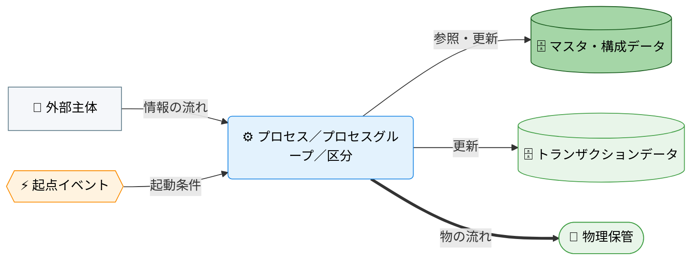

---
specdojo:
  id: specdojo:cdfd-overview-template
  type: template
  status: ready
  frontmatter_template:
    specdojo:
      id: cdfd-overview
      type: flow
      status: draft
      rulebook: specdojo:cdfd-overview-rulebook
      based_on: []
      supersedes: []
---

# 概念データフロー図（全体概要）: _TARGET_NAME_

_TODO_: 対象の業務または運用が何を扱うかを一文で定義する。

## 1. 目的

_TARGET_NAME_ の業務または運用の全体像として、_TODO_: プロセス領域のまとまりと、それらが読み書きするデータの関係を 1〜2 文で示す。

## 2. 適用範囲

- 対象は、_TODO_: 開始点、終了点、対象業務、組織またはシステム境界を書く。
- 本書が扱うのは、プロセス領域の分割と、領域間・データストア間の受け渡しまでである。各領域の内部（_TODO_: 操作手順、更新内容、処理の分岐、状態を変える処理と起点イベント、例外時の復旧手順など）は対象外とし、選択した方式の詳細 CDFD で詳細化する。状態の定義と遷移はステータス定義（Status Definition: STSD、`specdojo:stsd-rulebook`）を正本とし、詳細 CDFD は参照に留める。
- _TODO_: 一覧、検索、状態参照、検証などの補助操作を列挙し、独立した業務フローに含めず各領域を支える操作として扱うことを書く。
- 人間と AI Agent の責任分担は、_TODO_: 対応する方針文書があれば `[[_AUTHORITY_:prj-overview|プロジェクト概要]]` のように参照し、なければ「承認・完了判断は人間が担い、作成・評価は人が担うほか AI Agent へ委譲できる」のように原則を一文で書く。

## 3. プロセス領域

業務は _AREA_COUNT_ のプロセス領域を _GROUP_COUNT_ のプロセスグループまたは区分にまとめる。領域の定義は本書の表、受け渡しは本書の図、領域内部は選択した方式の詳細 CDFD を正本とする。

<!-- 今の方式ではプロセスグループ、系統の関係を描く方式では区分ごとに 3.n の節を繰り返す。8 以下とし、各節は領域表だけにする。PDCA（Plan、Do、Check、Action、全体など）は任意の列として追加できる。 -->

### 3.1. _PROCESS_GROUP_NAME_（_PROCESS_AREA_ID_〜_PROCESS_AREA_ID_）

<!-- prettier-ignore -->
| 領域 ID | プロセス領域 | 業務目的 | 主な担当 | 起点イベント |
| --- | --- | --- | --- | --- |
| `_PROCESS_AREA_ID_` | _PROCESS_AREA_NAME_ | _BUSINESS_PURPOSE_ | _OWNER_ROLE_ | _START_EVENT_ |
| `_PROCESS_AREA_ID_` | _PROCESS_AREA_NAME_ | _BUSINESS_PURPOSE_ | _OWNER_ROLE_ | _START_EVENT_ |

### 3.2. _PROCESS_GROUP_NAME_（_PROCESS_AREA_ID_）

<!-- prettier-ignore -->
| 領域 ID | プロセス領域 | 業務目的 | 主な担当 | 起点イベント |
| --- | --- | --- | --- | --- |
| `_PROCESS_AREA_ID_` | _PROCESS_AREA_NAME_ | _BUSINESS_PURPOSE_ | _OWNER_ROLE_ | _START_EVENT_ |

## 4. データストア

_TODO_: 区分の意味、パスの略記（例: `<project-id>` が指す範囲）、データストアとして扱わないもの（リポジトリ基盤、開発環境の設定など）を各一文で書く。

<!-- 「主な保管先」列は条件付き。実装が先にある場合は必須、設計中で候補がある場合は置いて未確定セルを _UNDECIDED_ にし、概念段階では列ごと削除する。 -->

### 4.1. マスタ・構成データ

<!-- prettier-ignore -->
| データストア | 主な内容 | 主な保管先 |
| --- | --- | --- |
| _DATA_STORE_NAME_ | _TODO_: 保持する情報の種別 | _TODO_: 複数ある場合は `、 ` で区切る |
| _DATA_STORE_NAME_ | _TODO_ | _TODO_ |

### 4.2. トランザクションデータ

<!-- prettier-ignore -->
| データストア | 主な内容 | 主な保管先 |
| --- | --- | --- |
| _DATA_STORE_NAME_ | _TODO_: 生成物なら生成元、退避先なら退避対象も書く | _TODO_ |
| _DATA_STORE_NAME_ | _TODO_ | _TODO_ |

## 5. 概念データフロー（概要）

_TODO_: 採用する構成方式（今の方式、または系統の関係を描く方式）と、この章で示す関係を 1〜2 文で書く。

<!-- 以下は今の方式の 1 図の雛形。16 ノードを超える場合はデータストアの区分または使い方の流れで節に分ける。系統の関係を描く方式では区分を代表ノードにし、データの種類で分けた図の間で位置をそろえ、受け渡しの線のない区分は省く。各区分はいずれかの図に必ず出す。調整役（Orchestrator）はデータの図に置かず、必要なら指示の図を別に置く。調整役は直接読み書きするストアだけにつなぎ、CLI 経由の読み書きはデータの図の該当区分から描く。区分間の実行要求は名詞のラベルで描いてよい。全図で名称を統一し、同じストアの再掲を認める。 -->

<!-- 複数図の場合は、例えば「5.1. PDCA のプロセスとデータの関係」「5.2. プロセスを実行する設定・構成情報の流れ」「5.3. Orchestrator による PDCA の調整」のように業務の言葉で題を付け、各節に図と読み取れることを 1 文で置く。 -->

_TODO_: 図の題を業務の言葉で書く。

_TODO_: この図から読み取れる業務上の関係を 1 文で書く。作図の約束は凡例にまとめる。

## 6. 詳細 CDFD 一覧

_TODO_: 採用した方式の詳細化先を簡潔に示す。状態の定義と遷移は STSD を正本とし、詳細 CDFD は参照に留める。

<!-- 今の方式では、以下の 2 表を使う。プロセスグループ別 CDFD はグループ内部のプロセス・起点イベント・例外・復旧・ストアの読み書きを定め、ユースケース別 CDFD は複数グループ間の順序と引き渡し条件だけを定める。系統の関係を描く方式では、6.1 の表を省略するか移行期・非推奨の記録とし、6.2 の表を各系統の流れを領域単位で詳細化する一覧に置き換える。列はケース ID、ユースケース（系統名）、業務目的、対象系統・領域、ユースケース別 CDFD とする。 -->

### 6.1. プロセスグループ別 CDFD

<!-- prettier-ignore -->
| プロセスグループ | 含む領域 | プロセスグループ別 CDFD |
| --- | --- | --- |
| _PROCESS_GROUP_NAME_ | `_PROCESS_AREA_ID_`〜`_PROCESS_AREA_ID_` | `cdfd-_GROUP_` |
| _PROCESS_GROUP_NAME_ | `_PROCESS_AREA_ID_` | `cdfd-_GROUP_` |

### 6.2. ユースケース別 CDFD

_TODO_: 今の方式では、複数グループを横断する順序と引き渡し条件を扱う旨を書く。系統の関係を描く方式では、各系統の入口・引き渡し・終了のイベントとストアの読み書きを領域単位で定める旨を書く。

<!-- prettier-ignore -->
| ケース ID | ユースケース | 業務目的 | 横断するプロセスグループ | ユースケース別 CDFD |
| --- | --- | --- | --- | --- |
| `_USE_CASE_ID_` | _USE_CASE_NAME_ | _TODO_ | _PROCESS_GROUP_NAME_ → _PROCESS_GROUP_NAME_ | `cdfd-uc-_TOPIC_` |

## 7. 凡例（本プロダクト共通）

<!-- 詳細 CDFD が複数存在し、共通のノード形状・色・絵文字を使う場合に設ける。単一の CDFD しかない場合は章ごと削除し、以降の章番号を詰める。 -->

本プロダクトの全 CDFD が共通して参照するノード形状・色・絵文字の対応を示す。個々の CDFD は、以下の定義を再掲せず、本章への参照に留める。

_TODO_: 採用する記法（Mermaid または D2）を示し、必要なら以下の Mermaid の凡例を D2 に置き換える。矢印は情報または実行要求の受け渡しであって実行順ではないこと、更新の線は更新前の参照を含むこと、外部主体や起点イベントの扱い、配置制御の非表示の線は受け渡しでないことをここにまとめる。

<!-- prettier-ignore -->
| 概念 | 形状 | 色 | 絵文字例 |
| --- | --- | --- | --- |
| プロセス／プロセスグループ／区分 | 角丸長方形 | 青（`#e3f2fd` / `#1e88e5`） | 業務内容が伝わる絵文字（例: ⚙️） |
| 起点イベント | 六角形 | 橙（`#fff3e0` / `#fb8c00`） | 出来事が伝わる絵文字（例: 🚦） |
| データストア（マスタ・構成データ） | 円柱 | 濃い緑（`#a5d6a7` / `#1b5e20`） | 保管物が伝わる絵文字（例: 📐） |
| データストア（トランザクションデータ） | 円柱 | 薄い緑（`#e8f5e9` / `#43a047`） | 保管物が伝わる絵文字（例: 📒） |
| 物理保管 | スタジアム形 | 薄い緑（トランザクションデータと同じ） | 保管場所が伝わる絵文字（例: 🏬） |
| 外部主体 | 四角 | グレー（`#f5f7fa` / `#607d8b`） | 主体が伝わる絵文字（例: 👤） |
| 情報の流れ | ラベル付き `-->` | — | — |
| 物の流れ | ラベル付き `==>` | — | — |

データストアの色分けは、大分類「データストア」の中の業務上のサブ分類を表す。マスタ・構成データは、他のプロセスから参照される比較的安定した基準情報を指す。トランザクションデータは、業務活動に伴い都度更新される記録を指す。物理保管は現物の保管先であり、いずれの区分にも属さないため、便宜上トランザクションデータと同じ色を用いる。

ノード形状・線種そのものの記法は、採用した記法の [[specdojo:cdfd-mermaid-rulebook|Mermaid 記法ルール]] または [[specdojo:cdfd-d2-rulebook|D2 記法ルール]] に従う。本章は、その記法に基づき _TARGET_NAME_ が実際に採用する色・絵文字の割り当てを固定する。

<!-- 未決事項がある場合のみ、以下の章を追加する。ない場合は章ごと削除する。本文中の未確定箇所には _UNDECIDED_ を付け、表の論点と対応させる。

## 8. 未決事項

| 論点 | 影響 | 決定者 | 決定時期 | 状態 |
| --- | --- | --- | --- | --- |
| _UNDECIDED_: _TODO_ | _IMPACT_ | _DECISION_ROLE_ | _DECISION_TIMING_ | open |

-->
