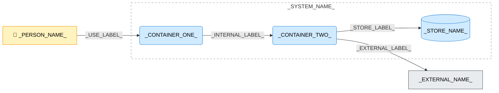

---
specdojo:
  id: specdojo:cnd-template
  type: template
  status: draft
  rulebook: specdojo:cnd-rulebook
  frontmatter_template:
    specdojo:
      id: _LOCAL_ID_
      type: architecture
      status: draft
      rulebook: specdojo:cnd-rulebook
      part_of: []
      based_on: _BASED_ON_
      supersedes: []
---

# _DELIVERABLE_NAME_

## 1. 概要

_TODO_: 対象システム、上位コンテキスト図との対応、分割の目的、対象外を記入する。派生した提供経路を加える場合は範囲の違いを説明する。

_TODO_: 実行・配備の前提を示す。仮定は _ASSUMPTION_: とし、影響・確認先を「メモ / 将来課題」へ記入する。

## 2. C4コンテナ図（Mermaid）

<!-- 要素・関係は対象に応じて増減する。外部システムやストアがない場合は該当しない理由を定義欄へ書く。骨組みの接続自体を確定構成として扱わない。 -->

_TODO_: 矢印の意味、応答の省略、構築時だけ成立する関係、任意依存を説明する。

## 3. 要素と境界の定義

### 3.1. 対象システムとシステム境界

_TODO_: 境界内に含める責務と、境界外へ委ねる処理を対にして記入する。物理配置と責務の境界を区別する。

### 3.2. Person（人・ロール）

| Person（図中ラベル） | 利用目的・接点  | 判断・確認の責務        |
| -------------------- | --------------- | ----------------------- |
| `_PERSON_NAME_`      | `_USE_PURPOSE_` | `_USER_RESPONSIBILITY_` |

### 3.3. Container（コンテナ）

| コンテナ（図中ラベル） | 責務                   | 技術区分・実行配備の前提 |
| ---------------------- | ---------------------- | ------------------------ |
| `_CONTAINER_ONE_`      | `_RESPONSIBILITY_ONE_` | `_EXECUTION_ONE_`        |
| `_CONTAINER_TWO_`      | `_RESPONSIBILITY_TWO_` | `_EXECUTION_TWO_`        |

### 3.4. Data Store（データストア）

| ストア（図中ラベル） | 保持する情報・正本        | アクセスと生成物の境界              |
| -------------------- | ------------------------- | ----------------------------------- |
| `_STORE_NAME_`       | `_PERSISTED_INFORMATION_` | `_READERS_WRITERS_AND_DERIVATIVES_` |

### 3.5. External Software System（外部システム）

| 外部システム（図中ラベル） | 利用条件・責任分界                          | 不在・障害時の影響 |
| -------------------------- | ------------------------------------------- | ------------------ |
| `_EXTERNAL_NAME_`          | `_DEPENDENCY_CONDITION_AND_RESPONSIBILITY_` | `_FAILURE_IMPACT_` |

### 3.6. Relationship（関係・連携契約）

<!-- 図の全関係に対応させる。詳細の正本は実在する文書なら wikilink、未作成なら ID またはファイル名をインラインコードで記入する。 -->

| 関係 ID  | 起点 → 終点                           | 図中ラベル         | 方式・条件と情報の要点             | 詳細の正本                  |
| -------- | ------------------------------------- | ------------------ | ---------------------------------- | --------------------------- |
| `REL-01` | `_PERSON_NAME_` → `_CONTAINER_ONE_`   | `_USE_LABEL_`      | `_USER_CHANNEL_AND_INFORMATION_`   | `_USER_SPEC_REFERENCE_`     |
| `REL-02` | `_CONTAINER_ONE_` → `_CONTAINER_TWO_` | `_INTERNAL_LABEL_` | `_INTERNAL_CHANNEL_AND_TIMING_`    | `_INTERNAL_SPEC_REFERENCE_` |
| `REL-03` | `_CONTAINER_TWO_` → `_STORE_NAME_`    | `_STORE_LABEL_`    | `_STORE_ACCESS_AND_TIMING_`        | `_DATA_SPEC_REFERENCE_`     |
| `REL-04` | `_CONTAINER_TWO_` → `_EXTERNAL_NAME_` | `_EXTERNAL_LABEL_` | `_EXTERNAL_CHANNEL_AND_CONDITION_` | `_EXTERNAL_SPEC_REFERENCE_` |

## 4. 技術前提・制約と検証観点

### 4.1. 技術前提・制約

- `_EXECUTION_AND_DEPLOYMENT_PRECONDITION_`
- `_BUILD_TIME_AND_RUNTIME_BOUNDARY_`
- `_TRUST_AND_APPROVAL_CONSTRAINT_`

### 4.2. コンテナ間・外部依存の検証対象

| 確認区分           | 対象関係・境界               | 観測する結果          | 主確認ロール    |
| ------------------ | ---------------------------- | --------------------- | --------------- |
| `_CHECK_CATEGORY_` | `_RELATIONSHIP_OR_BOUNDARY_` | `_OBSERVABLE_RESULT_` | `_REVIEW_ROLE_` |

## 5. メモ / 将来課題

<!-- 仮定・未確定事項がない場合だけ章ごと削除する。 -->

| 対象・論点     | 影響範囲   | 担当ロール     | 解消条件・引き継ぎ先           |
| -------------- | ---------- | -------------- | ------------------------------ |
| `_OPEN_TOPIC_` | `_IMPACT_` | `_OWNER_ROLE_` | `_RESOLUTION_AND_DESTINATION_` |
