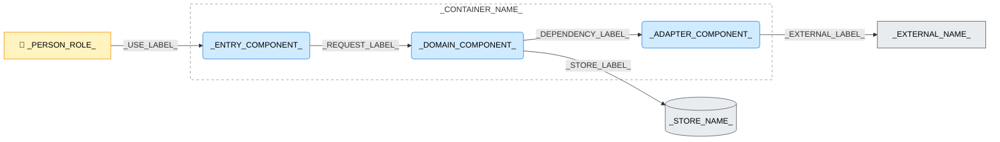

---
specdojo:
  id: specdojo:cpd-template
  type: template
  status: draft
  rulebook: specdojo:cpd-rulebook
  frontmatter_template:
    specdojo:
      id: _LOCAL_ID_
      type: architecture
      status: draft
      owner: ARC
      rulebook: specdojo:cpd-rulebook
      part_of: []
      based_on: _BASED_ON_
      supersedes: []
---

# _DELIVERABLE_NAME_

## 1. 概要

_TODO_: 上位コンテナ図の参照、対象コンテナ、分割の目的と設計入力としての用途、対象外を記入する。

_TODO_: 設計案と確認済みの実装構成を区別する。未確認の分割は _ASSUMPTION_: とし、影響と確認先を「メモ / 将来課題」に記入する。

## 2. C4コンポーネント図（Mermaid）

<!-- 要素・関係は対象に合わせて増減する。下図の接続を確定設計として流用しない。ストアや外部システムの内外は上位図の境界に合わせる。 -->

_TODO_: 矢印の意味、応答の扱い、主要経路と省略範囲を記入する。

## 3. 要素と境界の定義

### 3.1. 対象コンテナ境界と利用者

_TODO_: 境界に含む責務、境界外に残す別コンテナ・ストア・外部システム、上位図との対応を記入する。

| 上位図の Person | 本図の接点と確認する結果 |
| --------------- | ------------------------ |
| _PERSON_ROLE_   | _CONTACT_AND_RESULT_     |

<!-- Person が非該当なら表を削除し、その理由を書く。 -->

### 3.2. コンポーネントと論理配置

| コンポーネント   | 固有の責務       | 主な入力 → 出力    | 論理配置・境界      |
| ---------------- | ---------------- | ------------------ | ------------------- |
| _COMPONENT_NAME_ | _RESPONSIBILITY_ | _INPUT_ → _OUTPUT_ | _LOGICAL_PLACEMENT_ |

_TODO_: 実装配置への対応を示す場合は確認根拠を記入する。未確認の対応は「メモ / 将来課題」へ残す。

### 3.3. ストアと外部依存

| 要素・区分              | 保持内容または委ねる責務     | 利用条件・失敗の影響           |
| ----------------------- | ---------------------------- | ------------------------------ |
| _ELEMENT_NAME_AND_KIND_ | _CONTENTS_OR_RESPONSIBILITY_ | _CONDITION_AND_FAILURE_IMPACT_ |

<!-- ストア・外部依存のいずれかが非該当なら、その理由を書く。 -->

### 3.4. 関係と詳細の正本

| 関係 ID  | 起点 → 終点                   | 授受情報・条件              | 詳細の正本      |
| -------- | ----------------------------- | --------------------------- | --------------- |
| `REL-01` | _SOURCE_NAME_ → _TARGET_NAME_ | _INFORMATION_AND_CONDITION_ | _DETAIL_SOURCE_ |

_TODO_: 図の全関係を対応付ける。詳細の正本は既存なら文書 ID のリンク、未作成ならバッククォートの仮参照とする。

## 4. 技術前提・制約と検証観点

### 4.1. 技術前提・制約

- _DEPENDENCY_CONSTRAINT_
- _PERSISTENCE_AND_DERIVED_DATA_BOUNDARY_
- _EXTERNAL_CALL_CONSTRAINT_

### 4.2. コンポーネント間の検証対象

| 対象関係        | 条件                         | 観測する結果        |
| --------------- | ---------------------------- | ------------------- |
| `_RELATION_ID_` | _INPUT_OR_FAILURE_CONDITION_ | _OBSERVABLE_RESULT_ |

## 5. メモ / 将来課題

<!-- 仮定・未確認事項がない場合は章を省略する。論点は図・関係・制約の該当箇所と対応付ける。 -->

| 対象・論点           | 影響     | 担当ロール   | 解消条件・引き継ぎ先         |
| -------------------- | -------- | ------------ | ---------------------------- |
| _TOPIC_AND_RELATION_ | _IMPACT_ | _OWNER_ROLE_ | _RESOLUTION_AND_DESTINATION_ |
