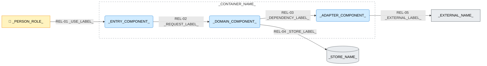

---
specdojo:
  id: specdojo:cpd-template
  type: template
  status: draft
  rulebook: specdojo:cpd-rulebook
  frontmatter_template:
    specdojo:
      id: _LOCAL_ID_
      type: architecture
      status: draft
      owner: ARC
      rulebook: specdojo:cpd-rulebook
      part_of: []
      based_on: _BASED_ON_
      supersedes: []
---

# _DELIVERABLE_NAME_

## 1. 概要

_TODO_: 上位コンテナ図の参照、対象コンテナ、分割の目的と設計入力としての用途、対象外を記入する。対象者の業務課題・放置時の影響・期待価値・成功基準は、上位の要求・目的の該当箇所を参照する。

_TODO_: 設計案と確認済みの実装構成を区別する。未確認の分割は _ASSUMPTION_: とし、影響と確認先を「メモ / 将来課題」に記入する。

_TODO_: 作成者、アーキテクチャ・実装・結合・業務の確認者と確認時点、最終合意者となる人間の PO を記入し、役割割当て・合意記録を参照する。公開する相手・媒体・範囲と、OPS の公開前確認の記録・PO の公開判断の参照先を記入する。

## 2. C4コンポーネント図（Mermaid）

<!-- 要素・関係は対象に合わせて増減する。下図の接続を確定設計として流用しない。ストアや外部システムの内外は上位図の境界に合わせる。 -->

_TODO_: 矢印の意味、応答の扱い、主要経路の選定理由と省略範囲を記入する。

## 3. 要素と境界の定義

### 3.1. 対象コンテナ境界と利用者

_TODO_: 境界に含む責務、境界外に残す別コンテナ・ストア・外部システム、上位図との対応を記入する。

| 上位図の Person | 本図の接点と確認する結果 |
| --------------- | ------------------------ |
| _PERSON_ROLE_   | _CONTACT_AND_RESULT_     |

<!-- Person が非該当なら表を削除し、その理由を書く。 -->

### 3.2. コンポーネントと論理配置

| コンポーネント   | 固有の責務       | 主な入力 → 出力    | 論理配置・境界      |
| ---------------- | ---------------- | ------------------ | ------------------- |
| _COMPONENT_NAME_ | _RESPONSIBILITY_ | _INPUT_ → _OUTPUT_ | _LOGICAL_PLACEMENT_ |

_TODO_: 主要な分割・共通化・依存の採用理由を、上位の業務目的または技術制約に対応付けて記入する。実装配置への対応を示す場合は確認根拠を記入し、未確認の対応は「メモ / 将来課題」へ残す。

### 3.3. ストアと外部依存

| 要素・区分              | 保持内容または委ねる責務     | 利用条件・失敗の影響           |
| ----------------------- | ---------------------------- | ------------------------------ |
| _ELEMENT_NAME_AND_KIND_ | _CONTENTS_OR_RESPONSIBILITY_ | _CONDITION_AND_FAILURE_IMPACT_ |

<!-- ストア・外部依存のいずれかが非該当なら、その理由を書く。 -->

### 3.4. 関係と詳細の正本

| 関係 ID  | 起点 → 終点                              | 授受情報・条件                         | 詳細の正本               |
| -------- | ---------------------------------------- | -------------------------------------- | ------------------------ |
| `REL-01` | _PERSON_ROLE_ → _ENTRY_COMPONENT_        | _USE_INFORMATION_AND_CONDITION_        | _USE_DETAIL_SOURCE_      |
| `REL-02` | _ENTRY_COMPONENT_ → _DOMAIN_COMPONENT_   | _REQUEST_INFORMATION_AND_CONDITION_    | _REQUEST_DETAIL_SOURCE_  |
| `REL-03` | _DOMAIN_COMPONENT_ → _ADAPTER_COMPONENT_ | _DEPENDENCY_INFORMATION_AND_CONDITION_ | _ADAPTER_DETAIL_SOURCE_  |
| `REL-04` | _DOMAIN_COMPONENT_ → _STORE_NAME_        | _STORE_INFORMATION_AND_CONDITION_      | _STORE_DETAIL_SOURCE_    |
| `REL-05` | _ADAPTER_COMPONENT_ → _EXTERNAL_NAME_    | _EXTERNAL_INFORMATION_AND_CONDITION_   | _EXTERNAL_DETAIL_SOURCE_ |

<!-- 図に合わせて行を増減し、全関係の ID・端点を対応付ける。値・構文・構造は詳細の正本へ委ね、既存なら文書 ID のリンク、未作成ならバッククォートの仮参照とする。 -->

## 4. 技術前提・制約と検証観点

### 4.1. 技術前提・制約

- _DEPENDENCY_CONSTRAINT_
- _PERSISTENCE_AND_DERIVED_DATA_BOUNDARY_
- _EXTERNAL_CALL_CONSTRAINT_

_TODO_: 保守・問い合わせ窓口と、変更時の影響確認記録を参照する。変更記録には影響する要素・関係 ID、後続成果物・実装・検証・Schedule の更新要否と理由・担当を残す。

### 4.2. コンポーネント間の検証対象

<!-- 通常時と失敗・応答欠落時の条件、合否を判断できる観測結果を関係 ID に対応付ける。実施結果は実行記録へ残す。 -->

| 対象関係        | 条件                         | 観測する結果        |
| --------------- | ---------------------------- | ------------------- |
| `_RELATION_ID_` | _INPUT_OR_FAILURE_CONDITION_ | _OBSERVABLE_RESULT_ |

_TODO_: 文書検査・描画確認の証跡を参照する。

## 5. メモ / 将来課題

<!-- 仮定・未確認事項がない場合は章を省略する。論点は共通ラベルで確定事項と区別し、図・関係・制約の該当箇所と対応付ける。 -->

| 対象・区分           | 影響と後続成果物             | 担当 Role code・判断者          | 期限または判断タイミング | 次アクション・解消条件       | 承認への影響・引き継ぎ先          |
| -------------------- | ---------------------------- | ------------------------------- | ------------------------ | ---------------------------- | --------------------------------- |
| _TOPIC_AND_CATEGORY_ | _IMPACT_AND_DOWNSTREAM_DOCS_ | _OWNER_ROLE_AND_DECISION_MAKER_ | _DECISION_TIMING_        | _NEXT_ACTION_AND_RESOLUTION_ | _APPROVAL_IMPACT_AND_DESTINATION_ |

_TODO_: ARC から PM・人間の PO への報告先、継続追跡する論点の PJR 参照を記入する。未起票なら登録候補の理由・起票担当・判断時点を残し、後続作業の着手可否と Schedule の順序・期限への影響を対応付ける。
