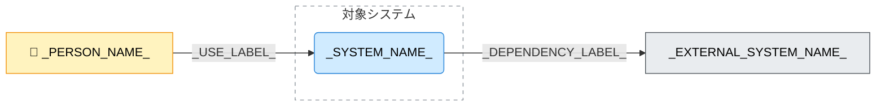

---
specdojo:
  id: specdojo:cxd-template
  type: template
  status: draft
  frontmatter_template:
    specdojo:
      id: _LOCAL_ID_
      type: architecture
      status: draft
      rulebook: specdojo:cxd-rulebook
      part_of: []
      based_on: _BASED_ON_
      supersedes: []
---

# _DELIVERABLE_NAME_

## 1. 概要

_TODO_: 対象システムの目的、提供価値、図の対象範囲を 1〜3 文で記入する。

| 対象者        | 課題・関心事 | 本図で確認する内容 |
| ------------- | ------------ | ------------------ |
| _STAKEHOLDER_ | _CONCERN_    | _CONFIRMATION_     |

_TODO_: 本図の対象外と、内部構成・操作・連携の詳細を委ねる先を示す。

## 2. C4コンテキスト図（Mermaid）

<!-- Person・外部システムと関係は対象に応じて増減し、表と対応させる。該当する主体がない場合は理由を本文に記入する。 -->

_TODO_: 矢印の向き、応答の省略など読み取りに必要な注記を 1〜3 文で記入する。

## 3. 要素と境界の定義

### 3.1. 対象システムとシステム境界

| 項目                                 | 内容                        |
| ------------------------------------ | --------------------------- |
| システム名                           | _SYSTEM_NAME_               |
| 提供する中核責務                     | _CORE_RESPONSIBILITY_       |
| 境界内に含める範囲                   | _IN_SCOPE_                  |
| 境界外へ委ねる範囲（対象外と委譲先） | _OUT_OF_SCOPE_AND_DELEGATE_ |

### 3.2. Person（人・ロール）

| Person（図中ラベル） | 対応ロール           | 利用目的・主な関わり | 境界上の接点・確認責務 |
| -------------------- | -------------------- | -------------------- | ---------------------- |
| _PERSON_NAME_        | _ROLE_OR_USER_GROUP_ | _USE_PURPOSE_        | _USER_RESPONSIBILITY_  |

### 3.3. External Software System（外部システム）

| 外部システム（図中ラベル） | 区分・位置づけ         | 対象システムとの責任分界  | 不在・障害時の影響と扱い |
| -------------------------- | ---------------------- | ------------------------- | ------------------------ |
| _EXTERNAL_SYSTEM_NAME_     | _DEPENDENCY_CONDITION_ | _RESPONSIBILITY_BOUNDARY_ | _FAILURE_IMPACT_         |

### 3.4. Relationship（関係・連携契約）

| 関係ID   | 起点 → 終点                            | 図中ラベル         | やり取りする情報・制御の要点 | 連携方式・境界        | 正本・関連仕様             |
| -------- | -------------------------------------- | ------------------ | ---------------------------- | --------------------- | -------------------------- |
| `REL-01` | _PERSON_NAME_ → _SYSTEM_NAME_          | _USE_LABEL_        | _USER_INPUT_OUTPUT_          | _USER_CHANNEL_        | _USER_SPEC_REFERENCE_      |
| `REL-02` | _SYSTEM_NAME_ → _EXTERNAL_SYSTEM_NAME_ | _DEPENDENCY_LABEL_ | _EXTERNAL_INPUT_OUTPUT_      | _INTEGRATION_CHANNEL_ | _INTERFACE_SPEC_REFERENCE_ |

## 4. 技術前提・制約と検証観点

### 4.1. 技術前提・制約

- _EXECUTION_OR_COMMUNICATION_CONSTRAINT_
- _TRUST_OR_APPROVAL_CONSTRAINT_
- _EXTERNAL_DEPENDENCY_PRECONDITION_

### 4.2. システム境界・外部依存の検証観点

| 確認区分         | 対象関係・境界             | 検証観点           | 主確認ロール  |
| ---------------- | -------------------------- | ------------------ | ------------- |
| _CHECK_CATEGORY_ | _RELATIONSHIP_OR_BOUNDARY_ | _OBSERVABLE_CHECK_ | _REVIEW_ROLE_ |

## 5. メモ / 将来課題

<!-- 未作成の参照先・未確定の境界・将来課題がなければ、この章を削除する。 -->

| 対象・論点   | 影響範囲 | 担当ロール   | 解消条件・引き継ぎ先         |
| ------------ | -------- | ------------ | ---------------------------- |
| _OPEN_TOPIC_ | _IMPACT_ | _OWNER_ROLE_ | _RESOLUTION_AND_DESTINATION_ |
