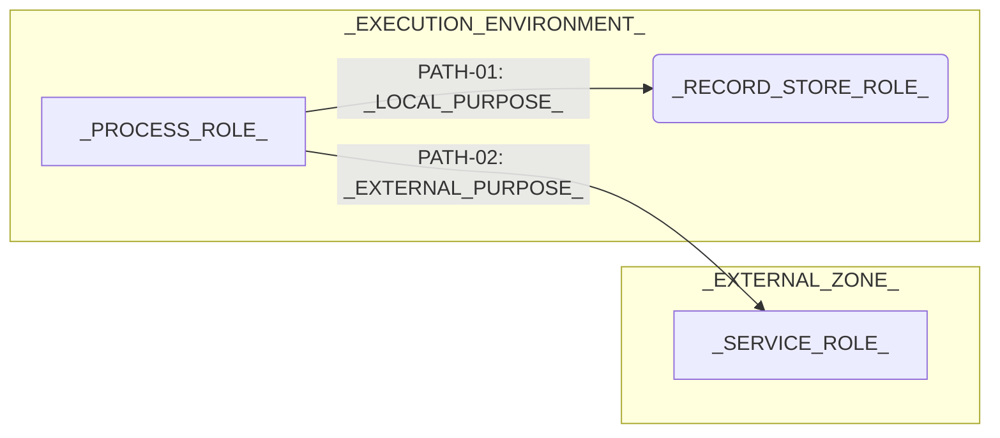

---
specdojo:
  id: specdojo:ifd-template
  type: template
  status: draft
  frontmatter_template:
    specdojo:
      id: _LOCAL_ID_
      type: architecture
      status: draft
      owner: ARC
      rulebook: specdojo:ifd-mermaid-rulebook
      part_of: []
      based_on: _BASED_ON_
      supersedes: []
---

# _DELIVERABLE_NAME_

## 1. 概要

_TODO_: 上位構成図への参照、対象環境、本図で判断する内容、対象外と詳細の委譲先を記入する。

_TODO_: 改訂・廃止で境界や経路が変わる場合、上位構成・連携設計（ARC）、検証対象（QE）、監視・運用参照（OPS）、公開判断（PO）の追従先と影響を記入する。

## 2. インフラ構成図（Mermaid）

<!-- 対象に必要な境界・処理・保管先へ増減する。仮定の経路は図の近傍にも明示する。 -->

_TODO_: 枠の意味、矢印の向きと応答の省略、線種の意味、仮定を記入する。中継を省略した経路は、中継と到達条件を明記する。

## 3. 配置と境界の定義

| 図中の環境・要素                             | 上位要素                | 管理主体             | 情報・到達条件                      |
| -------------------------------------------- | ----------------------- | -------------------- | ----------------------------------- |
| `_EXECUTION_ENVIRONMENT_` / `_PROCESS_ROLE_` | `_UPSTREAM_ELEMENT_`    | `_MANAGER_ROLE_`     | `_LOCAL_INFORMATION_AND_ACCESS_`    |
| `_RECORD_STORE_ROLE_`                        | `_UPSTREAM_STORE_`      | `_STORE_MANAGER_`    | `_RECORD_SCOPE_`                    |
| `_EXTERNAL_ZONE_` / `_SERVICE_ROLE_`         | `_UPSTREAM_DEPENDENCY_` | `_EXTERNAL_MANAGER_` | `_EXTERNAL_INFORMATION_AND_ACCESS_` |

_TODO_: 上位要素のうち図から除外したものと理由、代替配置があれば適用条件と置き換わる要素を記入する。

## 4. 通信経路と情報の境界

| 経路 ID   | 起点 → 終点                              | 目的・情報               | 利用条件・詳細の委譲先            |
| --------- | ---------------------------------------- | ------------------------ | --------------------------------- |
| `PATH-01` | `_PROCESS_ROLE_` → `_RECORD_STORE_ROLE_` | `_LOCAL_INFORMATION_`    | `_LOCAL_CONDITION_AND_SOURCE_`    |
| `PATH-02` | `_PROCESS_ROLE_` → `_SERVICE_ROLE_`      | `_EXTERNAL_INFORMATION_` | `_EXTERNAL_CONDITION_AND_SOURCE_` |

## 5. 技術前提・制約と検証観点

### 5.1. 技術前提・制約

- _TODO_: 実行場所・書込範囲・外部依存の必須性を記入する。
- _TODO_: 管理主体間の情報持ち出し・公開・認証の前提を記入する。
- _TODO_: 詳細設定・連携契約・運用手順の正本または未整備の引き継ぎ先を記入する。

### 5.2. 境界・障害の検証対象

_TODO_: 検証予定と実施済みの範囲を区別し、実施済みの場合は証跡への参照を記入する。

| 対象経路・境界       | 障害条件・影響         | 観測する結果・切り分け対象 | 主確認ロール   |
| -------------------- | ---------------------- | -------------------------- | -------------- |
| `_PATH_OR_BOUNDARY_` | `_FAILURE_AND_IMPACT_` | `_OBSERVABLE_RESULT_`      | `_CHECK_ROLE_` |

_TODO_: 監視対象と、閾値・通知先・復旧手順を管理する正本または引き継ぎ先を記入する。

## 6. メモ / 将来課題

<!-- 仮定・未決事項がない場合はこの章を削除する。論点には共通ラベルを付ける。未作成の委譲先はリンクにせず参照名をコードで記す。 -->

| 対象・論点     | 影響       | 担当           | 解消条件・引き継ぎ先           |
| -------------- | ---------- | -------------- | ------------------------------ |
| `_OPEN_TOPIC_` | `_IMPACT_` | `_OWNER_ROLE_` | `_RESOLUTION_AND_DESTINATION_` |
