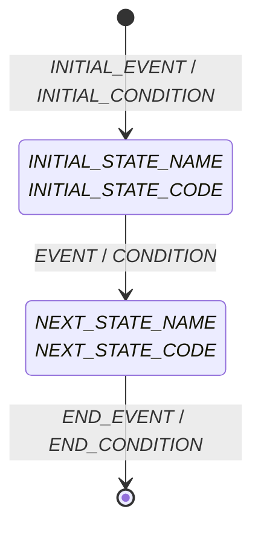

---
specdojo:
  id: specdojo:stsd-template
  type: template
  status: draft
  frontmatter_template:
    specdojo:
      id: _LOCAL_ID_
      type: data
      status: draft
      rulebook: specdojo:stsd-rulebook
      based_on: _BASED_ON_
      supersedes: []
---

# _DELIVERABLE_NAME_

_TODO_: `_DELIVERABLE_OVERVIEW_` を基に、何の状態と遷移を定義する文書かを 1〜2 行で示す。

## 1. 目的

_TODO_: 状態を管理する目的と利用者を、誰が何を判断するかが分かるように 1〜3 文で記述する。

## 2. 適用範囲

- 対象・スコープ: _TODO_: 状態を持つ一つの対象と AS-IS / TO-BE のスコープを示す。
- 状態の正本: _TODO_: 現在状態を確認する正本の管理場所を示す。
- 業務範囲: _TODO_: 状態変更を起こす業務の開始・到達点と対象外の境界を示す。
- 終了点を置かない場合: _TODO_: 管理を続ける状態と理由、出力遷移のない継続状態を示す。終了点を置く場合はこの項目を削除する。

<!-- 状態が一つだけの場合は、状態変化がない根拠も記載する。 -->

## 3. 状態一覧

| 値             | 状態名       | 通称          | 意味            | 成立条件          | 管理場所              |
| -------------- | ------------ | ------------- | --------------- | ----------------- | --------------------- |
| `_STATE_CODE_` | _STATE_NAME_ | _COMMON_NAME_ | _STATE_MEANING_ | _ENTRY_CONDITION_ | _MANAGEMENT_LOCATION_ |

<!-- 値は lower-kebab-case とし、`-` を除いて文書内で一意にする。コードを持たない場合、通称がない場合は `-` とする。状態名は状態遷移図・遷移の説明と完全一致させる。 -->

## 4. 状態遷移図

<!-- 表示名は状態一覧の状態名と値を使い、値が `-` の場合は ` ` と値を除いて状態名だけにする。`state_id`（雛形の `initial_state`・`next_state`）は英小文字で始まる英小文字・数字・アンダースコアにし、表示する値の代わりにはしない。ライフサイクルを閉じる業務イベントと条件がない場合は終了点への遷移を削除する。 -->

<!-- 状態一覧の全状態を図へ配置する。図にだけ存在する業務状態や ＜＜choice＞＞ などの疑似状態を残さず、分岐は同じ遷移元からの複数矢印として、全遷移にイベントと条件を記載する。業務状態が 15、遷移が 20、または一状態の入出力遷移合計が 6 を超える場合は図を分割し、各図が扱う遷移 ID と共有状態を明記する。 -->

## 5. 遷移の説明

| 遷移 ID           | 遷移元         | 遷移先         | イベント | 条件        | 補足   |
| ----------------- | -------------- | -------------- | -------- | ----------- | ------ |
| `_TRANSITION_ID_` | _SOURCE_STATE_ | _TARGET_STATE_ | _EVENT_  | _CONDITION_ | _NOTE_ |

<!-- 遷移 ID は T-01 形式とし、図の全遷移を一行ずつ記載する。初期点は `開始`、終了点は `終了` と記載する。 -->

<!-- 未決事項がある場合のみ、以下の章を追加する。ない場合は章ごと削除する。

## 6. 今後の検討メモ

| 論点                | 影響する状態・遷移 | 決定者          | 決定時期          |
| ------------------- | ------------------ | --------------- | ----------------- |
| _TODO_: / _UNDECIDED_: / _ASSUMPTION_: _ISSUE_ | _STATE_OR_TRANSITION_ | _DECISION_ROLE_ | _DECISION_TIMING_ |

-->
