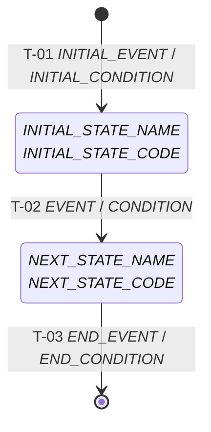

---
specdojo:
  id: specdojo:stsd-template
  type: template
  status: draft
  frontmatter_template:
    specdojo:
      id: _LOCAL_ID_
      type: data
      status: draft
      rulebook: specdojo:stsd-rulebook
      based_on: _BASED_ON_
      supersedes: []
---

# _DELIVERABLE_NAME_

_TODO_: `_DELIVERABLE_OVERVIEW_` を基に、何の状態と遷移を定義する文書かを 1〜2 行で示す。

## 1. 目的

_TODO_: 状態が対象の何を管理し、誰がその状態で何を判断するために使うかを 1〜3 文で記述する。

## 2. 適用範囲

- 対象: _TODO_: 状態を持つ一つの業務対象を示す。
- 業務範囲: _TODO_: 状態変更を起こす業務の開始と対象外の境界を示す。
- 到達点: _TODO_: 業務上の到達点を示す。終了点を置かない場合は、管理を続ける状態と理由、出力遷移のない継続状態も示す。

<!-- スコープは現行を既定として省略する。同じ対象の TO-BE 文書と並ぶ場合だけ「スコープ: AS-IS / TO-BE」の項目を追加し、文書を分ける。 -->

<!-- 状態が一つだけの場合は、状態変化がない根拠も記載する。 -->

## 3. 状態の判定

- 状態の正本: _TODO_: 現在状態を確認する正本の管理場所を示す。履歴・集約記録を併用する場合は正本と派生物を区別する。
- 一意判定: _TODO_: 現在状態を一意に決める規則を示す。該当する場合はイベントの再生順序と初期値、導出条件と再判定の契機、成立条件が重なる場合の優先関係を記載し、状態固有の成立条件は状態一覧を参照する。
- 互換の扱い: _TODO_: 旧状態値・旧イベント、未設定・欠損記録の読み取りや移行の扱いを示す。過去の記録の読み替えと現在発行する遷移を区別し、互換の扱いが不要ならその旨を明記する。

## 4. 状態一覧

| 値                     | 状態名               | 通称                  | 意味                    | 成立条件                  | 管理場所                      |
| ---------------------- | -------------------- | --------------------- | ----------------------- | ------------------------- | ----------------------------- |
| `_INITIAL_STATE_CODE_` | _INITIAL_STATE_NAME_ | _INITIAL_COMMON_NAME_ | _INITIAL_STATE_MEANING_ | _INITIAL_ENTRY_CONDITION_ | _INITIAL_MANAGEMENT_LOCATION_ |
| `_NEXT_STATE_CODE_`    | _NEXT_STATE_NAME_    | _NEXT_COMMON_NAME_    | _NEXT_STATE_MEANING_    | _NEXT_ENTRY_CONDITION_    | _NEXT_MANAGEMENT_LOCATION_    |

<!-- 対象の状態に合わせて行を増減する。値は lower-kebab-case とし、`-` を除いて文書内で一意にする。コードを持たない場合、通称がない場合は `-` とする。状態名は状態遷移の図・表と完全一致させる。 -->

## 5. 状態遷移

<!-- 状態一覧の全状態を図へ配置する。図にだけ存在する業務状態や ＜＜choice＞＞ などの疑似状態を残さず、分岐は同じ遷移元からの複数矢印として示す。全遷移に `T-01 イベント / 条件` の形（遷移 ID・イベント・条件）で記載し、無条件の場合は条件を `イベント発生時` とする。 -->

<!-- 業務状態が 15、遷移が 20、または一状態の入出力遷移合計が 6 を超える場合は、業務フェーズまたは通常系・例外系で図を分割する。分割理由・各図が扱う遷移 ID の範囲・共有状態は図の前へ記載する。共有状態の表示名と `state_id` をそろえ、全図をつないで到達性を判断できるようにする。図と直下の表を一組として繰り返し、図と表の間に説明文や別の図を挟まない。 -->

<!-- 表示名は状態一覧の状態名と値を使い、値が `-` の場合は ` ` と値を除いて状態名だけにする。`state_id`（雛形の `initial_state`・`next_state`）は英小文字で始まる英小文字・数字・アンダースコアにし、表示する値の代わりにはしない。ライフサイクルを閉じる業務イベントと条件がない場合は終了点への遷移と対応する表の行を削除する。初期点は開始遷移を扱う図だけに置く。 -->

<!-- 遷移表は直上の図の全遷移を一行ずつ記載し、分割時も文書全体で一意な遷移 ID を使い、重複・欠落を残さない。初期点は `開始`、終了点は `終了` と記載する。補足には判断者・証跡・例外の扱いなどを記入し、図表をなぞる説明は書かない。共通条件は適用する遷移 ID とともに図の前へまとめ、表から参照する。 -->

| 遷移 ID | 遷移元               | 遷移先               | イベント        | 条件                | 補足           |
| ------- | -------------------- | -------------------- | --------------- | ------------------- | -------------- |
| `T-01`  | 開始                 | _INITIAL_STATE_NAME_ | _INITIAL_EVENT_ | _INITIAL_CONDITION_ | _INITIAL_NOTE_ |
| `T-02`  | _INITIAL_STATE_NAME_ | _NEXT_STATE_NAME_    | _EVENT_         | _CONDITION_         | _NOTE_         |
| `T-03`  | _NEXT_STATE_NAME_    | 終了                 | _END_EVENT_     | _END_CONDITION_     | _END_NOTE_     |

<!-- 未決事項がある場合のみ、以下の章を追加する。ない場合は章ごと削除する。

## 6. 今後の検討メモ

| 論点                | 影響する状態・遷移 | 決定者          | 決定時期          |
| ------------------- | ------------------ | --------------- | ----------------- |
| _TODO_: / _UNDECIDED_: / _ASSUMPTION_: _ISSUE_ | _STATE_OR_TRANSITION_ | _DECISION_ROLE_ | _DECISION_TIMING_ |

-->
